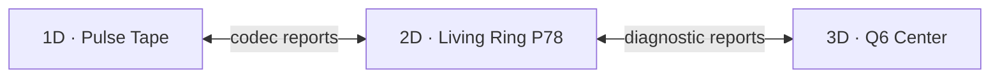

# 26 - Три соседних проекта: 1D-лента, 2D-кольцо и Q6-центр

Статус: реализованный и проверенный MVP (`P79 <-> P78 <-> P80`)  
Дата: 2026-07-19

## 1. Решение

MERIDIAN следует развивать как три соседних инструмента, а не как один экран, смешивающий все размерности:

| Проект | Роль | Доказуемый результат |
|---|---|---|
| **1D Pulse Tape** | последовательность, binary, ритм Морзе | точность кодирования, порядок и обратимость |
| **2D Living Ring / P78** | смысловое продолжение между крайностями | guard, точная transaction, commit, undo и replay |
| **3D Q6 Center** | сжатая диагностика шести условий | одно-битный контрфактический путь, достижимость и тупики |

На первом этапе это отдельные интерфейсы в одном workspace. Разносить их по разным репозиториям следует только после стабилизации общего протокола: иначе версии сообщений и инвариантов начнут расходиться.

Главное правило:

> 1D и 3D являются поставщиками отчётов. Только 2D-P78 может изменить пользовательский текст через существующий action-controller.

### 1.1. Что реализовано

| Слой | Реализация | Граница |
|---|---|---|
| обмен | `prototype/lib/p78-exchange-contract.js` | fail-closed схема `p78.exchange/1`, revision/epoch, provenance |
| 1D-ядро | `prototype/lib/p78-timeline-codec.js` | UTF-8, `msb0`, точный roundtrip, явные Morse-профили |
| 3D-ядро | `prototype/lib/p78-q6-diagnostics.js` | Q6 64/6/192, `Hamming=1`, неизвестное остаётся `UNKNOWN` |
| 1D-интерфейс | `prototype/p79-pulse-tape-1d.html` | движущаяся binary/Morse-лента, без права commit |
| 2D-арбитр | `prototype/p78-living-ring-interface.html` | отправляет снимок и принимает только проверенный отчёт |
| 3D-интерфейс | `prototype/p80-hypercube-center-3d.html` | локальная Three.js-проекция `Q6 = Q3 x Q3`, без права commit |

На `localhost` отчёт возвращается тремя согласованными путями: `BroadcastChannel`, ключ результата в `localStorage` и same-origin `postMessage` родительской вкладке. Каждый путь заканчивается одним `acceptResult()`, поэтому ни один транспорт не обходит проверку контракта. `postMessage` принимает только точное совпадение `event.origin`.

Большой P78 не копирует код соседей. HTML P79/P80 остаются маленькими точками входа, вычисления вынесены в чистые модули, а Three.js хранится отдельным локальным vendor-файлом с MIT-лицензией.

### 1.2. Граница математической аналогии

Три размерности являются архитектурными ролями, а не буквальными равенствами с объектами теории графов:

- **3D/Q6-центр** - структурированное обобщение шести условий, но не клика Рамсея;
- **1D binary/Morse** - линейное разложение и ритм, но не независимое множество Рамсея;
- **2D P73/P78** - динамический посредник между полюсами, а не третий исход теоремы Рамсея;
- клика и независимое множество допустимы только как диагностика отношений внутри данных: «всё связано» и «связи отсутствуют».

Поэтому центр не получает автоматически смысл «все знакомы», а край - смысл «никто не знаком». Эти утверждения должны следовать из измеренных рёбер конкретного графа.

## 2. Что такое Q6-центр

В проверенном [`meta/hexcore.py`](https://github.com/svend4/meta/blob/21065a96ba0df1e2e1060c8ede8e4e2d5050ffda/libs/hexcore/hexcore.py#L1-L116) `Q6` является графом `(Z2)^6`:

- 64 вершины;
- 6 соседей у каждой вершины;
- 192 неориентированных ребра;
- один переход меняет ровно один бит;
- кратчайшее расстояние равно расстоянию Хэмминга;
- Gray path посещает 64 вершины, меняя один бит за шаг.

[`pro2/core.py`](https://github.com/svend4/pro2/blob/0f897158e1a5f5dda9cedee158733324cf8258e4/yijing_transformer/models/geometry/core.py#L1-L44) независимо строит те же вершины как `{-1,+1}^6`.

Q6 не является обычным 3D-кубом. Центр может показывать **3D-проекцию шестимерного графа**, не меняя его топологию.

### 2.1. Проекция «куб из кубов»

```text
Q6 = Q3 x Q3
vertex = (localBits[3], macroBits[3])
```

Восемь малых кубов размещаются в вершинах большого куба:

- три локальных ребра меняют `localBits`;
- три межкубовых ребра меняют `macroBits`;
- сохраняются все 64 вершины и 192 ребра.

Цвет ребра обозначает номер изменённого условия. Пространственная близость в проекции не является семантической близостью.
Проверенную 3D-проекцию из `pro2` копировать нельзя: группировка пар битов в координаты `0..3` не является изометрией Q6 - одно ребро может получить разную экранную длину, а соседние экранные ячейки могут отличаться двумя битами. Истиной остаётся список рёбер `Hamming=1`, а не расстояние в 3D.

Заявленное в `pro2` разбиение «8 групп по 8» также нельзя использовать как инвариант: проверенный генератор последовательных flip возвращает семь состояний на группу. Для P78 нужны собственные property-тесты 64/6/192.


### 2.2. Почему центр не застывает

Центр сжимает множество измерений в шесть булевых предикатов. Его движение примитивно, но проверяемо:

```text
010101 -> 010111
changedBit = guardSafe
hammingDistance = 1
```

Каждый переход обязан иметь причину, provenance, исходные измерения и профиль порогов. Пребывание ограничивается `TTL/leaseTicks`. Если допустимого ребра нет, результатом становится `ABSTAIN`, после чего управление возвращается в 2D.

Количество единиц в вершине нельзя использовать как `lambda`, качество текста или осмысленность.

## 3. Диагностический профиль центра

Первый профиль `p78-center-safety-v0`:

| Бит | Предикат | Вопрос |
|---:|---|---|
| 0 | `sourceCovered` | исходный текст покрыт анализом? |
| 1 | `goalCovered` | цель задана и покрыта? |
| 2 | `relationSupported` | связь кандидата с исходником подтверждена? |
| 3 | `noveltyPreserved` | кандидат не сводится к повторению? |
| 4 | `guardSafe` | состояние после хода остаётся в живом кольце? |
| 5 | `reversible` | существует точная обратимая transaction? |

Каждый предикат хранит:

```text
value, measurement, threshold, thresholdProfile,
evidenceLevel, providerVersion, provenance[]
```

Неизвестное значение не преобразуется в `false`. Пока неизвестен хотя бы один бит, Q6-ячейка получает `ABSTAIN/PARTIAL`, а не фиктивный номер `0..63`.

## 4. 1D как binary- и Morse-лента

Существующие `p3` и `p8` дают визуальные заготовки конвейера и ритма. Новая 1D-модель должна заменить случайную реакцию строгим кодеком.

### 4.1. Канонический binary

- строка кодируется UTF-8;
- байты показываются по 8 бит, порядок `msb0` фиксирован;
- сохраняются исходный текст и `contentHash`;
- декодирование обязано вернуть исходный снимок;
- нормализация Unicode допускается только как явный версионированный профиль.

Binary является слоем данных, а не смысловой моделью.

### 4.2. Ритмический Morse

Morse является дополнительным временным и звуковым представлением. Обязательны `alphabetId`, версия таблицы и `tableHash`. Международный профиль использует длительности из [ITU-R M.1677-1](https://www.itu.int/rec/R-REC-M.1677-1-200910-I/):

```text
точка = 1
тире = 3
пауза внутри знака = 1
между знаками = 3
между словами = 7
```

Для кириллицы нужен отдельный явный профиль. Неподдерживаемые знаки не транслитерируются и не исчезают: возвращается `PARTIAL` или `ABSTAIN/CODEC_UNSUPPORTED_SYMBOL`.

```text
текст -> слова -> символы -> UTF-8-байты -> биты -> импульсы
```

Длина или краткость кода не измеряет смысл и степень обобщения.

## 5. Контракт обмена

```json
{
  "schema": "p78.exchange/1",
  "messageId": "deterministic-id",
  "kind": "REQUEST",
  "from": "2d",
  "to": "1d",
  "replyTo": null,
  "epoch": 3,
  "revision": "source-revision",
  "status": "READY",
  "code": null,
  "body": {},
  "evidence": {
    "providerId": "pulse-codec",
    "providerVersion": "1.0.0",
    "level": "STRUCTURAL",
    "soundness": "NOT_COMPUTED",
    "contentHash": "..."
  }
}
```

Статусы:

```text
READY | PARTIAL | ABSTAIN | BLOCKED | INVALID | UNAVAILABLE
```

`RESULT/READY` означает только корректность ответа соседа. Это не `transaction.status=READY`: P78 обязан заново построить решение и transaction из текущей revision.

### 5.1. Разрешённые маршруты

| Маршрут | Операция | Ответ |
|---|---|---|
| 2D -> 1D | `ENCODE`, `DECOMPOSE` | `SEQUENCE_REPORT` |
| 1D -> 2D | `SEQUENCE_REPORT` | структура, покрытие, хеши; без commit |
| 2D -> 3D | `DIAGNOSE_Q6` | ячейка или `ABSTAIN` |
| 2D -> 3D | `FIND_COUNTERFACTUAL` | одно-битный путь |
| 3D -> 2D | `HYPERCUBE_REPORT` | путь, тупики, coverage; без commit |
| 2D -> соседи | `COMMITTED`, `ROLLED_BACK`, `STALE` | read-only синхронизация |

Прямой маршрут `1D <-> 3D` запрещён. Иначе кодировка может незаметно стать «семантическим» признаком, минуя P78.



## 6. Инварианты

1. Только P78 action-controller изменяет текст и ledger.
2. Ответ повторяет `replyTo`, `epoch` и `revision`; stale-ответ не влияет на состояние.
3. Повтор `messageId` идемпотентен.
4. Q6-переход имеет расстояние Хэмминга ровно 1.
5. Binary roundtrip восстанавливает исходный снимок.
6. Morse-профиль, таблица и разделители версионированы.
7. Неизвестные данные дают `ABSTAIN`, а не догадку.
8. 1D/3D не имеют доступа к source, DOM, transaction и commit.
9. Rollback P78 работает даже при закрытых соседних вкладках.
10. Результаты содержат provenance и не заявляют semantic truth.

## 7. Связь с p73

`p73` остаётся 2D-носителем геометрического движения. При внутренней границе он может запросить Q6-контрфакт, при внешней - 1D-разложение. Соседи объясняют крайность, а P78 выбирает repair и выполняет точный rollback.

Подробное сопоставление траектории, Рамсея и формул `P_3D/P_1D/P_2D` добавлено в [`19-mathematics-of-reasonable-circulation.md`](19-mathematics-of-reasonable-circulation.md#10-связь-p73-с-рамсеем-и-асимметрией-перехода).

## 8. Реализация и проверка

1. `prototype/lib/p78-exchange-contract.js` - схема и fail-closed validator.
2. `prototype/lib/p78-timeline-codec.js` - UTF-8/binary/Morse без DOM.
3. `prototype/lib/p78-q6-diagnostics.js` - Q6, пути и verifier без Three.js.
4. `prototype/p79-pulse-tape-1d.html` - самостоятельный 1D-интерфейс.
5. `prototype/p80-hypercube-center-3d.html` - full-screen Three.js-проекция «куб из кубов».
6. Read-only подключение к P78 через три проверяемых транспорта на localhost.

Three.js отвечает только за визуализацию. Граф Q6, кодек, протокол и replay остаются чистыми JS-модулями и тестируются без Canvas/WebGL.

Автоматические проверки расположены в `prototype/tests/semantic-p78-*-regression.cjs` и `semantic-neighbor-world-interfaces-regression.cjs`. Полный пользовательский маршрут через localhost проверяет `prototype/tests/browser-p78-neighbor-worlds.cjs`: он измеряет движение Canvas, точный binary roundtrip, `PARTIAL` для неподдерживаемого алфавита, Q6 64/192, одно-битный контрфакт, мобильную ширину и неизменность исходного текста P78.

