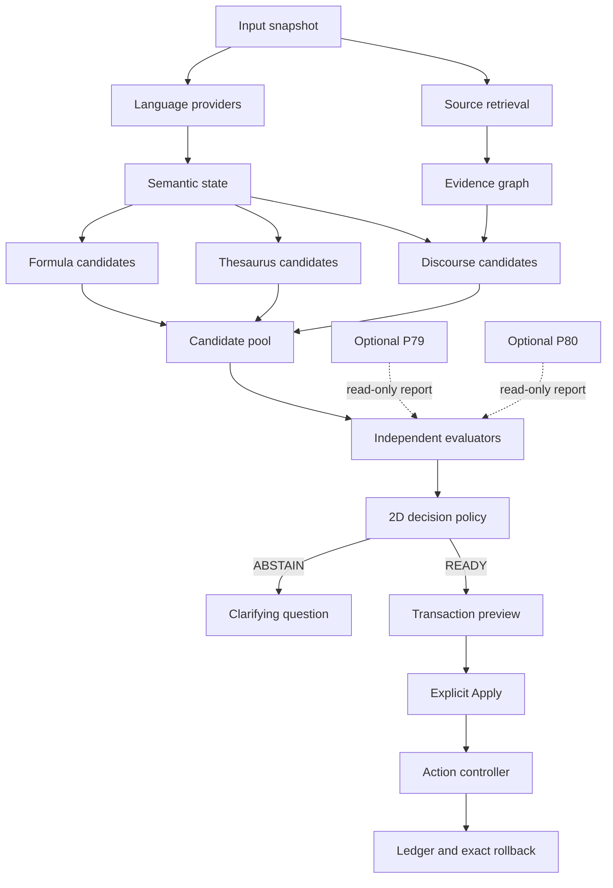

# 27 - Автономный P78: аудит и план развития самостоятельного 2D-ядра

Дата: 2026-07-20  
Статус: концептуальный и технический аудит локального репозитория  
Объект: `prototype/p78-living-ring-interface.html` и его локальные модули  
Граница утверждений: документ подтверждает устройство программы и проверяемые структурные свойства. Он не подтверждает истинность, полезность или человеческую осмысленность автоматически созданного текста.

## 0. Строгое решение

**Да, P78 может быть самодостаточным без P79 и P80.**

Это утверждение верно в следующем точном смысле:

1. P78 способен локально принять текст и необязательную цель.
2. Его собственные модули способны построить разбор, три ветви реакции, структурный guard, preview, транзакцию, commit, undo и replay.
3. P79 и P80 не входят в путь, который изменяет текст.
4. Отсутствие соседних вкладок не нарушает rollback P78.
5. Текущие ответы P79/P80 отображаются как read-only отчёты и не участвуют в вычислении `semanticState`, выборе кандидата или commit.

Но самодостаточность имеет предел:

- P78 уже самодостаточен как **детерминированный исследовательский 2D-редактор с эвристической семантикой**;
- P78 ещё не самодостаточен как **универсальный генератор содержательно верных новостных, энциклопедических или научных статей**;
- Q6 не устраняет этот недостаток, потому что Q6 проверяет комбинацию шести явно заданных условий, а не добывает факты и не понимает текст;
- 1D-кодек не устраняет этот недостаток, потому что точная кодировка подтверждает сохранность последовательности, а не её смысл;
- для содержательной статьи главным недостающим слоем являются источники фактов, модель дискурса, расширенное языковое покрытие и независимая оценка, а не дополнительная размерность интерфейса.

Рекомендуемое решение: **сначала развивать автономный P78 как основной продукт и подключать P79/P80 только через необязательные диагностические адаптеры**.

## 1. Что означает автономность

Нужно различать четыре уровня.

| Уровень | Вопрос | Статус P78 |
|---|---|---|
| Операционная автономность | Запускается ли основной цикл без P79/P80? | Да |
| Транзакционная автономность | Может ли P78 сам подготовить, применить и откатить ход? | Да |
| Семантическая автономность | Может ли P78 сам ранжировать и породить структурный кандидат? | Да, в пределах ручной модели и шаблонов |
| Эпистемическая автономность | Может ли P78 подтвердить фактическую истинность произвольного текста? | Нет |

Термины `1D`, `2D`, `3D` в проекте обозначают архитектурные роли. Из них не следует буквальная физическая размерность смысла.

- Внутренний **центр** обязателен как модель риска чрезмерного сжатия.
- Внутренний **край** обязателен как модель риска распада деталей.
- Открытая **2D-орбита** обязательна как допустимая область перехода.
- Отдельная программа P80/Q6 для существования центра не обязательна.
- Отдельная программа P79/binary/Morse для существования края не обязательна.

Иначе говоря, P78 обязан знать о двух полюсах как о своих граничных условиях, но не обязан делегировать их двум другим приложениям.

## 2. Метод и проверенная база

Аудит выполнен по локальным файлам, а не по желаемому описанию проекта.

Основные проверенные участки:

- [`p78-living-ring-interface.html`](../prototype/p78-living-ring-interface.html) - порядок подключения модулей и UI;
- [`p78-living-ring-runtime.js`](../prototype/lib/p78-living-ring-runtime.js) - основной цикл, Canvas и DOM-адаптеры;
- [`semantic-core.js`](../prototype/lib/semantic-core.js) - локальная модель слов, граф, guard и генераторы кандидатов;
- [`semantic-language.js`](../prototype/lib/semantic-language.js) - ограниченный русскоязычный разбор;
- [`semantic-decision.js`](../prototype/lib/semantic-decision.js) - интерпретация, проверка и решение;
- [`semantic-branch-evaluator.js`](../prototype/lib/semantic-branch-evaluator.js) - сравнение трёх ветвей;
- [`semantic-command-dsl.js`](../prototype/lib/semantic-command-dsl.js) - типизированные команды и композиция;
- [`semantic-transaction.js`](../prototype/lib/semantic-transaction.js) - pre/inv/post и строгий открытый интервал;
- [`semantic-action-gate.js`](../prototype/lib/semantic-action-gate.js) - единый шлюз действий;
- [`p78-semantic-action-controller.js`](../prototype/lib/p78-semantic-action-controller.js) - единственный владелец commit/undo/replay;
- [`semantic-ledger.js`](../prototype/lib/semantic-ledger.js) - журнал и provenance;
- [`semantic-data-evidence.js`](../prototype/lib/semantic-data-evidence.js) - необязательный локальный мини-корпус;
- [`p78-neighbor-worlds.js`](../prototype/lib/p78-neighbor-worlds.js) - изолированный мост к соседям;
- [`p78-exchange-contract.js`](../prototype/lib/p78-exchange-contract.js) - контракт read-only обмена;
- [`semantic-asymmetric-balance.js`](../prototype/lib/semantic-asymmetric-balance.js) - готовый, но пока не подключённый формульный оператор асимметрии.

Целевые регрессии, относящиеся к автономному пути, прошли `110/110` проверок. Они подтверждают детерминизм, ограничения диапазонов, отказ на OOV/неоднозначности, типизированную композицию, точную транзакцию, идемпотентный commit, rollback и replay. Эти тесты не являются человеческой оценкой качества текста.

## 3. Фактическая граница P78 и соседей

### 3.1. Что показывает код

Основной runtime не обращается к P79, P80, Q6 или timeline-codec. Связь существует только в отдельном модуле `p78-neighbor-worlds.js`.

Текущий путь соседа:

```text
кнопка в P78
-> p78-neighbor-worlds.js
-> p78.exchange/1 request
-> отдельная вкладка P79 или P80
-> валидированный read-only report
-> текстовый статус в панели соседей
```

Текущий автономный путь:

```text
source + optional target
-> language/core analysis
-> three branch candidates
-> structural verification
-> typed command composition
-> transaction PREPARE
-> preview
-> explicit Apply
-> action-controller
-> ledger receipt
-> exact Undo or Replay
```

Эти пути не пересекаются в точке решения. `acceptResult()` соседа обновляет статус и краткий отчёт интерфейса, но не пишет в `semanticState`, decision, transaction или ledger.

### 3.2. Строгая классификация зависимостей

| Зависимость | Роль | Для запуска полного P78 | Для осмысленного commit | Класс |
|---|---|---:|---:|---|
| `p78-runtime-state` | владение состоянием | обязательно | обязательно | внутреннее ядро |
| `p78-reaction-kernel` | планирование локальной реакции | обязательно текущему runtime | косвенно | внутреннее ядро |
| `p78-semantic-action-controller` | единственная запись текста | обязательно | обязательно | внутреннее ядро |
| `p78-interface-mode` | режимы `ход/анализ` | обязательно текущему runtime | нет | UI-обвязка |
| `semantic-core` | граф, метрики, guard, кандидаты | есть визуальный fallback | обязательно для заявленного семантического пути | внутреннее семантическое ядро |
| `semantic-language` | occurrence, формы, WSD, grammar | нет | желательно и фактически нужно для честного gate | внутренний анализатор |
| branch/decision/DSL/transaction/action-gate | решение и безопасное применение | страница частично отрисуется без них | обязательно | внутренний контур решения |
| ledger | receipt, undo, replay | можно отобразить без журнала | обязательно для полной транзакционной автономности | внутренний контур памяти |
| reaction field/runtime/rules | наблюдаемые события частиц | обязательно для полного живого поля | не обязательно для текстового commit | 2D-динамика |
| `vectors.json` и два соседних JSON | локальные данные до 5% веса | нет | нет, при недоступности `ABSTAIN` | необязательное evidence |
| P79/timeline-codec | точное 1D-разложение | нет | нет | диагностика |
| P80/Q6 | шесть флагов и одно-битный контрфакт | нет | нет | диагностика |
| Three.js | визуализация Q6 | нет | нет | внешний визуальный слой P80 |

### 3.3. Что концептуально обязательно

Для сохранения идентичности P78 обязательны не соседние приложения, а следующие идеи:

1. Два различимых риска: сжатие и распад.
2. Открытая рабочая область между ними.
3. Направленный ход, а не только статическая оценка текста.
4. Явный кандидат `before -> after`.
5. Возможность отказа `ABSTAIN/BLOCKED`, если данных недостаточно.
6. Единственный владелец изменения текста.
7. Точный rollback по квитанции.
8. Разделение структурной корректности и семантической истинности.
9. Память о принятых и отклонённых ходах.
10. Независимость решения от координат Canvas и декоративной геометрии.

## 4. Что уже умеет автономный 2D-P78

### 4.1. Ввод и интерпретация

- принимает исходный текст, внешнее условие и необязательную цель;
- сохраняет порядок occurrence в языковом слое;
- обнаруживает операторы `continue`, `generalize`, `detail` и ограниченную область отрицания;
- различает exact/alias/stem/morph/OOV;
- вычисляет покрытие распознанных содержательных слов;
- имеет ограниченный WSD для нескольких многозначных слов;
- проверяет часть согласования и валентности;
- воздерживается при низком покрытии, неразрешённой неоднозначности и грамматическом конфликте.

### 4.2. Локальная семантическая модель

Текущий `semantic-core` использует:

- 28 ручных словарных записей;
- aliases и stem-правила;
- роли `core/detail/bridge/neutral`;
- ручную path-иерархию и LCA;
- теги и восьмимерные ручные признаки;
- `GOOD_PAIRS` и `BAD_PAIRS`;
- комбинацию cosine/path/tag/SemFit;
- пороговый локальный граф связей и конфликтов.

Это объяснимая инженерная модель. Она не является универсальным тезаурусом, полноценными embeddings или доказательством смысла.

### 4.3. Динамика и ветвление

P78 умеет:

- классифицировать тягу к обобщению, детализации и движению;
- моделировать локальные встречи частиц;
- различать `OBSERVED` и `FORECAST` trace;
- строить три кандидата: `generalize`, `orbit`, `detail`;
- учитывать цель с ограниченным весом;
- блокировать ветвь при `center`, `edge` или `conflict`;
- детерминированно выбирать лучший допустимый кандидат.

Текущая структурная формула ранжирования:

```text
structural =
    0.24 * guard
  + 0.18 * life
  + 0.18 * move
  + 0.15 * theme
  + 0.15 * newness
  + 0.10 * middle(u)
```

При активной цели:

```text
score = 0.82 * structural + 0.18 * target
```

При доступном локальном мини-корпусе:

```text
score = 0.95 * structural + 0.05 * localCorpus
```

Коэффициенты являются настройками программы, а не доказанными законами языка.

### 4.4. Удержание открытого кольца

Реализованы:

- `stabilityGuard()`;
- `balanceRepair()`;
- `semanticTrajectory()`;
- `semanticBacktrack()`;
- строгая транзакционная проверка `0.18 < u < 0.82`;
- отклонение center/edge/conflict;
- repair-направление: center -> detail, edge -> generalize, conflict -> orbit/bridge.

Guard подтверждает соблюдение собственной модели риска. Он не подтверждает фактическую верность предложения.

### 4.5. Генерация структурных продолжений

Реализованы:

- `composeContinuation()`;
- `semanticTraceContinuation.compose()`;
- жанровые шаблоны для story/article/song;
- `semanticArchipelago()`;
- `semanticWeave()`;
- `semanticWindowRhythm()`;
- `semanticRails()`;
- `semanticGoal()`;
- `semanticPhi()`;
- короткая ритмическая мантра;
- создание моста, примера, тезиса или следующего хода.

Сильная сторона: каждый ход можно показать до применения и связать со структурной причиной.

Ограничение: генерация в основном переставляет распознанные слова внутри заранее написанных фразовых каркасов. Это пока не полноценное продолжение статьи на уровне фактов, аргументации и дискурса.

### 4.6. Безопасное действие

Уже реализован зрелый для прототипа контур:

```text
interpret
-> compare branches
-> verify grammar/ring/theme/newness
-> compose ID -> STATE -> EFFECT -> STATE
-> prepare transaction
-> preview exact insertLine and afterText
-> commit once
-> receipt
-> exact undo/replay
```

Проверяются stale source/target, подмена кандидата, повторный commit и конфликт ручной правки. Это одна из наиболее законченных частей P78.

## 5. Что P79 и P80 действительно добавляют

### 5.1. P79: полезность и предел

P79 добавляет проверяемые свойства последовательности:

- UTF-8 байты;
- порядок `msb0`;
- точный binary roundtrip;
- явный Morse-профиль;
- `PARTIAL/ABSTAIN` для неподдерживаемых символов;
- ритмическую и временную проекцию текста.

P79 полезен для сохранности, ритма, поэзии, кодирования, обучения и исследования формы. Он не определяет тему, факт, причинность, достоверность или качество следующего предложения.

### 5.2. P80: полезность и предел

P80 добавляет проверяемые свойства шестибитной диагностической модели:

- 64 состояния;
- степень каждой вершины 6;
- 192 ребра;
- переход `Hamming=1`;
- кратчайший одно-битный контрфакт;
- честный `UNKNOWN/ABSTAIN`.

P80 полезен, когда шесть условий уже имеют измеримое происхождение. Он не создаёт эти условия и не превращает текст в надёжные биты автоматически.

### 5.3. Почему ни один сосед не обязателен

P79 отвечает на вопрос: **сохранена ли и как устроена последовательность?**

P80 отвечает на вопрос: **какое одно из шести формализованных условий нужно изменить?**

P78 отвечает на вопрос: **какой следующий текстовый ход допускает текущая модель и можно ли его безопасно применить?**

Третий вопрос не выводится из первых двух. Поэтому P79/P80 могут усиливать наблюдаемость, но не должны становиться обязательными источниками решения.

## 6. Инварианты автономного P78

### 6.1. Уже поддерживаемые инварианты

| ID | Инвариант | Состояние |
|---|---|---|
| A1 | Исходный текст не меняется при preview | реализован и проверен |
| A2 | Только action-controller выполняет продвигающую запись | реализован и проверен |
| A3 | Commit возможен только для `READY` transaction | реализован и проверен |
| A4 | Один commit создаёт одну запись и одну квитанцию | реализован и проверен |
| A5 | Повторный commit идемпотентен | реализован и проверен |
| A6 | Stale source/target закрываются без записи | реализован и проверен |
| A7 | Undo требует точного совпадения `afterText` | реализован и проверен |
| A8 | Ручная правка не теряется при конфликте rollback | реализован и проверен |
| A9 | Кандидат обязан оставаться в `0.18 < u < 0.82` | реализован и проверен |
| A10 | OOV, неоднозначность и отрицание могут приводить к отказу | реализован частично и проверен на малом наборе |
| A11 | Evidence маркируется, soundness остаётся `NOT_COMPUTED` | реализован |
| A12 | Локальные данные необязательны и ограничены весом 5% | реализован |

### 6.2. Обязательные инварианты следующей версии

| ID | Инвариант | Требование |
|---|---|---|
| N1 | Unknown не превращается в умеренную совместимость | любое неизвестное отношение хранится как `UNKNOWN`, а не как фиксированный положительный SemFit |
| N2 | Визуальный граф не является evidence-графом | координаты, цвет и резервные рёбра Canvas не участвуют в семантическом решении |
| N3 | Каждая формула версионирована | обязательны `formulaId`, version, domain, range, units, provenance |
| N4 | Каждая статья разделена на claims | кандидат не применяется как один непрозрачный текстовый блок |
| N5 | Фактический claim требует опоры | без источника разрешены только связки, вопросы, планы и явно маркированные гипотезы |
| N6 | Структурный score не называется истинностью | UI и API используют `STRUCTURAL/HEURISTIC/SOURCE_SUPPORTED`, но не `TRUE` |
| N7 | Генератор и судья разделены | один и тот же шаблон или score не должен одновременно создавать и подтверждать кандидат |
| N8 | Решение воспроизводимо | одинаковые source/target/provider versions дают одинаковый ranking и trace |
| N9 | Длинный текст использует явное окно | никакого скрытого обрезания без метаданных `windowStart/windowEnd/omittedCount` |
| N10 | Источник факта неизменяем и адресуем | `sourceId`, fragmentId, contentHash, retrievedAt, license |
| N11 | Отказ является полноценным результатом | при нехватке данных возвращается вопрос или `ABSTAIN`, а не уверенная общая фраза |
| N12 | Соседний отчёт не имеет права commit | P79/P80 остаются providers без доступа к source DOM, transaction и ledger |
| N13 | Отсутствие соседа не меняет результат автономного профиля | `NullNeighborProvider` и закрытые вкладки дают тот же 2D-результат |
| N14 | Метрики проверяются на holdout | пороги нельзя продвигать в основной gate только по синтетическому набору |
| N15 | Новизна не равна смене слов | отдельно измеряются лексическая, реляционная и фактическая новизна |

## 7. Полная матрица четырёх вариантов

### 7.1. Сводная матрица

| Критерий | Autonomous 2D | 2D + 1D | 2D + 3D | Full 1D + 2D + 3D |
|---|---|---|---|---|
| Основной арбитр | P78 | P78 | P78 | P78 |
| Может работать без вкладок-соседей | да | нет для 1D-отчёта, да для основного хода | нет для Q6-отчёта, да для основного хода | да в режиме деградации |
| Генерирует кандидат | да | только P78 | только P78 | только P78 |
| Изменяет текст | только P78 | только P78 | только P78 | только P78 |
| Проверяет точную последовательность | базово через hash/transaction | усиленно через UTF-8/binary roundtrip | базово | усиленно |
| Даёт ритм Morse | нет | да | нет | да |
| Даёт шестибитный контрфакт | нет | нет | да | да |
| Автоматически повышает фактическую достоверность | нет | нет | нет | нет |
| Минимальная сложность | наименьшая | средняя | средняя | наибольшая |
| Риск связности | низкий | транспорт и профили кодека | ложная бинаризация условий | оба риска одновременно |
| Лучший первый этап | да | только при задаче формы | только при зрелых флагах | нет |
| Пригодность для автономного offline | максимальная | высокая при локальном кодеке | высокая при локальном Q6 | высокая, но тяжёлая |
| Пригодность для энциклопедической статьи | зависит от корпуса P78 | почти не улучшается | улучшается объяснимость gate, не содержание | не решает отсутствие источников |
| Evidence-граница | structural/heuristic | + sequence integrity | + condition topology | объединение без semantic truth |

### 7.2. Вариант A: Autonomous 2D

Состав:

```text
P78 UI
+ language/core
+ formula/branch engines
+ guard
+ transaction/action-controller/ledger
+ optional local corpus
+ NullNeighborProvider
```

Ситуации применения:

- разработка семантики без транспортного шума;
- локальный и приватный редактор;
- проверка формул и детерминизма;
- обучение на маленьком контролируемом корпусе;
- тестирование рассказов, статей и тезисов;
- основной продуктовый вариант.

Преимущества:

- минимальная связность;
- быстрый цикл изменений;
- легко установить причинность ошибки;
- можно измерить реальный вклад каждого нового семантического слоя;
- соседние метафоры не маскируют слабость языка.

Риски:

- self-confirming метрики;
- ручной словарь создаёт узкую область успеха;
- шаблонная генерация может выглядеть умнее, чем является;
- отсутствие независимого evidence-provider;
- одна система создаёт и оценивает кандидата.

Вердикт: **рекомендуемый основной путь на ближайшие этапы**.

### 7.3. Вариант B: 2D + 1D

Состав:

```text
Autonomous 2D
+ p78.exchange/1
+ P79 exact sequence report
```

Ситуации применения:

- стихи, песни, ритм, повтор и пауза;
- контроль сохранности текста при преобразованиях;
- исследование букв, слогов, байтов и символов;
- экспорт в Morse/binary;
- обучение последовательностям и кодированию.

Допустимый вклад 1D в P78:

- `roundtripOk` как инвариант целостности;
- количество байтов/битов/символов;
- покрытие Morse-профиля;
- ритмическая длина и паузы;
- обнаружение повреждения или неподдерживаемого алфавита.

Недопустимый вклад:

- считать короткий код более общим смыслом;
- считать длинный код более подробным смыслом;
- ранжировать факты по двоичному представлению;
- передавать commit в P79.

Вердикт: выбирать, когда форма и обратимость действительно входят в задачу. Для энциклопедической статьи это вторичный инструмент.

### 7.4. Вариант C: 2D + 3D

Состав:

```text
Autonomous 2D
+ p78.exchange/1
+ Q6 report with typed UNKNOWN
+ one-bit counterfactual path
```

Ситуации применения:

- аудит сложного решения;
- объяснение, какое одно условие блокирует ход;
- сравнение профилей порогов;
- стресс-тест guard;
- эксперимент с несколькими независимыми evidence providers.

Предлагаемый будущий профиль `p78-autonomy-v1`:

| Бит | Условие | Источник | UNKNOWN при |
|---:|---|---|---|
| 0 | source snapshot сохранён | transaction hash | нет точного снимка |
| 1 | языковое покрытие достаточно | language provider | provider недоступен или coverage не вычислен |
| 2 | открытое кольцо соблюдено | guard | formula/profile не совпадают |
| 3 | фактические claims имеют опоры | evidence provider | нет корпуса или provenance |
| 4 | кандидат не является дубликатом | novelty provider | нет истории или окна |
| 5 | следующий ход остаётся открытым | discourse planner | open-next не вычислен |

Это предложение нового профиля, а не описание уже автоматически вычисляемых битов P80.

Риски:

- сложное непрерывное явление принудительно превращается в boolean;
- `UNKNOWN` может ошибочно стать `false`;
- смена одного бита может не соответствовать одному реальному изменению текста;
- красивый гиперкуб может восприниматься как доказательство;
- Q6 может дублировать уже существующие checks transaction.

Вердикт: подключать после появления шести независимых и измеримых флагов. До этого P80 остаётся лабораторией диагностики.

### 7.5. Вариант D: Full

Состав:

```text
P79 sequence provider
<-> P78 sole arbiter
<-> P80 condition provider
```

Ситуации применения:

- демонстрация полной концепции трёх соседних миров;
- исследовательская выставка;
- комплексный аудит одного принятого хода;
- сценарии, где одинаково важны форма текста и логика условий.

Обязательные ограничения:

- прямой маршрут P79 <-> P80 запрещён;
- оба ответа привязаны к одной revision;
- stale report игнорируется;
- отсутствие ответа не блокирует автономный 2D-путь;
- ни один отчёт не становится `READY transaction` автоматически;
- любой вклад в ranking сначала проходит отдельную калибровку на holdout.

Риски:

- наибольшая стоимость сопровождения;
- сложнее объяснить пользователю, что реально повлияло на решение;
- транспортная ошибка может быть ошибочно принята за семантическую;
- интерфейс снова станет перегруженным;
- дополнительные измерения не компенсируют отсутствие фактов.

Вердикт: использовать как расширенный исследовательский режим, а не как обязательную архитектуру основного редактора.

## 8. Ситуации применения и критерии выбора

### 8.1. Матрица ситуаций

| Задача | Рекомендуемый вариант | Что требуется сверх текущего кода |
|---|---|---|
| Демонстрация движения между полюсами | Autonomous 2D | ничего обязательного |
| Продолжение простого рассказа | Autonomous 2D | расширить дискурс, персонажей и причинность |
| Продолжение энциклопедической статьи | Autonomous 2D + source-backed corpus | claims, retrieval, provenance, citation, factual checks |
| Продолжение новостной статьи | Autonomous 2D + актуальный источник | timestamp, источник, дедупликация событий, запрет выдуманных фактов |
| Сжатие статьи в тезис | Autonomous 2D | coverage и проверка сохранённых claims |
| Разложение слова/фразы | 2D + 1D | явный codec profile |
| Песня, ритм, Morse | 2D + 1D | метрики ритма, не semantic score |
| Объяснение одного блокирующего условия | 2D + 3D | измеримые Q6 flags |
| Аудит высокорискового применения | 2D + 3D | независимые providers и человек в контуре |
| Публичная концептуальная инсталляция | Full | упрощённый UX и наблюдаемая деградация |

### 8.2. Правило выбора

Новый сосед подключается только тогда, когда выполнены все условия:

1. Он вычисляет свойство, которое P78 не может проверить тем же способом.
2. Свойство имеет явный тип, диапазон и provenance.
3. Известно, как результат `UNKNOWN/ABSTAIN` влияет на систему.
4. Есть тест, доказывающий отсутствие права commit.
5. Есть A/B-оценка информационной пользы отчёта.
6. Пользователь может увидеть, что результат является диагностикой.
7. P78 сохраняет работоспособность при недоступности соседа.

Если хотя бы одно условие не выполнено, функция остаётся внутри автономной 2D-лаборатории или отдельного эксперимента.

## 9. Чего сейчас не хватает больше всего

Приоритеты перечислены по влиянию на самостоятельную семантику, а не по визуальной эффектности.

### 9.1. P0: независимое содержание

P78 умеет строить структурный ход, но почти не имеет внешнего материала, из которого можно получить новый проверяемый факт.

Нужны:

- локальный или удалённый корпус с лицензией;
- адресуемые фрагменты источника;
- retrieval по теме и отношениям;
- claims и ссылки на evidence;
- дата актуальности;
- запрет фактической вставки без опоры.

### 9.2. P0: разделение генератора и оценщика

Сейчас один набор ручных признаков участвует и в построении, и в оценке кандидата. Это создаёт риск `proof by construction`.

Нужны два независимых контура:

```text
CandidateProducer[] -> candidates
IndependentEvaluator[] -> evidence packs
DecisionPolicy -> ranking or ABSTAIN
```

### 9.3. P0: языковое покрытие

Текущий словарь и морфология слишком малы для Wikipedia/news/encyclopedia. Ограничение особенно заметно для:

- новых имён и терминов;
- длинных форм слов;
- синтаксических зависимостей;
- анафоры и местоимений;
- причинности;
- дат, величин и единиц;
- отрицаний с широкой областью;
- полисемии вне нескольких ручных примеров.

### 9.4. P1: модель дискурса статьи

Статья не является списком локально совместимых предложений. Нужны роли разделов и переходов:

```text
тема
-> определение
-> контекст
-> механизм или причина
-> пример или данные
-> ограничение
-> следствие
-> открытый следующий вопрос
```

### 9.5. P1: историческая, а не одношаговая Phi

Текущая `semanticPhi()` оценивает состояние средствами той же модели. Следующая версия должна считать историю по ledger:

- прирост подтверждённых claims;
- число новых отношений;
- повторение уже использованных фраз;
- количество rollback;
- устойчивость темы через несколько ходов;
- долю `ABSTAIN`;
- пользовательское принятие или редактирование.

### 9.6. P1: длинный контекст

`semantic-core.tokenize()` ограничивает анализ 26 уникальными токенами. Для статьи нужны:

- предложения и абзацы как адресуемые единицы;
- скользящее окно;
- краткая память раздела;
- архив claims;
- явное указание пропущенной части;
- отдельные локальный и глобальный контексты.

## 10. Параллельные ветви развития автономного 2D

### 10.1. Ветка F: формульная «матрёшка»

Цель: начать с области, где выводимость можно проверить формально, до попытки свободной лингвистической генерации.

Идея:

```text
атомарные данные
-> формула первого уровня
-> проверенный результат
-> вход формулы второго уровня
-> guard
-> объяснимый текстовый вывод
```

Каждая формула описывается как объект:

```text
FormulaSpec {
  id
  version
  inputTypes
  outputType
  domain
  range
  units
  preconditions
  invariant
  postconditions
  evaluator
  provenance
  evidenceLevel
}
```

Минимальные классы формул:

1. Нормализация значений в `[0,1]`.
2. Баланс центра/края.
3. Асимметричное разложение `P_3D + P_1D + P_2D = 1`.
4. Guard открытого кольца.
5. Изменение состояния `delta`.
6. Допустимость перехода.
7. Составная формула решения.

Уже доступные кирпичи:

- типизированный DSL;
- композиция `ID -> STATE -> EFFECT -> STATE`;
- `semantic-asymmetric-balance.crossState()`;
- fail-closed диапазоны;
- structural proof packs;
- transaction pre/inv/post.

Главный недостающий элемент: версионированный реестр формул и граф зависимостей между ними.

Преимущество: правильность вычисления и типов можно доказать тестами.

Ограничение: формальная выводимость результата не доказывает, что выбранные входы верно описывают человеческий смысл.

### 10.2. Ветка T: лингвистическая математика и тезаурус

Цель: заменить часть stem-эвристик явными отношениями понятий.

Минимальный тезаурус:

```text
Concept {
  conceptId
  labels[]
  language
  partOfSpeech
  senses[]
  relations[]
  provenance
}

Relation {
  from
  type: is_a | part_of | causes | enables | contrasts | exemplifies | located_in | precedes
  to
  confidence
  sourceId
}
```

Лингвистическая «математика» здесь означает не арифметику слов, а типизированные операции над отношениями:

```text
generalize(x) -> parent concept
detail(x) -> part/example
bridge(x,y) -> typed relation path
continue(state) -> relation not yet instantiated in discourse
contradiction(x,y) -> explicit incompatible predicates under one scope
```

Сначала использовать controlled natural language. Свободная фраза строится только после того, как заполнены роли:

```text
subject + predicate + object + qualifier + evidence + open_next
```

Преимущество: объяснимые пути и меньше случайных строк.

Ограничение: создание и поддержка тезауруса дорого; отношение в тезаурусе не гарантирует истинность конкретного утверждения.

### 10.3. Ветка C: source-backed продолжение статьи

Цель: получать предложение, которое не только структурно продолжает тему, но и имеет наблюдаемую опору.

Безопасный порядок развития:

1. Extractive continuation: выбрать подходящее предложение или фрагмент источника.
2. Controlled synthesis: собрать одно предложение только из подтверждённых claims.
3. Limited abstractive continuation: разрешить перефразирование при сохранении claim links.
4. Open generation: рассматривать только после независимой оценки.

Для каждого кандидата нужны:

- `claimIds`;
- `sourceFragments`;
- `supportCoverage`;
- `contradictionStatus`;
- `citationReady`;
- `freshness`;
- `license`;
- `semanticTruth: false` или отсутствие такого поля.

Для новостей обязательны дата публикации и дата события. Старый локальный корпус не должен выдавать себя за актуальный источник.

### 10.4. Ветка E: независимый корпус оценки

Цель: измерять не то, что формула заранее считает хорошим, а то, что независимо оценено человеком или источником.

Набор должен включать:

- рассказы;
- Wikipedia-подобные объяснения;
- энциклопедические статьи;
- новости;
- научно-популярные тексты;
- грамматичный бессмысленный текст;
- противоречия;
- полисемию;
- OOV-термины;
- короткие и длинные контексты;
- случаи, где правильный ответ - `ABSTAIN`.

Разбиение:

```text
development
calibration
holdout
adversarial
```

Holdout нельзя использовать для изменения правил и порогов.

### 10.5. Ветка H: историческое кольцо

Цель: оценивать не отдельное красивое предложение, а устойчивость цепи.

Состояние шага:

```text
RingStep {
  revision
  sourceClaims
  insertedClaims
  preservedTheme
  relationDelta
  lexicalNovelty
  factualNovelty
  guardBefore
  guardAfter
  acceptedByUser
  editedAfterCommit
  rollbackReason
}
```

Эта ветка может использовать ledger уже сейчас и не требует P79/P80.

### 10.6. Ветка D: необязательные диагностические соседи

Развивается параллельно, но не блокирует F/T/C/E/H.

- P79 проверяет последовательность и ритм.
- P80 проверяет комбинацию измеримых условий.
- Результаты сначала отображаются как evidence cards.
- В ranking они допускаются только после отдельного эксперимента на holdout.

## 11. Предлагаемая архитектура автономного ядра



### 11.1. Принцип адаптеров

Ядро не должно знать, открыта ли соседняя вкладка.

```text
NeighborProvider {
  capabilities()
  diagnose(snapshot)
  status()
}
```

Реализации:

```text
NullNeighborProvider
SequenceNeighborProvider
Q6NeighborProvider
CompositeNeighborProvider
```

`NullNeighborProvider` возвращает `UNAVAILABLE` и никогда не меняет ranking. Это формализует автономность.

### 11.2. Разделение трёх графов

В следующей версии нужны три разных объекта:

1. **DiscourseGraph** - предложения, claims и логические переходы.
2. **EvidenceGraph** - claims и поддерживающие фрагменты источников.
3. **ViewGraph** - точки и линии Canvas.

Нельзя выводить semantic/evidence relation из геометрической близости `ViewGraph`.

## 12. Техническое задание

### 12.1. Цель

Создать автономный 2D-движок P78, который локально и воспроизводимо:

1. анализирует вход и показывает покрытие;
2. строит несколько типизированных продолжений;
3. отделяет структурный ход от фактического claim;
4. выбирает кандидат только по явным providers;
5. воздерживается при нехватке evidence;
6. показывает точный preview;
7. применяет изменение только через существующий action-controller;
8. сохраняет provenance и точный rollback;
9. работает при полном отсутствии P79/P80;
10. допускает их read-only подключение без изменения контракта ядра.

### 12.2. Функциональные требования

| ID | Требование | Приёмка |
|---|---|---|
| FR-01 | Создавать неизменяемый `InputSnapshot` | hash и revision одинаковы для одинакового ввода |
| FR-02 | Показывать language coverage и OOV | каждый content occurrence имеет provenance |
| FR-03 | Хранить предложения и claims отдельно | у claim есть диапазон исходного текста |
| FR-04 | Поддерживать не менее трёх candidate producers | formula, thesaurus, discourse/source |
| FR-05 | Каждый кандидат имеет тип операции | generalize/detail/orbit/repair/clarify |
| FR-06 | Каждый фактический кандидат имеет evidence links | иначе candidate.kind не может быть `factual` |
| FR-07 | Независимые evaluators возвращают `READY/PARTIAL/ABSTAIN` | unknown не преобразуется в score |
| FR-08 | 2D policy строит ranking с вкладом каждого evaluator | итог объясним и воспроизводим |
| FR-09 | Center/edge/conflict всегда блокируют commit | property-tests на диапазонах |
| FR-10 | Preview содержит exact `insertLine` и `afterText` | совпадает с transaction payload |
| FR-11 | Apply и Undo используют текущий controller | прямых записей в DOM/ledger нет |
| FR-12 | NullNeighbor режим является режимом по умолчанию | одинаковый результат при закрытых соседях |
| FR-13 | P79/P80 отчёты сохраняются отдельно от decision | тип `DiagnosticEvidence`, read-only |
| FR-14 | Длинный текст использует явное окно | UI/API показывает omitted count |
| FR-15 | Для статьи выбирается discourse move | definition/example/cause/limitation/consequence |
| FR-16 | При недостатке фактов система задаёт вопрос | пустая общая фраза не считается продолжением |
| FR-17 | Все формулы берутся из versioned registry | неизвестная версия блокирует решение |
| FR-18 | Ledger хранит provider versions и evidence hashes | replay воспроизводит или честно сообщает stale |

### 12.3. Нефункциональные требования

| ID | Требование |
|---|---|
| NFR-01 | Автономный профиль не требует сети |
| NFR-02 | Никакого `eval` или `new Function` |
| NFR-03 | Семантический расчёт не выполняется внутри каждого animation frame |
| NFR-04 | Один активный rAF, ограниченные очереди и бюджеты |
| NFR-05 | Провайдеры версионированы и fail-closed |
| NFR-06 | Детерминированные тесты не зависят от Canvas |
| NFR-07 | UI не скрывает `ABSTAIN`, OOV и provenance |
| NFR-08 | Данные корпуса имеют лицензию и content hash |
| NFR-09 | Мобильный интерфейс не имеет горизонтального overflow |
| NFR-10 | Основной экран показывает один следующий ход, расширенные доказательства находятся в анализе |
| NFR-11 | Производительность измеряется отдельно для semantic runtime и кадрового цикла |
| NFR-12 | Любое изменение порога сопровождается calibration report |

### 12.4. Статусы evidence

```text
STRUCTURAL       - типы, диапазоны, hashes, pre/inv/post проверены
HEURISTIC        - языковое или смысловое правило без независимого корпуса
LOCAL_CORPUS     - поддержка малым локальным набором
SOURCE_SUPPORTED - claim связан с адресуемым источником
HUMAN_REVIEWED   - конкретный результат оценён человеком
UNVERIFIED       - подтверждения недостаточно
```

Ни один статус не называется `SEMANTIC_TRUE`.

## 13. Контракты данных следующей версии

### 13.1. InputSnapshot

```js
{
  schema: 'p78.input/2',
  revision: '...',
  source: '...',
  target: '...',
  language: 'ru',
  createdAt: '...',
  sourceHash: '...',
  providerProfile: 'autonomous-2d-v1'
}
```

### 13.2. FormulaSpec

```js
{
  schema: 'p78.formula/1',
  formulaId: 'asymmetric.cross-state',
  version: '1.0.0',
  inputs: [{ name: 'x', type: 'QTY', domain: [0, 1] }],
  output: { type: 'STATE' },
  pre: ['all inputs known', 'all inputs in domain'],
  inv: ['p3d + p1d + p2d = 1'],
  post: ['all components in [0,1]'],
  provenance: { owner: 'local', source: 'docs/24' },
  evidenceLevel: 'STRUCTURAL'
}
```

### 13.3. Candidate

```js
{
  schema: 'p78.candidate/2',
  candidateId: '...',
  revision: '...',
  producerId: 'formula|thesaurus|discourse|source',
  producerVersion: '...',
  operation: 'generalize|detail|orbit|repair|clarify',
  kind: 'structural|factual|question',
  line: '...',
  afterText: '...',
  claims: [],
  relationDelta: [],
  evidenceRefs: [],
  declaredUnknowns: [],
  semanticTruth: false
}
```

### 13.4. EvaluationPack

```js
{
  schema: 'p78.evaluation/2',
  candidateId: '...',
  evaluatorId: 'ring-guard',
  evaluatorVersion: '...',
  status: 'READY|PARTIAL|ABSTAIN|BLOCKED',
  score: 0.0,
  scoreMeaning: 'bounded structural preference',
  checks: [],
  unknowns: [],
  evidenceLevel: 'STRUCTURAL',
  soundness: 'NOT_COMPUTED'
}
```

### 13.5. Decision

```js
{
  schema: 'p78.decision/2',
  revision: '...',
  status: 'READY|CLARIFY|ABSTAIN|BLOCKED',
  selectedCandidateId: null,
  ranking: [],
  requiredEvidence: [],
  reasonCodes: [],
  neighborReportsUsed: [],
  formulaVersions: {},
  semanticTruth: false
}
```

## 14. Формульная схема автономного кольца

### 14.1. Разделение вычислимого и интерпретируемого

Строго вычислимо:

- диапазоны;
- hashes;
- exact text diff;
- сумма разложения;
- Hamming distance;
- количество claims/relations;
- повторение токенов;
- наличие source reference;
- соблюдение pre/inv/post.

Эвристически интерпретируется:

- тема;
- смысловая близость;
- новизна идеи;
- достаточность примера;
- качество перехода;
- полезность продолжения.

### 14.2. Формульная «матрёшка» первого этапа

```text
F0: normalize(rawMeasurements) -> X
F1: relationEvidence(X) -> (x, y, confidence)
F2: crossState(x,y) -> (P3D, P1D, P2Df, P2Dr)
F3: aggregate(states, confidence) -> OrbitState
F4: guard(OrbitState, candidate) -> GuardResult
F5: discourse(candidate, source) -> DiscourseResult
F6: evidence(candidate) -> EvidenceResult
F7: decide(F4,F5,F6) -> READY | ABSTAIN | BLOCKED
F8: transaction(source,candidate,F7) -> PREVIEW
```

Каждый уровень получает только результат предыдущего уровня с подходящим типом. Никакая формула не читает DOM.

### 14.3. Подключение асимметричного оператора

Готовый модуль уже гарантирует:

```text
P_3D      = x*y
P_1D      = (1-x)*(1-y)
P_2D_fwd  = x*(1-y)
P_2D_rev  = (1-x)*y
P_2D      = P_2D_fwd + P_2D_rev
P_3D + P_1D + P_2D = 1
```

До подключения к решению нужно определить:

1. Что именно измеряют `x` и `y`.
2. На каком графе они вычислены.
3. Каков порог отношения.
4. Что является единицей наблюдения.
5. Как учитывается confidence.
6. На каком holdout проверены пороги.

Без этих ответов модуль остаётся математически корректным калькулятором, но не семантической мерой.

## 15. Поэтапная дорожная карта

### Этап 0. Зафиксировать автономный baseline

Цель: доказать, что P78 не зависит от соседей.

Работы:

- ввести profile `autonomous-2d`;
- добавить `NullNeighborProvider`;
- отделить neighbor panel от decision state;
- зафиксировать набор автономных fixtures;
- измерить baseline acceptance/abstention/rollback.

Ворота:

- одинаковый source даёт одинаковый decision с закрытыми P79/P80;
- удаление транспорта из test harness не меняет commit/undo/replay;
- все текущие автономные регрессии зелёные.

### Этап 1. Реестр формул

Цель: сделать формулы первоклассными объектами.

Работы:

- `FormulaRegistry`;
- типы, domain/range/units;
- граф зависимостей;
- обнаружение циклов;
- topological evaluation;
- version pinning в ledger;
- property-tests для инвариантов.

Ворота:

- неизвестная формула или версия даёт `BLOCKED`;
- циклическая зависимость даёт `INVALID`;
- одинаковые inputs дают одинаковый proof pack;
- structural proof не содержит semantic truth.

### Этап 2. Формульный домен-пилот

Цель: проверить «матрёшку» на области с известными выводами.

Возможные пилоты:

- арифметические преобразования;
- единицы измерения;
- простые пропорции;
- графовые свойства;
- причинные правила с явно заданными premises.

Ворота:

- не менее 100 позитивных и 100 негативных случаев;
- ни один неверный тип не проходит;
- текстовый renderer не меняет математическое содержание;
- отсутствие premise приводит к вопросу, а не догадке.

### Этап 3. Тезаурус и controlled language

Цель: перейти от stem-ролей к typed relations.

Работы:

- versioned concept IDs;
- relation types;
- senses и disambiguation;
- morphology adapter;
- discourse slots;
- генерация из relation path;
- явный OOV workflow.

Ворота:

- не менее 80% coverage на development-наборе выбранного домена;
- OOV не получает положительный SemFit автоматически;
- relation path видим пользователю;
- грамматический конфликт блокирует factual candidate.

### Этап 4. Источники и claims

Цель: дать P78 материал для энциклопедического продолжения.

Работы:

- ingestion локального корпуса;
- chunking с сохранением section hierarchy;
- claim extraction;
- retrieval;
- provenance и citation;
- contradiction/duplicate checks;
- extractive candidate producer.

Ворота:

- каждый factual candidate имеет минимум один source fragment;
- цитата указывает точный fragmentId;
- при отсутствии опоры factual generation запрещена;
- источник с устаревшей датой явно маркируется.

### Этап 5. Дискурс статьи

Цель: продолжать не строку, а структуру статьи.

Работы:

- классификация текущей роли абзаца;
- план следующего rhetorical move;
- локальная и глобальная темы;
- контроль повторов;
- обязательный open-next;
- claim-preservation при обобщении.

Ворота:

- candidate сохраняет заданные обязательные claims;
- новый абзац не повторяет предыдущий только другими словами;
- next move соответствует annotated holdout чаще простого шаблонного baseline;
- при ничьей система показывает варианты или `ABSTAIN`.

### Этап 6. Независимая оценка и калибровка

Цель: прекратить оценивать систему только её собственными формулами.

Работы:

- human rubric;
- blind pairwise comparison;
- train/calibration/holdout split;
- calibration curves;
- error taxonomy;
- threshold promotion protocol.

Минимальные метрики:

- factual support precision;
- contradiction rate;
- claim preservation;
- discourse move accuracy;
- abstention precision/recall;
- human usefulness;
- edit distance после принятия;
- rollback rate;
- latency.

Ворота:

- пороги выбираются без доступа к holdout;
- результаты публикуются с интервалами неопределённости;
- улучшение сравнивается с простым extractive baseline;
- провал factual support блокирует переход к свободной генерации.

### Этап 7. Необязательная интеграция 1D/3D

Цель: добавить диагностику после стабилизации автономного решения.

Работы:

- единый `DiagnosticEvidence` adapter;
- capability negotiation;
- timeout и `UNAVAILABLE`;
- UI provenance;
- A/B вклад отчёта;
- Q6 profile только из измеримых flags.

Ворота:

- автономный результат не меняется при отсутствии соседей;
- stale/duplicate reports безопасны;
- вклад в ranking ограничен и откалиброван;
- прямой commit соседа невозможен.

## 16. Псевдокод

### 16.1. Главный автономный цикл

```text
function runAutonomous2D(source, target, profile):
    snapshot = InputSnapshot.create(source, target, profile)

    language = LanguageProviders.analyze(snapshot)
    if language.status in [EMPTY, AMBIGUOUS, CONFLICT]:
        return Clarify(language.reasonCodes)

    if language.coverage < profile.minCoverage:
        return Abstain(LOW_COVERAGE, language.unknowns)

    semanticState = SemanticModel.build(snapshot, language)
    discourseState = DiscourseModel.build(snapshot, semanticState)
    evidenceState = EvidenceProviders.retrieve(snapshot, semanticState)

    candidates = CandidatePool.empty()
    candidates.addAll(FormulaProducer.produce(semanticState))
    candidates.addAll(ThesaurusProducer.produce(semanticState))
    candidates.addAll(DiscourseProducer.produce(discourseState, evidenceState))

    if candidates.empty():
        return Abstain(NO_CANDIDATE)

    evaluations = evaluateIndependently(candidates, snapshot, semanticState, evidenceState)
    decision = TwoDimensionalPolicy.select(evaluations, profile)

    if decision.status != READY:
        return decision

    transaction = Transaction.prepare(snapshot, decision.selectedCandidate)
    if transaction.status != READY:
        return Blocked(transaction.errors)

    return Preview(decision, transaction)
```

### 16.2. Независимая оценка кандидатов

```text
function evaluateIndependently(candidates, snapshot, state, evidence):
    evaluators = [
        RingGuardEvaluator,
        LanguageEvaluator,
        ThemePreservationEvaluator,
        DiscourseEvaluator,
        NoveltyEvaluator,
        SourceSupportEvaluator
    ]

    packs = []
    for candidate in candidates:
        candidatePacks = []
        for evaluator in evaluators:
            pack = evaluator.evaluate(candidate, snapshot, state, evidence)
            assert pack.candidateId == candidate.id
            assert pack.status in ALLOWED_STATUSES
            candidatePacks.append(pack)
        packs.append({ candidate, evaluations: candidatePacks })
    return packs
```

### 16.3. Политика 2D

```text
function select(evaluatedCandidates, profile):
    eligible = []

    for item in evaluatedCandidates:
        if any required evaluator is BLOCKED:
            continue
        if any required evaluator is ABSTAIN:
            continue
        if item.ring.zone in [center, edge, conflict]:
            continue
        if item.candidate.kind == factual and item.sourceSupport != READY:
            continue

        score = calibratedWeightedScore(item, profile)
        eligible.append({ item, score })

    if eligible.empty():
        return Abstain(NO_SUPPORTED_2D_MOVE)

    sort eligible by score desc, candidateId asc

    if confidenceGap(eligible[0], eligible[1]) < profile.tieMargin:
        return Clarify(AMBIGUOUS_NEXT_MOVE, topTwo=eligible[0:2])

    return Ready(eligible[0])
```

### 16.4. Вычисление формульной «матрёшки»

```text
function evaluateFormulaGraph(requestedFormulaId, inputs, registry):
    graph = registry.dependencyGraph(requestedFormulaId)
    if graph.hasCycle:
        return Invalid(FORMULA_CYCLE)

    values = immutableMap(inputs)
    proofs = []

    for formulaId in graph.topologicalOrder:
        spec = registry.getPinned(formulaId)
        if spec is missing:
            return Blocked(FORMULA_VERSION_UNAVAILABLE)

        args = typedInputs(spec, values)
        if args contain UNKNOWN:
            return Abstain(FORMULA_INPUT_UNKNOWN, formulaId)
        if not spec.pre(args):
            return Blocked(FORMULA_PRECONDITION, formulaId)

        result = spec.evaluate(args)
        if not spec.invariant(args, result):
            return Invalid(FORMULA_INVARIANT, formulaId)
        if not spec.post(args, result):
            return Invalid(FORMULA_POSTCONDITION, formulaId)

        values[formulaId] = result
        proofs.append(structuralProof(spec, args, result))

    return Ready(values[requestedFormulaId], proofs)
```

### 16.5. Тезаурусный кандидат

```text
function produceThesaurusCandidate(state, target):
    topic = resolveConcept(state.topic)
    if topic.status != READY:
        return Abstain(TOPIC_UNKNOWN)

    desiredMove = DiscoursePolicy.nextMove(state, target)
    relationPath = Thesaurus.findTypedPath(topic, desiredMove.requiredRelation)

    if relationPath.status != READY:
        return Abstain(NO_RELATION_PATH)

    slots = ControlledLanguage.fill(relationPath, desiredMove)
    if slots.missingRequired:
        return Clarify(MISSING_SLOT, slots.missingRequired)

    line = Morphology.realize(slots)
    return Candidate(
        kind = structural,
        line = line,
        relationDelta = relationPath,
        evidenceLevel = HEURISTIC,
        semanticTruth = false
    )
```

### 16.6. Source-backed энциклопедическое продолжение

```text
function produceArticleCandidate(snapshot, discourse, corpus):
    nextMove = discourse.planNextMove()
    query = buildQuery(snapshot.topic, nextMove, discourse.openClaims)
    fragments = corpus.retrieve(query, topK=profile.topK)

    supportedClaims = []
    for fragment in fragments:
        claims = ClaimExtractor.extract(fragment)
        for claim in claims:
            support = SourceSupport.verify(claim, fragment)
            if support.status == READY:
                supportedClaims.append({ claim, fragment, support })

    if supportedClaims.empty():
        return Clarify(NO_SOURCE_SUPPORT, questionFor(nextMove))

    selected = ClaimPlanner.selectNonContradictory(supportedClaims, discourse)
    if selected.empty():
        return Abstain(CONTRADICTION_OR_DUPLICATION)

    line = ControlledArticleRenderer.render(nextMove, selected)
    return Candidate(
        kind = factual,
        line = line,
        claims = selected.claimIds,
        evidenceRefs = selected.fragmentIds,
        evidenceLevel = SOURCE_SUPPORTED,
        semanticTruth = false
    )
```

### 16.7. Необязательные соседи

```text
function collectDiagnostics(snapshot, providers):
    reports = []
    for provider in providers:
        if not provider.available():
            reports.append(Unavailable(provider.id))
            continue

        report = provider.diagnose(snapshot, timeout=profile.diagnosticTimeout)
        if report.revision != snapshot.revision:
            reports.append(Stale(provider.id))
            continue
        if not ExchangeContract.validate(report):
            reports.append(Invalid(provider.id))
            continue

        reports.append(ReadOnly(report))

    return reports
```

### 16.8. Commit и rollback

```text
function applyPreview(preview, currentSource, currentTarget):
    assert preview.transaction.status == READY
    assert hash(currentSource) == preview.transaction.sourceHash
    assert hash(currentTarget) == preview.transaction.targetHash

    outcome = ActionController.commitPrepared(
        currentSource,
        currentTarget,
        preview.decision,
        preview.transaction
    )

    if outcome.status != COMMITTED:
        return outcome

    return {
        text: outcome.text,
        receipt: outcome.receipt,
        ledgerEntry: outcome.entry
    }

function rollback(currentSource, receipt):
    if currentSource != receipt.afterText:
        return Blocked(ROLLBACK_CONFLICT)
    return ActionController.undo(currentSource)
```

## 17. План проверки качества

### 17.1. Уровень 1: формальная корректность

Проверяет:

- типы;
- диапазоны;
- формульные инварианты;
- детерминизм;
- hashes;
- transaction/rollback;
- отсутствие прямой записи соседей.

Это можно полностью автоматизировать.

### 17.2. Уровень 2: структурная семантика

Проверяет:

- coverage;
- WSD на размеченных примерах;
- grammar checks;
- сохранение темы;
- relation paths;
- discourse move;
- abstention.

Нужен размеченный корпус. Результат остаётся эвристическим.

### 17.3. Уровень 3: фактическая поддержка

Проверяет:

- каждое ли утверждение связано с источником;
- поддерживает ли фрагмент claim;
- нет ли противоречия;
- не устарел ли источник;
- не смешаны ли разные сущности.

Нужны независимые источники и ручной аудит выборки.

### 17.4. Уровень 4: человеческая полезность

Оценочная карточка:

| Ось | Вопрос | Шкала |
|---|---|---:|
| Связность | Продолжает ли строка исходную тему? | 1-5 |
| Новизна | Добавляет ли она новое содержание? | 1-5 |
| Фактическая опора | Поддерживаются ли claims? | 0/1/NA |
| Ясность | Понятно ли предложение без объяснения интерфейса? | 1-5 |
| Следующий ход | Оставляет ли оно полезное продолжение? | 1-5 |
| Редактирование | Сколько пришлось изменить пользователю? | символы/слова |
| Решение | принять, исправить, отклонить, abstain | категория |

### 17.5. Базовые сравнения

P78 должен сравниваться не только со своей предыдущей версией:

1. Ничего не добавлять.
2. Повторить последнее предложение.
3. Простой шаблон `тема -> пример`.
4. Extractive retrieval без генерации.
5. Автономный P78.
6. P78 + corpus.
7. P78 + выбранный диагностический сосед.

Если сложная версия не превосходит простой baseline, её нельзя считать улучшением.

## 18. Риски и меры

| Риск | Проявление | Мера |
|---|---|---|
| Ручной словарь | успех только на знакомых словах | domain profile, coverage, OOV abstain |
| Мягкий fallback SemFit | unknown выглядит совместимым | typed UNKNOWN и запрет положительного default |
| Proof by construction | формула подтверждает собственный шаблон | независимый evaluator и holdout |
| Шаблонное эхо | текст движется формально, но ничего не добавляет | factual/relation novelty и human edit rate |
| Потеря длинного контекста | анализируются первые 26 уникальных токенов | явные sentence/paragraph windows |
| Ложная фактичность | правдоподобная фраза без источника | factual kind требует source support |
| Устаревшая новость | старый corpus выглядит актуальным | eventDate/publishedAt/retrievedAt |
| Смешение графов | Canvas воспринимается как evidence | три раздельных графа |
| Ложная бинаризация Q6 | UNKNOWN становится 0 | nullable bits и ABSTAIN |
| Семантизация binary | длина кода влияет на смысл | P79 только integrity/rhythm |
| Перегруженный интерфейс | пользователь не видит основной ход | progressive disclosure |
| Сложность Full | трудно определить причину решения | автономный baseline и вклад providers |
| Drift формул | новая версия меняет replay | pin formula/provider versions |
| Лицензии корпуса | нельзя распространять данные | license metadata и разрешённые источники |
| Слепая автоматизация | система уверенно применяет спорный ход | explicit Apply и человеческий контроль |

## 19. Рекомендуемая последовательность решений

1. **Не делать P80 обязательным центром P78.** Центр должен остаться внутренним граничным состоянием 2D-модели.
2. **Не делать P79 обязательным краем P78.** Край должен остаться внутренним граничным состоянием, а 1D - необязательной проверкой формы.
3. **Зафиксировать автономный профиль как эталон.** Любое расширение сравнивать с ним.
4. **Первой новой веткой внедрять формульный реестр.** Для него уже есть DSL, transaction и асимметричный чистый модуль.
5. **Параллельно строить тезаурус выбранного узкого домена.** Не пытаться сразу покрыть весь русский язык.
6. **Для энциклопедической статьи сначала использовать extractive source-backed продолжение.** Затем controlled synthesis.
7. **Создать независимый корпус до перенастройки основных порогов.** Иначе улучшение нельзя отличить от подгонки.
8. **Развивать ledger как историю движения.** Историческая Phi полезнее ещё одной одношаговой формулы.
9. **Подключать Q6 только после появления шести evidence-backed флагов.**
10. **Подключать 1D там, где измеряется форма, ритм или точная обратимость.**
11. **Full-режим оставить расширенной лабораторией.** Основной пользовательский путь должен оставаться 2D.

## 20. Definition of Done автономного P78 v2

Автономный P78 v2 можно считать завершённым только при одновременном выполнении условий:

- [ ] P79/P80 полностью недоступны, но основной сценарий работает;
- [ ] `NullNeighborProvider` является проверенным профилем;
- [ ] formula registry версионирован и не допускает циклов;
- [ ] unknown не получает положительный смысловой score по умолчанию;
- [ ] генератор и evaluator разделены;
- [ ] есть sentence/paragraph model и явное окно длинного текста;
- [ ] есть versioned thesaurus хотя бы одного ограниченного домена;
- [ ] factual candidate всегда имеет source fragments;
- [ ] без источника factual candidate превращается в вопрос или `ABSTAIN`;
- [ ] discourse planner различает минимум пять типов следующего хода;
- [ ] transaction, commit, undo и replay сохраняют текущие гарантии;
- [ ] holdout не использован при настройке правил;
- [ ] система превосходит простой extractive или template baseline по заранее выбранным метрикам;
- [ ] опубликованы ошибки, ограничения и интервалы неопределённости;
- [ ] ни API, ни UI не заявляют semantic truth;
- [ ] P79/P80, если подключены, остаются read-only диагностикой.

## 21. Итог

P78 уже содержит достаточно механизмов, чтобы быть самостоятельным 2D-проектом. Его автономность основана не на отсутствии центра и края, а на том, что эти полюса представлены внутренними ограничениями, а решение, транзакция и память принадлежат самому кольцу.

P79 и P80 полезны, но решают ортогональные задачи. P79 доказывает свойства последовательности. P80 доказывает свойства переходов по заранее формализованным шести условиям. Ни один из них не заменяет языковое понимание, источники фактов и дискурс статьи.

Поэтому главный следующий этап - не расширение размерностей, а углубление автономного 2D по трём связанным направлениям:

```text
формулы с проверяемой выводимостью
+ тезаурус с типизированными отношениями
+ source-backed discourse с независимой оценкой
```

Только после этого диагностические 1D/3D отчёты можно обоснованно использовать как дополнительное evidence. До появления такой проверки они должны оставаться наблюдаемыми, полезными и необязательными.
