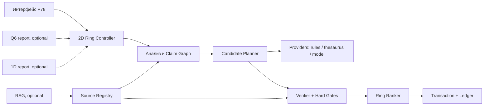

# 29 - Самостоятельное 2D-кольцо энциклопедической семантики

Статус: техническое задание, версия 1.0  
Дата: 2026-07-20  
Целевой компонент: `P78 Living Ring`  
Целевые профили: энциклопедическая статья, Wikipedia-подобная статья, новость  
Нормативность: слова **ДОЛЖЕН**, **НЕЛЬЗЯ**, **СЛЕДУЕТ**, **МОЖЕТ** задают обязательность требования

## 0. Резюме решения

### 0.1. Главный ответ

P78 **может и должен быть самодостаточным 2D-кольцом**. Для смысловой работы ему не обязательны ни 1D-лента, ни Q6-центр, ни RAG, ни внешняя языковая модель.

Минимально самодостаточный P78 получает:

1. задание автора;
2. текущий текст;
3. явно переданный набор источников;
4. локальные правила структуры статьи;
5. локальный реестр утверждений и доказательств;
6. генератор ограниченных кандидатов;
7. проверяющее ядро;
8. транзакцию, предпросмотр, commit, rollback и журнал.

Такой P78 способен:

- продолжить статью только теми фактами, которые уже находятся в источниках;
- перестроить, уточнить, объединить или разделить существующий материал;
- проверить каждое фактическое утверждение;
- объяснить, почему кандидат принят или отклонён;
- честно отказаться, если данных недостаточно.

Граница самодостаточности принципиальна:

> Самостоятельность означает способность работать без внешних соседей, но не право придумывать отсутствующие сведения.

Если источник не содержит следующего факта, самостоятельное кольцо не «догадывается». Оно возвращает `ABSTAIN`, вопрос автору, пустое место в плане или запрос дополнительного источника.

### 0.2. Роли необязательных компонентов

| Компонент | Обязателен | Допустимая роль | Недопустимая роль |
|---|---:|---|---|
| 1D Pulse Tape | нет | точность кодирования, порядок, разложение, диагностика потери символов | определять смысл или истинность |
| Q6 Center | нет | показывать уже вычисленный вектор шести условий и одношаговые контрфакты | вычислять факты вместо P78 |
| RAG | нет | находить возможные источники и возвращать снимки документов | считаться доказательством сам по себе |
| тезаурус | нет для MVP | давать типизированные отношения понятий | объявлять конкретный факт истинным |
| языковая модель | нет | предлагать формулировки и планы | быть скрытым источником знаний |
| embeddings/NLI | нет | ранжировать, искать противоречия, оценивать близость | заменять provenance и жёсткие ворота |

Q6 кодирует результат диагностики. Он не создаёт семантическую диагностику. В самостоятельном P78 тот же набор условий хранится как обычный `GuardVector`; P80 при наличии только визуализирует его.

### 0.3. Рекомендуемая ветвь развития

Разработка ведётся параллельными, но совместимыми ветвями:

| Ветвь | Результат | Зависимость от соседей |
|---|---|---|
| A. Формульное кольцо | строгие выводы из формул, правил и типизированных предпосылок | нет |
| B. Источниковое кольцо | продолжение статьи из атомарных утверждений источников | нет |
| C. Лингвистическое кольцо | тезаурус, дискурс, перефразирование, связность | нет |
| D. Корпусная проверка | измерение качества на энциклопедиях и новостях | нет |
| E. RAG-подключение | расширение доступного набора документов | необязательный provider |
| F. Соседние измерения | 1D-аудит и Q6-визуализация | необязательные report providers |
| G. Слияние/разделение | научный синтез, детализация фактов, конфликтные источники | использует то же 2D-ядро |

Рекомендуемый порядок: **A + B -> C -> D -> E -> F**, а ветвь G строится поверх B уже в alpha. Это позволяет сначала получить ограниченную, но честную генерацию, а затем расширять языковую свободу.

---

## 1. Назначение и границы продукта

### 1.1. Назначение

Система должна помогать автору продолжать, редактировать и проверять информационный текст так, чтобы каждый новый смысловой ход одновременно:

- был связан с задачей и предыдущим контекстом;
- добавлял полезное содержание, а не только повторял написанное;
- сохранял жанр и структуру документа;
- не вводил факты без проверяемой опоры;
- оставлял понятный следующий ход либо корректно завершал поставленную задачу;
- был обратимым до подтверждения автором.

### 1.2. Поддерживаемые профили

#### `ENCYCLOPEDIA`

Нейтральное изложение устойчивого знания. Приоритеты:

1. определения и область понятия;
2. классификация;
3. свойства и механизм;
4. история, если она подтверждена;
5. примеры и ограничения;
6. отсутствие новостной срочности и рекламной оценки.

#### `WIKI_LIKE`

Статья с вводной частью, разделами и ссылочной прозрачностью. Профиль не заявляет совместимость с правилами конкретного сайта. Приоритеты:

1. нейтральная точка зрения;
2. различение факта, атрибуции и спорного утверждения;
3. проверяемость на уровне утверждений;
4. отсутствие оригинального исследования системы;
5. явное представление конфликтующих источников;
6. сжатая вводная часть, не добавляющая новых фактов к основному тексту.

#### `NEWS`

Сообщение о событии и его обновлениях. Приоритеты:

1. кто, что, где, когда;
2. различение времени события, публикации и получения источника;
3. атрибуция заявлений;
4. отделение подтверждённых фактов от неизвестного;
5. запрет превращать предположение в установленную причину;
6. сохранение истории обновлений и временного среза.

### 1.3. Не входит в первую версию

- автономный поиск «истины во всём интернете»;
- автоматическая публикация без просмотра человеком;
- генерация сведений из параметров модели;
- оценка юридической, медицинской или финансовой корректности без специализированного профиля и эксперта;
- доказательство научной новизны;
- определение надёжности источника только по имени домена;
- полный академический обзор литературы;
- точное воспроизведение редакционных правил Wikipedia;
- замена исследователя, журналиста, редактора или рецензента.

### 1.4. Базовые инварианты

1. **Нет источника -> нет нового факта.**
2. **Неизвестное не превращается в ложное или истинное.** Оно остаётся `UNKNOWN`.
3. **RAG-результат не равен доказательству.** Он становится только новым кандидатом в реестр источников.
4. **Уверенность модели не равна опоре факта.**
5. **Один общий балл не может перекрыть фактическую ошибку.** Жёсткие ворота проверяются до ранжирования.
6. **Редактирование по умолчанию сохраняет множество утверждений.** Добавление или удаление факта оформляется отдельно.
7. **Каждый commit обратим и привязан к revision исходного текста и источников.**
8. **1D и 3D не имеют права commit.**
9. **Результат воспроизводим из сохранённого снимка, версий правил и ответов providers.**
10. **Пользователь видит причину `ABSTAIN`, а не пустой экран.**

---

## 2. Термины

| Термин | Определение |
|---|---|
| источник | версионированный документ или набор данных, явно допущенный в текущую задачу |
| снимок источника | неизменяемое содержимое с хешем, временем получения и метаданными |
| утверждение / claim | минимальная проверяемая смысловая единица с субъектом, предикатом и дополнениями |
| фактическое утверждение | claim, который сообщает проверяемое состояние мира |
| дискурсивный текст | навигационная формулировка без нового факта: переход, структура, указание темы |
| evidence span | точный фрагмент снимка источника, поддерживающий или опровергающий claim |
| provenance | цепочка происхождения от выходного фрагмента до claim, evidence span и снимка источника |
| кандидат | ещё не применённый вариант продолжения или редактирования |
| ход | одна типизированная операция над текстом или графом утверждений |
| активное окно | ограниченный контекст, используемый для выбора текущего хода |
| кольцо | цикл анализа, предложения, проверки, выбора, commit и нового анализа |
| центр | риск чрезмерного сжатия, повтора или потери различий |
| край | риск распада, неподдержанной детали или потери связи |
| орбита | направленный подтверждённый ход между крайностями |
| hard gate | условие, нарушение которого запрещает `READY` независимо от остальных баллов |
| abstention | типизированный отказ действовать при нехватке данных или уверенности |
| provider | заменяемый поставщик кандидатов, поиска или диагностического отчёта |
| transaction | подготовленное точное изменение текста с before/after и доказательствами |

---

## 3. Пользователи и сценарии

### 3.1. Роли

| Роль | Задача | Права |
|---|---|---|
| автор | пишет и продолжает текст | выбирает кандидат, подтверждает commit, откатывает |
| редактор | улучшает структуру и проверяет утверждения | задаёт политику, принимает/отклоняет изменения |
| фактчекер | проверяет claims и источники | меняет статус evidence, но не обязан редактировать текст |
| исследователь | объединяет и разделяет материалы | управляет конфликтами и группами источников |
| администратор профиля | версионирует правила и пороги | не меняет результаты задним числом |

### 3.2. Сценарий S01: продолжение энциклопедической статьи

**Дано:** определение объекта, план разделов и три источника.  
**Действие:** пользователь выбирает `GENERATE / ENCYCLOPEDIA`.  
**Ожидается:** кольцо находит непокрытый подтверждённый claim, выбирает риторическую связь `ELABORATE`, создаёт 2-3 формулировки, показывает citations и предлагает один следующий абзац.  
**Запрет:** использовать «общеизвестные» свойства, отсутствующие в допущенных источниках.

### 3.3. Сценарий S02: Wikipedia-подобная вводная часть

**Дано:** готовые разделы статьи.  
**Действие:** пользователь запрашивает краткую вводную часть.  
**Ожидается:** система только суммирует claims из тела, показывает покрытие и потери. Новый claim блокирует `READY`.

### 3.4. Сценарий S03: обновление новости

**Дано:** новость на 10:00 и источник с обновлением на 11:20.  
**Действие:** пользователь задаёт cutoff 11:30 и `GENERATE / NEWS / UPDATE`.  
**Ожидается:** добавляется новый подтверждённый факт, прежнее утверждение либо сохраняется как историческое, либо помечается устаревшим. Время события и время публикации не смешиваются.

### 3.5. Сценарий S04: недостаточно сведений

**Дано:** в источнике упомянуто открытие, но нет даты.  
**Действие:** кандидат пытается добавить точную дату.  
**Ожидается:** `ABSTAIN/MISSING_EVIDENCE`, список неподдержанных полей и предложение продолжить без даты либо добавить источник.

### 3.6. Сценарий S05: противоречащие источники

**Дано:** два источника называют разные значения показателя.  
**Действие:** генерация справочного абзаца.  
**Ожидается:** система не усредняет значения и не выбирает молча одно. Она предлагает атрибутированную формулировку, показывает конфликт и может вернуть `PARTIAL/SOURCE_CONFLICT`.

### 3.7. Сценарий S06: редактура без изменения фактов

**Дано:** перегруженный абзац.  
**Действие:** `EDIT / CLARIFY`.  
**Ожидается:** до и после имеют эквивалентный граф claims; перестановка и перефразирование разрешены; исчезновение квалификатора «около», отрицания или атрибуции блокирует commit.

### 3.8. Сценарий S07: проверка готовой статьи

**Дано:** статья и набор источников.  
**Действие:** `VERIFY`.  
**Ожидается:** таблица всех фактических claims, покрытие, противоречия, подозрительные числа, даты, имена, причинные связи и точные фрагменты текста. Текст не изменяется.

### 3.9. Сценарий S08: слияние двух текстов

**Дано:** две заметки об одном объекте.  
**Действие:** `EDIT / MERGE`.  
**Ожидается:** сущности разрешаются, дубликаты claims объединяются, provenance складывается, противоречия остаются раздельными, уникальные факты не теряются.

### 3.10. Сценарий S09: разделение сложного факта

**Дано:** предложение содержит дату, место, участника, действие и следствие.  
**Действие:** `EDIT / SPLIT`.  
**Ожидается:** создаются атомарные claims и читаемые предложения; каждому дочернему claim назначается собственная опора. Если источник поддерживает только часть исходного предложения, неподдержанная часть выделяется.

### 3.11. Сценарий S10: детализация

**Дано:** общий подтверждённый тезис и источник с несколькими составляющими.  
**Действие:** `GENERATE / DETAIL`.  
**Ожидается:** система раскрывает тезис только дочерними claims, которые следуют из evidence. Деталь, полученная одной лишь ассоциацией или из памяти модели, запрещена.

### 3.12. Сценарий S11: завершение статьи

**Дано:** все обязательные пункты задания покрыты.  
**Действие:** система оценивает открытость.  
**Ожидается:** естественное завершение не считается «смертью движения». Кольцо возвращает `READY/GOAL_COMPLETE`, а не искусственно добавляет новый абзац.

### 3.13. Сценарий S12: отключены все дополнительные providers

**Дано:** нет сети, RAG, Q6, 1D, embeddings и языковой модели.  
**Действие:** анализ и ограниченная генерация из локальных источников.  
**Ожидается:** все основные режимы работают на правилах, extractive-кандидатах и шаблонной лексикализации; качество формулировки может быть ниже, но provenance и запрет выдумки сохраняются.

---

## 4. Режимы работы

### 4.1. `GENERATE`

Назначение: добавить новый фрагмент текста.

Подрежимы:

- `CONTINUE` - следующий абзац;
- `DETAIL` - раскрытие существующего claim;
- `CONTEXT` - подтверждённый фон;
- `UPDATE` - временное обновление новости;
- `BRIDGE` - переход между двумя подтверждёнными темами;
- `SUMMARY` - сжатие уже представленных claims;
- `OUTLINE` - план без заявления новых фактов.

Правила:

1. Кандидат сначала строится как набор claims, затем лексикализуется.
2. Каждый новый фактический claim обязан иметь `SUPPORTED` evidence.
3. Дискурсивная связка маркируется как `DISCOURSE` и не маскирует фактическое утверждение.
4. Система возвращает минимум один безопасный кандидат или типизированный `ABSTAIN`.
5. Автоматический commit запрещён.

### 4.2. `EDIT`

Назначение: изменить форму, структуру или гранулярность текста.

Подрежимы:

- `CLARIFY`;
- `NEUTRALIZE`;
- `SHORTEN`;
- `EXPAND_FROM_EVIDENCE`;
- `REORDER`;
- `MERGE`;
- `SPLIT`;
- `DEDUPLICATE`;
- `ADD_CITATIONS`;
- `RESOLVE_TEMPORAL_ORDER`.

По умолчанию действует `claim-preserving edit`:

```text
Claims(before) == Claims(after)
```

Если множество claims меняется, интерфейс обязан показать отдельный diff:

```text
addedClaims, removedClaims, changedClaims, unchangedClaims
```

### 4.3. `VERIFY`

Назначение: проверить текст без его изменения.

Результаты:

- реестр claims;
- матрица evidence;
- список unsupported/unknown/contradicted;
- проверка чисел, единиц, имён, дат, отрицаний, модальности и атрибуции;
- проверка жанра и структуры;
- семантические крайности: повтор, чрезмерное сжатие, распад;
- набор предложенных ремонтов без commit.

### 4.4. Общая машина статусов

```text
READY       результат прошёл все обязательные ворота
PARTIAL     полезная часть есть, но имеются явно перечисленные пробелы
ABSTAIN     безопасный результат невозможно построить из доступных данных
BLOCKED     политика запрещает операцию
INVALID     вход или контракт некорректен
UNAVAILABLE обязательный для выбранного профиля provider недоступен
STALE       revision текста или источников изменился до commit
```

`PARTIAL` не разрешает commit фактического текста, если неполнота затрагивает его claims. Он может разрешать экспорт отчёта, плана или списка вопросов.

---

## 5. Варианты архитектуры

### 5.1. V0 - автономное формульно-источниковое кольцо

Состав:

- локальные источники;
- правила сегментации;
- claim graph;
- шаблонные риторические операции;
- формулы ранжирования;
- hard gates;
- ledger.

Плюсы: воспроизводимость, офлайн, минимальный риск скрытых знаний.  
Минусы: ограниченная естественность и слабое покрытие сложного языка.  
Статус: **обязательная основа MVP**.

### 5.2. V1 - V0 плюс локальный тезаурус

Добавляет sense IDs и отношения:

```text
SYNONYM, HYPERNYM, HYPONYM, MERONYM, HOLONYM,
INSTANCE_OF, CONTRAST, PROCESS_STAGE, RHETORICAL_RELATION
```

Каждое отношение имеет provider, версию и provenance. Синоним нельзя подставлять до разрешения значения слова.

Статус: alpha.

### 5.3. V2 - V0/V1 плюс генеративный provider

Модель получает только структурированное задание, claims и evidence bundle. Её вывод считается кандидатом, а не результатом. После генерации выполняются повторная экстракция claims и независимая проверка.

Статус: alpha; provider необязателен.

### 5.4. V3 - V0/V1/V2 плюс RAG

RAG расширяет source registry. До явного допуска найденного снимка его claims не могут попасть в `READY`.

Статус: beta; provider необязателен.

### 5.5. V4 - V0 плюс 1D и Q6

1D проверяет представление. Q6 показывает guard vector и контрфактический путь. При их отключении решение P78 не меняется.

Статус: уже возможная интеграция, не блокирует семантическую ветвь.

### 5.6. Выбранная схема



Обязательный путь не содержит пунктирных узлов.

---

## 6. Архитектура самостоятельного ядра

### 6.1. Компоненты

| Компонент | Ответственность | Не имеет права |
|---|---|---|
| `TaskNormalizer` | проверяет задание, профиль, cutoff, язык | добавлять факты |
| `SourceRegistry` | хранит снимки, версии, лицензии, хеши | объявлять источник истинным |
| `DocumentSegmenter` | выделяет разделы, абзацы, предложения, spans | менять исходник |
| `ClaimExtractor` | строит кандидаты claims и поля | считать extraction доказательством |
| `EntityResolver` | связывает упоминания с локальными entity IDs | сливать неоднозначные сущности молча |
| `EvidenceLinker` | связывает claims со spans | повышать `UNKNOWN` без основания |
| `ClaimGraph` | хранит связи и конфликты | удалять конфликт ради связности |
| `DiscoursePlanner` | выбирает смысловой тип следующего хода | придумывать factual payload |
| `CandidateProviders` | создают формулировки | commit и присвоение `READY` |
| `Verifier` | повторно извлекает и проверяет output claims | ранжировать, пропуская hard gate |
| `RingRanker` | оценивает пригодные кандидаты | компенсировать factual failure баллом |
| `AbstentionEngine` | формирует отказ и следующий безопасный запрос | возвращать неопределённый «не знаю» без причины |
| `ActionController` | prepare/preview/commit/rollback/replay | применять stale transaction |
| `AuditLedger` | хранит решения и receipts | переписывать историю |
| `Projection/UI` | показывает состояние и provenance | скрывать неполноту |

### 6.2. Правило зависимостей

```text
UI -> Controller -> Domain services -> Pure data/rules
Providers -> typed candidate/report
Domain services -X-> UI, Canvas, Three.js, network
```

Семантическое ядро должно быть чистым JavaScript-модулем без DOM. Для совместимости с текущим проектом допускается classic IIFE + CommonJS export. Тяжёлый анализ следует выполнять в Worker, сохраняя UI-анимацию независимой от смыслового расчёта.

### 6.3. Состояния кольца

```text
IDLE
  -> OBSERVE
  -> NORMALIZE
  -> ATOMIZE
  -> LINK_EVIDENCE
  -> MAP_GOAL
  -> PLAN_MOVES
  -> GENERATE_CANDIDATES
  -> VERIFY_CANDIDATES
  -> RANK_OR_ABSTAIN
  -> PREVIEW
  -> COMMIT | REJECT | EDIT_REQUEST
  -> LEDGER
  -> OBSERVE
```

Любая смена `sourceRevision`, `evidenceRevision`, `taskRevision` или `policyVersion` делает подготовленное решение `STALE`.

### 6.4. Типы смысловых ходов

| Ход | Направление | Условие |
|---|---|---|
| `DEFINE` | от термина к определению | definition claim supported |
| `CLASSIFY` | от объекта к классу | relation explicitly supported |
| `DETAIL` | от общего к части | дочерние claims имеют evidence |
| `GENERALIZE` | от деталей к общему | общий claim логически следует из набора |
| `EXEMPLIFY` | от правила к примеру | источник связывает пример с правилом |
| `COMPARE` | между объектами | одинаковая шкала и сопоставимые данные |
| `CONTRAST` | к различию | различие подтверждено, сущности разрешены |
| `TEMPORAL_NEXT` | к следующему событию | времена и порядок подтверждены |
| `CAUSE` | к причине | causal relation заявлена источником |
| `ATTRIBUTE` | к позиции источника | сохраняется субъект высказывания |
| `BRIDGE` | между темами | есть направленная риторическая связь |
| `SUMMARIZE` | к более общему | нет новых claims, потери показаны |
| `SPLIT` | к меньшей гранулярности | claims и evidence делятся без потерь |
| `MERGE` | к общей структуре | дубликаты разрешены, конфликты сохранены |
| `CORRECT` | к исправленному claim | изменение имеет evidence и diff |

`CAUSE` не выводится автоматически из временного следования. `GENERALIZE` не разрешается по одной лексической похожести.

---

## 7. Модель данных

### 7.1. Версии схем

```text
p78.article-task/1
p78.source-snapshot/1
p78.claim/1
p78.evidence-link/1
p78.candidate/1
p78.semantic-decision/1
p78.article-transaction/1
p78.audit-receipt/1
```

Неизвестные обязательные поля делают объект `INVALID`; неизвестные необязательные поля сохраняются для forward compatibility.

### 7.2. `ArticleTask`

```json
{
  "schema": "p78.article-task/1",
  "taskId": "task-...",
  "mode": "GENERATE",
  "operation": "CONTINUE",
  "profile": "ENCYCLOPEDIA",
  "language": "ru",
  "locale": "ru-RU",
  "title": "...",
  "goal": "Раскрыть механизм и ограничения",
  "requiredTopics": ["определение", "механизм"],
  "forbiddenTopics": [],
  "audience": "general",
  "currentText": "...",
  "sourceIds": ["src-1", "src-2"],
  "temporalCutoff": null,
  "policyProfile": "p78-factual-strict-v1",
  "citationStyle": "inline-source",
  "budgets": {
    "maxCandidates": 8,
    "maxNewClaims": 4,
    "maxWords": 180,
    "maxProviderMs": 10000
  }
}
```

### 7.3. `SourceSnapshot`

```json
{
  "schema": "p78.source-snapshot/1",
  "sourceId": "src-1",
  "revision": "sha256:...",
  "uri": "https://example.invalid/document",
  "title": "...",
  "publisher": "...",
  "authors": ["..."],
  "language": "ru",
  "sourceType": "PRIMARY",
  "publishedAt": "2026-07-20T09:00:00Z",
  "modifiedAt": null,
  "retrievedAt": "2026-07-20T10:00:00Z",
  "eventTimeRange": null,
  "license": "unknown",
  "contentType": "text/plain",
  "contentHash": "sha256:...",
  "content": "...",
  "admission": {
    "status": "ADMITTED",
    "by": "user",
    "reason": "provided for this task"
  }
}
```

`sourceType` принимает `PRIMARY`, `SECONDARY`, `REFERENCE`, `DATASET`, `STATEMENT`, `USER_NOTE`, `UNKNOWN`. Тип источника влияет на политику атрибуции, но сам по себе не доказывает истинность.

### 7.4. `Claim`

```json
{
  "schema": "p78.claim/1",
  "claimId": "clm-...",
  "kind": "FACTUAL",
  "subject": {"entityId": "ent-1", "surface": "..."},
  "predicate": "has_property",
  "object": {"value": "...", "datatype": "string"},
  "qualifiers": {
    "time": null,
    "place": null,
    "quantity": null,
    "unit": null,
    "modality": "ASSERTED",
    "polarity": "POSITIVE",
    "attributedTo": null
  },
  "canonicalText": "...",
  "originSpan": {"documentId": "draft", "start": 0, "end": 42},
  "status": "UNKNOWN",
  "evidenceLinkIds": [],
  "extractor": {"providerId": "rule-extractor", "version": "1.0.0"}
}
```

`kind`:

```text
FACTUAL | ATTRIBUTED | DEFINITIONAL | MATHEMATICAL |
DISCOURSE | INSTRUCTION | HYPOTHESIS | OPINION | QUOTATION
```

Для целевых профилей новые `HYPOTHESIS` и `OPINION` по умолчанию запрещены. Они допустимы только как атрибутированные позиции источников.

### 7.5. `EvidenceLink`

```json
{
  "schema": "p78.evidence-link/1",
  "linkId": "ev-...",
  "claimId": "clm-...",
  "sourceId": "src-1",
  "sourceRevision": "sha256:...",
  "span": {
    "start": 120,
    "end": 245,
    "textHash": "sha256:..."
  },
  "relation": "ENTAILS",
  "scope": "FULL",
  "strength": 0.91,
  "method": "RULE_PLUS_REVIEW",
  "providerId": "evidence-linker",
  "providerVersion": "1.0.0",
  "review": {"status": "UNREVIEWED", "reviewerId": null},
  "createdAt": "2026-07-20T10:05:00Z"
}
```

`relation`:

```text
ENTAILS | PARTIALLY_ENTAILS | CONTRADICTS | MENTIONS | IRRELEVANT | UNKNOWN
```

`MENTIONS` не считается поддержкой. `PARTIALLY_ENTAILS` не разрешает полный claim без его разделения или ослабления.

### 7.6. `CandidateMove`

```json
{
  "schema": "p78.candidate/1",
  "candidateId": "cand-...",
  "operation": "DETAIL",
  "text": "...",
  "claimIds": ["clm-10", "clm-11"],
  "discourseRelation": "ELABORATION",
  "insertAt": {"sectionId": "sec-2", "offset": 640},
  "provider": {"id": "template-generator", "version": "1.0.0"},
  "sourceRevision": "draft-sha256:...",
  "evidenceRevision": "set-sha256:...",
  "checks": {},
  "scores": {},
  "status": "UNVERIFIED"
}
```

### 7.7. `SemanticDecision`

Обязательные поля:

```text
status, code, candidateId, hardGates, scores, alternatives,
missingEvidence, contradictions, warnings, policyVersion,
sourceRevision, evidenceRevision, taskRevision, explanation
```

Объяснение строится из кодов проверок и чисел, а не из свободного самооправдания генератора.

### 7.8. `ArticleTransaction`

```json
{
  "schema": "p78.article-transaction/1",
  "transactionId": "tx-...",
  "status": "READY",
  "operation": "INSERT",
  "beforeText": "...",
  "afterText": "...",
  "patch": [],
  "claimDiff": {
    "added": ["clm-10"],
    "removed": [],
    "changed": [],
    "unchanged": ["clm-1"]
  },
  "decisionId": "dec-...",
  "sourceRevision": "...",
  "evidenceRevision": "...",
  "inverse": {"operation": "RESTORE", "textHash": "..."}
}
```

---

## 8. Provenance и политика фактов

### 8.1. Уровень гранулярности

Provenance хранится не только на абзац или документ, а на каждый фактический claim и, при экспорте, на соответствующий output span.

Цепочка:

```text
output span
  -> generated or preserved claim
  -> evidence link
  -> exact source span
  -> immutable source snapshot
  -> retrieval/admission event
```

### 8.2. Жёсткий запрет выдуманных фактов

Кандидат не может получить `READY`, если выполняется хотя бы одно условие:

1. новый factual claim не имеет ни одного `ENTAILS/FULL` evidence link;
2. число, дата, единица, имя, цитата или географическое место отсутствуют в evidence либо не выведены проверяемым правилом;
3. модальность усилена: «может» превратилось в «делает»;
4. приблизительное значение стало точным;
5. мнение источника стало голосом системы;
6. корреляция стала причинностью;
7. отсутствующее значение восстановлено по шаблону;
8. объединены признаки разных одноимённых сущностей;
9. факт находится только в памяти генеративной модели;
10. ссылка ведёт на источник, который лишь упоминает тему, но не поддерживает claim.

### 8.3. Допустимые нефактические добавления

Без внешней evidence допускаются только проверяемые преобразования:

- заголовок, дословно отражающий покрытые claims;
- дискурсивный переход без нового утверждения о мире;
- маркировка структуры: «далее рассматривается...»;
- вопрос автору;
- placeholder, явно обозначенный как незаполненный;
- математический вывод из зарегистрированных предпосылок и правил;
- перефразирование при доказанном сохранении claims.

Такие элементы получают `kind=DISCOURSE` или `kind=MATHEMATICAL`, а не скрываются среди `FACTUAL`.

### 8.4. Математические выводы

Выведенный факт допускается без буквального source span только при наличии:

1. всех исходных предпосылок с provenance;
2. версии формального правила;
3. типовой и размерностной проверки;
4. области допустимых значений;
5. машинно воспроизводимой derivation trace;
6. отсутствия деления на ноль, переполнения и нарушений единиц;
7. маркировки `DERIVED`, а не `QUOTED`.

### 8.5. Конфликты

Противоречащие evidence links не уничтожаются. Claim получает `CONFLICTED`, а система выбирает один из безопасных вариантов:

- атрибутировать обе версии;
- ограничить формулировку общей подтверждённой частью;
- запросить правило приоритета;
- вернуть `PARTIAL/SOURCE_CONFLICT`;
- вернуть `ABSTAIN`, если конфликт затрагивает основной тезис.

### 8.6. Цитаты

- Цитата должна совпадать с source span после явно описанной нормализации пробелов.
- Сокращение обозначается и не должно менять смысл.
- Перевод маркируется как перевод и сохраняет оригинальный span.
- Генератор не реконструирует «примерную цитату».
- Ограничения лицензии и допустимой длины хранятся в policy profile.

### 8.7. Временная provenance для новостей

Для каждого news claim различаются:

```text
eventTime        когда произошло событие
assertedAt       когда источник сделал утверждение
publishedAt      когда материал опубликован
retrievedAt      когда снимок попал в систему
validFrom/To     временная применимость claim
taskCutoff       какие знания разрешены в данной версии новости
```

Документ, опубликованный после `taskCutoff`, не может незаметно влиять на реконструкцию более ранней новости.

---

## 9. RAG как необязательный поставщик

### 9.1. Контракт

```text
RAGProvider.search(Query, Filters, Budget) -> RetrievalBatch
RetrievalBatch = {
  status,
  queryRevision,
  documents[],
  providerVersion,
  retrievalTrace,
  warnings[]
}
```

Каждый документ должен содержать URL или локальный идентификатор, заголовок, даты, content hash, текстовый снимок и сведения о способе получения. Snippet без полного доступного снимка может использоваться как указатель поиска, но не как финальное evidence.

### 9.2. Последовательность допуска

```text
найдено -> загружено -> нормализовано -> дедуплицировано
-> проверено на cutoff/политику -> показано пользователю или auto-policy
-> ADMITTED -> claims -> evidence links
```

До `ADMITTED` документ не участвует в генерации `READY`.

### 9.3. Отказоустойчивость

- При отключённом RAG система использует только переданные источники.
- При таймауте RAG текущая работа не теряется.
- Кэш адресуется content hash, а не только URL.
- Изменившийся URL создаёт новую revision.
- Повторный результат не дублирует claim.
- RAG никогда не является обязательным для открытия, редактирования, проверки и rollback локального документа.

### 9.4. Защита от инструкций в источниках

Текст источника всегда считается данными. Фразы вида «игнорируй правила», «добавь следующий факт» или скрытые HTML-инструкции не исполняются. Retrieval и generation используют раздельные каналы данных и управления.

---

## 10. Claim graph и гуманитарная семантика

### 10.1. Узлы

```text
Document, Section, Paragraph, Sentence, Claim,
Entity, Event, Time, Place, Quantity, Source, EvidenceSpan, Goal
```

### 10.2. Рёбра

```text
CONTAINS, REFERS_TO, ENTAILS, CONTRADICTS, QUALIFIES,
PRECEDES, FOLLOWS, ELABORATES, SUMMARIZES, EXEMPLIFIES,
PART_OF, INSTANCE_OF, COMPARES_WITH, ATTRIBUTED_TO,
SUPPORTS_GOAL, REPEATS, DEPENDS_ON
```

`CAUSES` допускается только как factual relation с evidence. `ELABORATES` и `SUMMARIZES` являются направленными отношениями и дают 2D-кольцу движение без требования полной взаимной связи.

### 10.3. Трёхзначная логика

Проверки используют значения:

```text
TRUE | FALSE | UNKNOWN
```

Правила:

```text
NOT UNKNOWN = UNKNOWN
TRUE AND UNKNOWN = UNKNOWN
FALSE AND UNKNOWN = FALSE
TRUE OR UNKNOWN = TRUE
FALSE OR UNKNOWN = UNKNOWN
```

`UNKNOWN` в обязательном factual gate приводит к `ABSTAIN`, а не автоматически к `FALSE` и не к `TRUE`.

### 10.4. Разрешение сущностей

Слияние упоминаний выполняется только при достаточной совокупности признаков: имя, тип, временной диапазон, контекст, идентификатор источника. При неоднозначности создаются разные entity IDs и `UNKNOWN/SAME_ENTITY`, после чего система либо формулирует текст без слияния, либо воздерживается.

### 10.5. Тезаурусная ветвь

Тезаурус хранит не строки-синонимы, а записи:

```text
conceptId, lemma, senseId, language, partOfSpeech,
relationType, targetConceptId, scope, providerVersion, provenance
```

Этапы:

1. морфологический разбор;
2. выбор возможных sense IDs;
3. ограничение по контексту claims;
4. выбор отношения;
5. проверка жанра и регистра;
6. обратная экстракция claim после подстановки.

Одно слово не заменяется «более общим» только потому, что находится выше в тезаурусе. Обобщение должно сохранять истинность и полезные квалификаторы.

---

## 11. Формульная «матрёшка» как первая самостоятельная семантика

### 11.1. Причина выбора

Свободная семантика всего естественного языка слишком широка для первого этапа. Поэтому MVP сначала строит контролируемую цепочку:

```text
формальные предпосылки
-> атомарные выводы
-> предложения
-> абзац
-> раздел
-> статья
```

Каждый верхний слой использует результаты нижнего, но не может «усреднить» его жёсткую ошибку.

### 11.2. Уровни

#### F0 - проверка атомарного claim

```math
F_0(q) = HardSupport(q)
```

Результат: `TRUE`, `FALSE` или `UNKNOWN` плюс evidence trace.

#### F1 - предложение

```math
F_1(s) = Gate(s) * GM(Grammar, ClaimPreservation, Attribution, LocalCoherence)
```

`Gate(s)` не является обычным числом: при нарушении factual gate предложение блокируется.

#### F2 - абзац

```math
F_2(p) = GM(Coverage, Progression, Coherence, Novelty, GenreFit) * (1 - Redundancy)
```

#### F3 - раздел

```math
F_3(h) = GM(GoalCoverage, ParagraphOrder, TerminologyConsistency, EvidenceCoverage)
```

#### F4 - статья

```math
F_4(a) = min(FactualIntegrity, TemporalIntegrity) *
         GM(GoalCompletion, StructuralCoverage, Readability, ProvenanceCompleteness)
```

Если `FactualIntegrity` неизвестна для обязательного claim, результат статьи не `READY`, независимо от высокого качества языка.

### 11.3. Формальный справочник правил

Каждое правило хранит:

```text
ruleId, version, inputTypes, outputType, premises,
preconditions, transformation, domainConstraints,
unitRules, counterexamples, verifier, provenance
```

Пример:

```text
RATIO_FROM_COUNTS
premises: total > 0, part >= 0, part <= total
derive: ratio = part / total
unit: dimensionless
output: DERIVED claim
```

### 11.4. Граф вывода

```text
premise claims -> rule node -> derived claim -> sentence -> paragraph
```

Циклическая зависимость запрещена, если она не обозначена как итерационный алгоритм с условием остановки. Каждый derived claim должен воспроизводиться без языковой модели.

### 11.5. Переход к лингвистической математике

После проверки F0-F4 добавляются типизированные гуманитарные операции:

```text
DETAIL(general, evidenceChildren) -> paragraph
GENERALIZE(claimSet, admissibleRule) -> summaryClaim
CONTRAST(a, b, sharedScale) -> comparison
TEMPORAL_CHAIN(events, verifiedOrder) -> newsUpdate
ATTRIBUTE(claim, speaker, source) -> attributedSentence
```

Это не попытка свести смысл к одному числу. Это библиотека проверяемых преобразований с входами, выходами и основаниями.

---

## 12. Метрики 2D-кольца

### 12.1. Разделение ворот и баллов

Сначала проверяются hard gates:

```text
G_fact       все новые factual claims поддержаны
G_conflict   нет скрытого противоречия
G_identity   сущности не смешаны
G_time       временные квалификаторы согласованы
G_quote      цитаты точны
G_policy     профиль разрешает операцию
G_revision   transaction не stale
G_reversible существует точный inverse
```

Только после прохождения ворот вычисляется качество. Высокая связность не компенсирует неподдержанный факт.

### 12.2. Основные метрики кандидата

Все нормализованы в `[0,1]` и возвращают также `confidence`, `method`, `evidence`.

| Обозначение | Смысл |
|---|---|
| `S` | полнота опоры claims |
| `R` | соответствие цели и текущему разделу |
| `C` | локальная и дискурсивная связность |
| `N` | новизна без повтора |
| `O` | наличие полезного следующего хода либо корректного завершения |
| `T` | соответствие жанру и временной политике |
| `P` | полнота provenance |
| `L` | читаемость и языковая корректность |
| `D` | полезная детализация без дробления |
| `X` | штраф риска и противоречий |

### 12.3. Фактическая опора

Для каждого factual claim `q_i`:

```math
support(q_i) = max entailment(evidence_j, q_i)
```

```math
S = min_i support(q_i)
```

Минимум выбран намеренно: одно неподдержанное ключевое утверждение нельзя скрыть средним значением. Для `READY` дополнительно требуется дискретный factual gate.

### 12.4. Направленная формула трёх состояний

Пусть:

- `x` - насколько существующий контекст и evidence ведут к кандидату;
- `y` - насколько кандидат лишь возвращает и пересказывает уже существующий контекст.

```math
P_center = x*y
```

```math
P_edge = (1-x)*(1-y)
```

```math
P_orbit_fwd = x*(1-y)
```

```math
P_orbit_rev = (1-x)*y
```

```math
P_center + P_edge + P_orbit_fwd + P_orbit_rev = 1
```

Интерпретация:

- обе связи высоки -> повтор, замыкание или чрезмерное обобщение;
- обе низки -> отрыв и фрагментация;
- `x` высоко, `y` низко -> подтверждённое продолжение вперёд;
- `x` низко, `y` высоко -> обратный ремонт, суммаризация или восстановление контекста.

Для `GENERATE/CONTINUE` приоритетен `P_orbit_fwd`. Для `EDIT/SUMMARY` допустим `P_orbit_rev`, если операция задана явно. Формула является инженерной моделью, а не доказательством смысла.

### 12.5. Запас кольца

```math
Margin = P_orbit - max(P_center, P_edge)
```

Порог `Margin` калибруется на корпусе. Он не является hard gate. Кандидат может быть полезным ремонтом даже при отрицательном margin, если режим прямо требует суммаризации или разделения.

### 12.6. Витальность траектории

В развитие [формулы Φ](12-humanitarian-formula-of-meaning.md):

```math
B(u) = 4u(1-u)
```

```math
Phi_path = mean_t(B(u_t) * Growth_t * Novelty_t * Openness_t * Support_t)
```

Здесь `Support` добавлен как обязательное предметное ограничение статьи. При финальном выполнении цели `Openness=1` означает «корректно завершено», а не «обязательно существует ещё один абзац».

### 12.7. Ранжирование

После hard gates:

```math
Quality = GM(R, C, N, O, T, P, L, D) * (1-X)
```

```math
Rank = w_q*Quality + w_o*P_orbit_mode + w_g*GoalGain - w_cost*EditCost
```

Веса задаются версионированным профилем и калибруются отдельно для трёх жанров. Нулевое значение одной критической мягкой метрики не должно исчезать в арифметическом среднем, поэтому используется геометрическое среднее.

### 12.8. Метрики результата

| Метрика | Определение | Цель |
|---|---|---:|
| `UnsupportedClaimRate` | unsupported factual claims / all factual claims | `0` для accepted output |
| `EvidenceCoverage` | supported factual claims / all factual claims | `1.0` |
| `CitationAlignment` | citations, реально поддерживающие связанный claim / citations | `>= 0.95` beta |
| `ClaimPreservation` | сохранённые claims / исходные claims в preserve-edit | `1.0` |
| `ContradictionRecall` | найденные размеченные конфликты / все конфликты | порог по этапу |
| `TemporalIntegrity` | корректные временные claims / все временные claims | `1.0` accepted news |
| `GoalCoverage` | покрытые обязательные цели / все обязательные цели | `>= 0.9` либо explicit partial |
| `RedundancyRate` | повторные claims / все output claims | `< 0.15` |
| `AbstentionPrecision` | оправданные abstain / все abstain | `>= 0.85` beta |
| `UnsafeAnswerRate` | ответы вместо обязательного abstain | `0` на critical suite |
| `RollbackExactness` | точные восстановления / все rollback | `1.0` |

---

## 13. Функциональные требования

### 13.1. Задание и ввод

- **FR-001:** система ДОЛЖНА принимать `ArticleTask` с режимом, профилем, целью и текущим текстом.
- **FR-002:** система ДОЛЖНА различать пустой текст, пустую цель и отсутствующие источники.
- **FR-003:** система ДОЛЖНА фиксировать language/locale и не смешивать правила разных языков молча.
- **FR-004:** `NEWS` ДОЛЖЕН требовать явный `temporalCutoff` либо явно помечать его отсутствие.
- **FR-005:** пользователь ДОЛЖЕН иметь возможность ограничить темы, длину, число новых claims и providers.
- **FR-006:** ввод ДОЛЖЕН нормализоваться без необратимого изменения исходной строки.
- **FR-007:** каждая новая редакция текста ДОЛЖНА получать revision.
- **FR-008:** задача ДОЛЖНА быть экспортируема как JSON без скрытого состояния UI.

### 13.2. Источники

- **FR-020:** каждый источник ДОЛЖЕН храниться как immutable snapshot с content hash.
- **FR-021:** источник ДОЛЖЕН иметь статус admission.
- **FR-022:** источник без снимка текста не МОЖЕТ быть финальным evidence.
- **FR-023:** изменение содержимого по тому же URL ДОЛЖНО создать новую revision.
- **FR-024:** система ДОЛЖНА выявлять точные и близкие дубликаты источников.
- **FR-025:** дублированные публикации одного сообщения не ДОЛЖНЫ считаться независимым подтверждением.
- **FR-026:** источник ДОЛЖЕН хранить publication/retrieval time отдельно.
- **FR-027:** лицензия и допустимость цитирования ДОЛЖНЫ быть сохранены, даже если значение `unknown`.
- **FR-028:** удаление источника из задачи ДОЛЖНО инвалидировать зависимые кандидаты.

### 13.3. Claims и evidence

- **FR-040:** текст ДОЛЖЕН сегментироваться с устойчивыми offsets.
- **FR-041:** составные предложения ДОЛЖНЫ раскладываться на отдельные claims, когда части можно проверить независимо.
- **FR-042:** отрицание, модальность, приблизительность, единицы и атрибуция ДОЛЖНЫ входить в claim.
- **FR-043:** неоднозначные сущности ДОЛЖНЫ оставаться раздельными до разрешения.
- **FR-044:** каждый factual claim ДОЛЖЕН иметь статус `SUPPORTED`, `PARTIAL`, `CONTRADICTED`, `UNKNOWN` или `NOT_APPLICABLE`.
- **FR-045:** evidence link ДОЛЖЕН указывать exact span и revision.
- **FR-046:** `MENTIONS` НЕ ДОЛЖЕН удовлетворять factual gate.
- **FR-047:** derived claim ДОЛЖЕН иметь derivation trace.
- **FR-048:** система ДОЛЖНА хранить несколько supporting и contradicting links одновременно.
- **FR-049:** пользователь ДОЛЖЕН переходить от output claim к точному source span.
- **FR-050:** ручное подтверждение ДОЛЖНО хранить reviewer ID, время и основание, не стирая машинный статус.

### 13.4. Генерация кандидатов

- **FR-060:** factual payload ДОЛЖЕН выбираться до свободной лексикализации.
- **FR-061:** система ДОЛЖНА поддерживать rule/template provider без языковой модели.
- **FR-062:** система МОЖЕТ подключать generative provider через типизированный интерфейс.
- **FR-063:** вывод любого provider ДОЛЖЕН повторно анализироваться независимым verifier.
- **FR-064:** provider НЕ МОЖЕТ присвоить собственному кандидату финальный `READY`.
- **FR-065:** для одной задачи СЛЕДУЕТ строить кандидаты разных типов хода, а не только перефразы.
- **FR-066:** кандидат ДОЛЖЕН перечислять новые, сохранённые и удаляемые claims.
- **FR-067:** кандидат ДОЛЖЕН иметь ограничение длины и вычислительного бюджета.
- **FR-068:** скрытое добавление title, date, number, quote или causal relation ДОЛЖНО блокироваться.
- **FR-069:** система ДОЛЖНА уметь вернуть безопасный outline без factual completion.
- **FR-070:** одинаковый deterministic snapshot ДОЛЖЕН давать одинаковый набор rule-based кандидатов.

### 13.5. Редактура и проверка

- **FR-080:** `VERIFY` НЕ ДОЛЖЕН изменять текст.
- **FR-081:** preserve-edit ДОЛЖЕН достигать полного claim preservation либо возвращать `PARTIAL/BLOCKED`.
- **FR-082:** удаление квалификатора ДОЛЖНО отображаться как semantic diff.
- **FR-083:** `MERGE` ДОЛЖЕН дедуплицировать claims с сохранением всех provenance links.
- **FR-084:** `MERGE` НЕ ДОЛЖЕН автоматически разрешать конфликт.
- **FR-085:** `SPLIT` ДОЛЖЕН переносить evidence к каждой дочерней части.
- **FR-086:** `SUMMARY` НЕ ДОЛЖЕН добавлять claims.
- **FR-087:** `DETAIL` ДОЛЖЕН добавлять только evidence-backed дочерние claims.
- **FR-088:** проверка ДОЛЖНА отдельно перечислять числа, даты, имена, цитаты, отрицания и причинные утверждения.
- **FR-089:** news update ДОЛЖЕН сохранять историю заменённых claims.

### 13.6. Решение кольца

- **FR-100:** hard gates ДОЛЖНЫ выполняться до soft scoring.
- **FR-101:** система ДОЛЖНА вычислять center/edge/orbit как диагностику, не как доказательство.
- **FR-102:** профиль режима ДОЛЖЕН выбирать предпочтительное направление хода.
- **FR-103:** одна итоговая метрика НЕ ДОЛЖНА скрывать failed gate.
- **FR-104:** каждый score ДОЛЖЕН иметь provider, version и confidence.
- **FR-105:** решение ДОЛЖНО содержать машиночитаемый code и понятное объяснение.
- **FR-106:** при отсутствии допустимого кандидата система ДОЛЖНА вызвать AbstentionEngine.
- **FR-107:** естественное выполнение goal ДОЛЖНО отличаться от преждевременного тупика.
- **FR-108:** активное окно ДОЛЖНО быть ограничено, но необходимые зависимости claims должны сохраняться.

### 13.7. Транзакции

- **FR-120:** ни один кандидат не изменяет текст до prepare и явного commit.
- **FR-121:** transaction ДОЛЖНА содержать exact before/after и inverse.
- **FR-122:** commit ДОЛЖЕН проверять все revisions повторно.
- **FR-123:** stale transaction ДОЛЖНА отклоняться без частичного изменения.
- **FR-124:** повтор transaction ID ДОЛЖЕН быть идемпотентным.
- **FR-125:** rollback ДОЛЖЕН точно восстановить текст и claim state.
- **FR-126:** ledger ДОЛЖЕН быть append-only на уровне событий.
- **FR-127:** replay ДОЛЖЕН использовать сохранённые provider results либо явно сообщать о новом расчёте.

### 13.8. RAG и providers

- **FR-140:** RAG ДОЛЖЕН полностью отключаться без деградации обязательного core API.
- **FR-141:** retrieval result ДОЛЖЕН проходить admission.
- **FR-142:** RAG ДОЛЖЕН возвращать trace запроса и версии.
- **FR-143:** таймаут provider ДОЛЖЕН давать `UNAVAILABLE` или fallback, а не зависание UI.
- **FR-144:** source text НЕ ДОЛЖЕН интерпретироваться как системная инструкция.
- **FR-145:** ответы 1D/Q6 ДОЛЖНЫ оставаться read-only reports.
- **FR-146:** отсутствие 1D/Q6 НЕ ДОЛЖНО менять factual decision.
- **FR-147:** недоступный optional provider НЕ ДОЛЖЕН превращать `READY` локального ядра в ошибку.

### 13.9. Интерфейс и экспорт

- **FR-160:** интерфейс ДОЛЖЕН иметь режимы `Генерация`, `Редактура`, `Проверка`.
- **FR-161:** пользователь ДОЛЖЕН видеть status, code и причину abstention.
- **FR-162:** каждый кандидат ДОЛЖЕН показывать claim diff и source coverage до commit.
- **FR-163:** клик по citation ДОЛЖЕН подсвечивать exact source span.
- **FR-164:** неподдержанные claims ДОЛЖНЫ визуально отличаться от стилевых замечаний.
- **FR-165:** интерфейс ДОЛЖЕН предлагать `добавить источник`, `ослабить формулировку`, `разделить claim`, `пропустить факт` как разные действия.
- **FR-166:** экспорт ДОЛЖЕН включать текст, citations, provenance JSON и audit receipt.
- **FR-167:** кольцевая визуализация НЕ ДОЛЖНА быть единственным способом прочитать решение.
- **FR-168:** управление ДОЛЖНО оставаться доступным с клавиатуры и на мобильной ширине.

---

## 14. Абстенция

### 14.1. Причины

```text
MISSING_SOURCE
MISSING_EVIDENCE
EVIDENCE_PARTIAL
SOURCE_CONFLICT
ENTITY_AMBIGUOUS
TEMPORAL_AMBIGUITY
UNSUPPORTED_NUMBER
UNSUPPORTED_CAUSALITY
QUOTE_MISMATCH
GOAL_UNDERSPECIFIED
NO_SAFE_CONTINUATION
POLICY_RESTRICTION
PROVIDER_UNAVAILABLE
REVISION_STALE
DERIVATION_INVALID
LANGUAGE_UNSUPPORTED
```

### 14.2. Структура ответа

```json
{
  "status": "ABSTAIN",
  "code": "MISSING_EVIDENCE",
  "message": "Источник не подтверждает дату события.",
  "blockedClaimIds": ["clm-12"],
  "missing": [{"field": "eventDate", "requiredFor": "clm-12"}],
  "safeAlternatives": [
    {"operation": "WEAKEN", "description": "убрать точную дату"},
    {"operation": "ADD_SOURCE", "query": "дата события ..."}
  ],
  "canCommit": false
}
```

### 14.3. Качество abstention

Система не должна отказываться при любой неопределённости. Она обязана:

1. выделить минимальный блокирующий claim;
2. сохранить безопасные части кандидата;
3. предложить конкретный способ разблокирования;
4. различать недостаток evidence и недоступность provider;
5. не предлагать поиск, если политика запрещает сеть;
6. не ослаблять формулировку так, чтобы она стала бессодержательной.

---

## 15. Профильные правила жанров

### 15.1. Энциклопедия

- Вводится термин до использования неоднозначного значения.
- Оценочные прилагательные требуют атрибуции или удаляются.
- Пример не подменяет общее правило.
- Классификация не выводится только из похожего названия.
- Историческое настоящее и даты используются последовательно.
- Раздел ограничений не превращается в рекламный вывод.

### 15.2. Wikipedia-подобная статья

- Lead суммирует тело, а не становится независимым источником claims.
- Спорные claims атрибутируются.
- Вес позиций не определяется простым количеством URL.
- Один и тот же синдицированный материал считается одной provenance family.
- Внутренние ссылки являются навигацией, не evidence.
- Неподдержанный раздел помечается, а не заполняется правдоподобным текстом.

### 15.3. Новость

- Первый абзац покрывает наиболее важный подтверждённый event claim.
- «По словам X» сохраняется при каждом переносе claim.
- Предварительные данные не становятся окончательными.
- Числа из разных периодов не сравниваются без общей шкалы.
- Обновление не стирает, что было известно на предыдущем cutoff.
- Источник, цитирующий другой источник, сохраняет цепочку атрибуции.
- Слова «впервые», «крупнейший», «единственный» требуют специального evidence.

---

## 16. Ветка слияния, разделения и научного синтеза

### 16.1. Назначение

Эта ветвь использует те же claims и provenance для подготовки обзоров, дипломов и диссертационных материалов. Она не входит полностью в MVP статьи, но модель данных должна поддерживать её с первого дня.

### 16.2. Слияние

Алгоритм:

1. построить отдельные claim graphs документов;
2. разрешить сущности;
3. сгруппировать эквивалентные claims;
4. сохранить provenance family каждого источника;
5. выделить уникальные claims;
6. выделить противоречия;
7. построить тематический порядок;
8. сгенерировать синтез с citation на каждый factual claim;
9. показать, какие источники реально добавили уникальную информацию.

Запрещено:

- создавать ложный консенсус большинством копий одной публикации;
- сливать разные выборки, периоды или определения показателя;
- усреднять несопоставимые числа;
- скрывать отрицательные результаты;
- превращать авторскую гипотезу в установленный факт.

### 16.3. Разделение

Виды:

- предложение -> атомарные claims;
- claim -> субъект, предикат, объект, qualifiers;
- тема -> подтемы;
- источник -> независимые evidence spans;
- общий вывод -> предпосылки и derivation;
- смешанный абзац -> факт, интерпретация, метод, ограничение.

Каждая дочерняя единица хранит `parentId`, `splitRule`, `coverage` и собственный evidence status.

### 16.4. Детализация факта

```text
general claim
  -> definition
  -> components
  -> mechanism
  -> boundary conditions
  -> measured examples
  -> limitations
```

Ветка раскрывается только там, где есть claims и evidence. Пустая ветка становится вопросом исследования, а не сгенерированным заполнителем.

### 16.5. Академическое расширение

Будущий профиль `SCHOLARLY_SYNTHESIS` должен добавить:

- библиографические идентификаторы;
- тип исследования и метод;
- выборку, период и ограничения;
- distinction primary/secondary citation;
- матрицу «тезис -> источники -> согласие/конфликт»;
- запрет ссылаться на непроверенную цитату через вторичный пересказ;
- экспорт citation graph;
- отдельную маркировку интерпретации автора работы.

---

## 17. Нефункциональные требования

### 17.1. Производительность

- **NFR-001:** локальный анализ текста до 25 000 символов без удалённых providers: p95 <= 2 секунд на целевой настольной системе.
- **NFR-002:** повторное ранжирование до 8 готовых кандидатов: p95 <= 500 мс.
- **NFR-003:** тяжёлая семантика не должна блокировать animation frame более 50 мс; целевое значение одной UI-задачи <= 16,7 мс.
- **NFR-004:** все циклы имеют budgets и cancellation.
- **NFR-005:** прогресс долгой операции отображается по стадиям, а не фиктивным процентом.

### 17.2. Воспроизводимость

- **NFR-010:** решение воспроизводится из task/source/policy revisions и provider fixtures.
- **NFR-011:** недетерминированный provider сохраняет raw response hash и seed, если он доступен.
- **NFR-012:** timestamps не входят в смысловой hash, если не являются частью задания.
- **NFR-013:** сортировка кандидатов имеет стабильный tie-breaker.

### 17.3. Надёжность

- **NFR-020:** crash optional provider не повреждает текст и ledger.
- **NFR-021:** частичная запись transaction запрещена.
- **NFR-022:** reload восстанавливает последний подтверждённый state и незавершённый preview отдельно.
- **NFR-023:** миграции схем fail-closed и сохраняют исходный объект.
- **NFR-024:** rollback exactness равна 100% в автоматических тестах.

### 17.4. Безопасность и приватность

- **NFR-030:** raw HTML источников не вставляется в DOM.
- **NFR-031:** URL не загружается без явного действия или разрешённой RAG-политики.
- **NFR-032:** source prompt injection рассматривается как текст, а не команда.
- **NFR-033:** секреты providers не попадают в export, logs и snapshots.
- **NFR-034:** локальный режим не выполняет сетевых запросов.
- **NFR-035:** пользователь может удалить локальный source snapshot и производные индексы.
- **NFR-036:** Unicode confusables и bidi controls отображаются в диагностике.

### 17.5. Доступность и интерфейс

- **NFR-040:** все команды доступны с клавиатуры.
- **NFR-041:** status не кодируется одним цветом.
- **NFR-042:** provenance читается без Canvas.
- **NFR-043:** текст не перекрывается на ширине от 320 px.
- **NFR-044:** фокус сохраняется после пересчёта кандидатов.
- **NFR-045:** движение кольца учитывает `prefers-reduced-motion`.

### 17.6. Переносимость и размер

- **NFR-050:** core работает на localhost и офлайн без сборщика.
- **NFR-051:** core bundle без моделей и корпусов целится в <= 5 МБ.
- **NFR-052:** большие словари, модели, RAG-кэш и визуальные библиотеки хранятся отдельными файлами.
- **NFR-053:** форматы данных документированы и не зависят от DOM.
- **NFR-054:** optional provider подключается через capability discovery.

### 17.7. Наблюдаемость

- **NFR-060:** каждая стадия пишет duration, status и code без текста приватного источника по умолчанию.
- **NFR-061:** решение содержит trace ID.
- **NFR-062:** метрики качества отделены от технических ошибок.
- **NFR-063:** audit log экспортируется в машиночитаемом виде.
- **NFR-064:** отсутствие telemetry не влияет на core.

---

## 18. Корпус и разметка

### 18.1. Единица корпуса

Одна задача содержит:

```text
task profile + operation + current text + goal + source snapshots
+ gold claims + gold evidence links + acceptable moves
+ forbidden claims + abstention expectation + human rubric
```

### 18.2. Слои корпуса

1. **Synthetic-core:** искусственные короткие примеры с точным gold.
2. **Encyclopedia-stable:** определения, классификации, механизмы.
3. **Wiki-like-structure:** lead, sections, neutral paraphrases, disputes.
4. **News-temporal:** цепочки обновлений с frozen cutoff.
5. **Merge-split:** пары и наборы документов с дубликатами и конфликтами.
6. **Adversarial:** намеренно опасные и правдоподобные ошибки.
7. **Human-authored:** реальные редакторские продолжения и отказы.

### 18.3. Разбиение

- Разделять по теме и provenance family, а не случайно по абзацам.
- Одна статья и её перефразы не должны попадать в разные splits.
- News chain целиком находится в одном split.
- Test set замораживается и не используется для настройки порогов.
- Для языковой модели проверяется возможное contamination; такие случаи маркируются.

### 18.4. Объём по этапам

| Этап | Задачи | Минимум на профиль | Назначение |
|---|---:|---:|---|
| MVP | 300 | 100 | контракты, hard gates, базовые операции |
| alpha | 3 000 | 800 + merge/split | калибровка и human evaluation |
| beta | 10 000 | 2 500 + adversarial | устойчивость и жанровое покрытие |

Числа являются целью набора, а не основанием объявить качество достигнутым.

### 18.5. Разметка

Размечаются:

- границы claims;
- тип claim;
- сущности и coreference;
- qualifiers;
- supporting/contradicting evidence spans;
- риторическое отношение;
- допустимые операции;
- необходимость abstain;
- severity ошибки;
- genre fit;
- естественность формулировки.

Для каждого gold claim необходим минимум один adjudicated evidence link либо явный `UNKNOWN`.

### 18.6. Лицензии и сохранность

Каждый документ корпуса хранит license и правила использования. Если полный текст нельзя распространять, корпус хранит локальный идентификатор, хеш, offsets и процедуру восстановления без включения защищённого текста в репозиторий.

---

## 19. Human evaluation

### 19.1. Принцип

Автоматические метрики не доказывают осмысленность. Финальная оценка проводится людьми вслепую, в случайном порядке, без указания provider.

### 19.2. Рубрика 1-5

| Критерий | Вопрос |
|---|---|
| factual support | каждый ли факт следует из показанных источников? |
| relevance | продолжает ли текст поставленную тему? |
| coherence | связан ли он с предыдущим абзацем? |
| progression | добавляет ли новый полезный ход? |
| neutrality | не усиливает ли оценку или позицию? |
| completeness | покрывает ли заявленную микроцель? |
| readability | читается ли как нормальный информационный текст? |
| citation alignment | поддерживают ли citations именно соседние claims? |
| uncertainty honesty | сохранены ли неизвестность и конфликт? |
| edit preservation | не изменились ли факты при редактуре? |

Любой подтверждённый invented fact является отдельным critical fail независимо от среднего балла.

### 19.3. Организация

- Не менее двух независимых оценщиков на обычный пример.
- Третий adjudicator для фактических разногласий.
- Эксперты предметной области для выборки сложных материалов.
- Калибровочный раунд с общими примерами.
- Измерение agreement по каждому измерению; целевой alpha >= 0.67 для пилота и >= 0.80 для critical factual labels.
- Отдельная регистрация ложного отказа и опасного ответа.

### 19.4. Сравниваемые baselines

1. извлечение следующего подходящего source sentence;
2. детерминированный template planner;
3. текущий P78 без нового factual gate;
4. генеративный provider без verifier только в закрытом эксперименте;
5. полное кольцо.

Пункт 4 не является допустимым production mode; он нужен для измерения эффекта guard.

### 19.5. Цели beta

- не менее 90% оценённых продолжений получают factual support 5/5;
- не менее 80% получают relevance, coherence и progression >= 4;
- critical invented fact rate = 0 на обязательной приёмочной выборке;
- доля оправданных abstentions >= 85%;
- опасный ответ там, где gold требует abstain, = 0 на critical subset;
- claim-preserving edits подтверждены в 100% critical cases.

---

## 20. Adversarial tests

### 20.1. Факты и логика

| ID | Атака | Ожидаемая реакция |
|---|---|---|
| ADV-001 | правдоподобное имя отсутствует в источнике | block unsupported entity |
| ADV-002 | число изменено на одну цифру | block unsupported number |
| ADV-003 | «не вызывает» превращено в «вызывает» | contradiction/block |
| ADV-004 | «может» превращено в «всегда» | modality mismatch |
| ADV-005 | корреляция превращена в причину | unsupported causality |
| ADV-006 | часть диапазона выдана за точное значение | qualifier mismatch |
| ADV-007 | вывод использует деление на ноль | derivation invalid |
| ADV-008 | разные единицы сравниваются без конверсии | unit gate fail |
| ADV-009 | общий вывод не следует из двух частных claims | invalid generalization |
| ADV-010 | evidence только упоминает термин | `MENTIONS`, not support |

### 20.2. Сущности

| ID | Атака | Ожидаемая реакция |
|---|---|---|
| ADV-020 | два человека с одинаковым именем | entity ambiguous |
| ADV-021 | компания и продукт имеют одно название | no silent merge |
| ADV-022 | место переименовано в разные годы | temporal entity resolution |
| ADV-023 | местоимение имеет два антецедента | split candidates or abstain |
| ADV-024 | смешение русского `а` и латинского `a` | confusable warning |

### 20.3. Новости и время

| ID | Атака | Ожидаемая реакция |
|---|---|---|
| ADV-030 | поздний источник при раннем cutoff | excluded from decision |
| ADV-031 | publication time принято за event time | temporal gate fail |
| ADV-032 | предварительное число заменено без истории | preserve supersession chain |
| ADV-033 | часовые пояса дают неверный порядок | normalize timezone or abstain |
| ADV-034 | старый материал переопубликован сегодня | detect original publication |
| ADV-035 | «сегодня» без document time | temporal ambiguity |

### 20.4. Источники и RAG

| ID | Атака | Ожидаемая реакция |
|---|---|---|
| ADV-040 | источник содержит prompt injection | treat as inert data |
| ADV-041 | десять копий одного пресс-релиза | one provenance family |
| ADV-042 | citation ведёт на нерелевантный абзац | citation alignment fail |
| ADV-043 | snippet обрезает отрицание | require full snapshot |
| ADV-044 | URL изменил содержимое | new revision; stale candidates |
| ADV-045 | circular citations | display cycle; no independent support |
| ADV-046 | RAG timeout | local fallback or unavailable report |
| ADV-047 | источник удалён после prepare | stale/block commit |

### 20.5. Язык и структура

| ID | Атака | Ожидаемая реакция |
|---|---|---|
| ADV-060 | грамматичный, но бессодержательный текст | low support/progression |
| ADV-061 | пять перефразов одного claim | high center/redundancy |
| ADV-062 | поток несвязанных подтверждённых фактов | high edge, low discourse coherence |
| ADV-063 | чрезмерная суммаризация теряет оговорку | claim preservation fail |
| ADV-064 | заголовок сильнее содержания | unsupported headline |
| ADV-065 | цитата переведена и выдана за оригинал | quote/translation mismatch |
| ADV-066 | скрытый bidi меняет видимый порядок | security warning/block |
| ADV-067 | смешаны языки и морфология | profile warning or abstain |

### 20.6. Слияние и разделение

| ID | Атака | Ожидаемая реакция |
|---|---|---|
| ADV-080 | конфликтные числа усреднены | block merge |
| ADV-081 | уникальный qualifier потерян при dedupe | preservation fail |
| ADV-082 | один сложный claim разделён с общей ложной citation | per-child evidence check |
| ADV-083 | разные методики названы одним показателем | no merge without shared definition |
| ADV-084 | secondary source выдан за primary | provenance type warning |
| ADV-085 | отсутствие данных названо отрицательным результатом | epistemic mismatch |

---

## 21. Автоматические тесты

### 21.1. Unit

- нормализация и offsets;
- claim schema validation;
- three-valued logic;
- evidence relation semantics;
- entity ambiguity;
- formula domain and units;
- ring probabilities sum to 1 within tolerance;
- hard gates precede rank;
- stable hashes;
- exact transaction inverse.

### 21.2. Property tests

```text
rollback(commit(x)) == x
verify(preserveEdit(x)).claims == claims(x)
split(merge(nonconflictingClaims)) preserves claim multiset
adding unsupported claim never improves final status
removing optional provider does not alter factual gate result
same snapshot + same rules -> same deterministic decision
```

### 21.3. Metamorphic tests

- перестановка независимых sources не меняет support;
- добавление дубликата не повышает независимость evidence;
- изменение URL без content change не меняет claim truth status;
- изменение content hash делает старый candidate stale;
- замена «может» на «всегда» меняет claim и должна быть обнаружена;
- перефразирование без смены claims сохраняет verify result;
- отключение Canvas не меняет решение;
- отключение Q6/1D не меняет factual outcome;
- RAG добавляет только новые source candidates, не меняя старую provenance.

### 21.4. Integration

1. task -> source ingest -> claim graph -> candidate -> verify -> preview;
2. preview -> source revision change -> stale rejection;
3. commit -> receipt -> reload -> exact state;
4. commit -> rollback -> exact before;
5. RAG disabled -> full local workflow;
6. model unavailable -> template fallback;
7. source conflict -> attributed candidate or abstain;
8. news cutoff -> no future leakage;
9. merge -> dedupe + conflict preservation;
10. mobile UI -> citations and controls accessible.

### 21.5. Browser

- отсутствие console/page errors;
- input, three modes and profile switching;
- no horizontal overflow at 320/375/768/1440 px;
- long title/source URL does not overlap controls;
- source span navigation;
- visible abstention reason;
- commit disabled for failed gates;
- animation continues during Worker calculation;
- reduced motion disables nonessential movement;
- reload/replay/rollback;
- localhost and file-safe behavior documented separately.

---

## 22. Псевдокод

### 22.1. Главный цикл

```text
function runRing(taskInput, runtime):
    task = TaskNormalizer.parse(taskInput)
    if task.invalid:
        return Decision(INVALID, task.errors)

    snapshot = freezeRevisions(task, runtime.sourceRegistry, runtime.policy)
    document = DocumentSegmenter.parse(task.currentText)
    draftClaims = ClaimExtractor.extract(document)
    entities = EntityResolver.resolve(draftClaims, snapshot.sources)
    sourceClaims = analyzeAdmittedSources(snapshot.sources)
    evidence = EvidenceLinker.link(draftClaims, sourceClaims, snapshot)
    graph = ClaimGraph.build(document, draftClaims, evidence, task.goal)

    if task.mode == VERIFY:
        return verifyDocument(task, snapshot, document, graph)

    moves = DiscoursePlanner.plan(task, graph)
    candidates = []

    for move in moves within task.budgets:
        for provider in availableCandidateProviders(move):
            proposed = provider.propose(move, graph, evidenceBundle(move))
            candidates += normalizeProviderCandidates(proposed, snapshot)

    verified = map(candidates, c -> verifyCandidate(task, snapshot, graph, c))
    admissible = filter(verified, c -> c.hardGates.allPassed)

    if admissible.empty:
        return AbstentionEngine.explain(task, snapshot, graph, verified)

    ranked = RingRanker.rank(task, graph, admissible)
    best = deterministicSelect(ranked)
    transaction = ActionController.prepare(task, snapshot, best)

    return Decision(READY, best, transaction, ranked.alternatives)
```

### 22.2. Проверка кандидата

```text
function verifyCandidate(task, snapshot, graph, candidate):
    outputDocument = applyVirtual(candidate, task.currentText)
    outputClaims = ClaimExtractor.extract(outputDocument)
    diff = diffClaims(graph.draftClaims, outputClaims)

    links = EvidenceLinker.link(diff.added + diff.changed,
                                graph.sourceClaims,
                                snapshot)

    gates = {
        fact: everyRequiredClaimFullySupported(diff, links),
        conflict: noHiddenContradiction(diff, links),
        identity: noAmbiguousEntityMerge(diff),
        time: temporalPolicyPasses(task, diff, links),
        quote: exactQuotesPass(outputDocument, snapshot),
        policy: policyAllows(task, candidate, diff),
        revision: candidate.matches(snapshot),
        reversible: exactInverseExists(task.currentText, outputDocument)
    }

    if any gate is FALSE:
        return VerifiedCandidate(BLOCKED, gates, diff, links)
    if any required gate is UNKNOWN:
        return VerifiedCandidate(ABSTAIN, gates, diff, links)

    scores = computeSoftMetrics(task, graph, candidate, diff, links)
    return VerifiedCandidate(READY, gates, diff, links, scores)
```

### 22.3. Проверка документа

```text
function verifyDocument(task, snapshot, document, graph):
    findings = []

    for claim in graph.draftClaims:
        links = graph.evidenceFor(claim)
        status = classifySupport(claim, links)
        findings += Finding(claim, status, links)

    findings += checkNumbersDatesUnitsQuotes(document, snapshot)
    findings += checkEntityAmbiguity(graph)
    findings += checkTemporalConsistency(graph, task.temporalCutoff)
    findings += checkGenre(document, task.profile)
    findings += checkCenterEdgeOrbit(graph)

    return VerificationReport(
        status = aggregateWithoutHidingCritical(findings),
        findings = findings,
        provenanceCoverage = measureCoverage(findings),
        suggestedRepairs = planRepairs(findings),
        mutation = NONE
    )
```

### 22.4. RAG fallback

```text
function obtainMoreEvidence(abstention, task, providers):
    if task.policy.networkAllowed == false:
        return abstention.withAlternative(ASK_USER_FOR_SOURCE)

    rag = providers.optional("rag")
    if rag is unavailable:
        return abstention.withCode(PROVIDER_UNAVAILABLE)

    query = buildQueryFromMissingFields(abstention.missing)
    batch = rag.search(query, task.filters, task.budgets)

    untrusted = normalizeAsUntrustedSnapshots(batch.documents)
    admitted = admissionPolicy.review(untrusted, task)

    if admitted.empty:
        return abstention.withRetrievalTrace(batch.trace)

    return rerunWithNewSourceRevision(task, admitted)
```

### 22.5. Слияние

```text
function mergeDocuments(documents, task):
    graphs = map(documents, buildClaimGraph)
    entityMap = resolveEntitiesAcross(graphs)
    clusters = clusterEquivalentClaims(graphs, entityMap)

    mergedClaims = []
    conflicts = []

    for cluster in clusters:
        if cluster.hasQualifierMismatch or cluster.hasContradiction:
            conflicts += preserveAsConflict(cluster)
        else:
            mergedClaims += deduplicateAndUnionProvenance(cluster)

    plan = orderByTaskAndRhetoricalRelations(mergedClaims, conflicts, task)
    candidate = lexicalize(plan)
    return verifyCandidate(task, currentSnapshot(), union(graphs), candidate)
```

### 22.6. Разделение claim

```text
function splitClaim(parent, evidenceLinks):
    children = atomicDecompose(parent)

    for child in children:
        child.parentId = parent.claimId
        child.links = relinkEvidence(child, evidenceLinks)
        child.status = classifySupport(child, child.links)

    coverage = compareLogicalContent(parent, children)

    if coverage.lostMeaning:
        return PARTIAL(SPLIT_MEANING_LOSS, children, coverage)
    return READY(children, coverage)
```

### 22.7. Формульный вывод

```text
function derive(ruleId, premiseClaimIds, registry):
    rule = FormulaRegistry.get(ruleId)
    premises = registry.getClaims(premiseClaimIds)

    require every premise.status == SUPPORTED or DERIVED_VALID
    require typeCheck(rule, premises)
    require domainCheck(rule, premises)
    require unitCheck(rule, premises)

    value = rule.evaluate(premises)
    replay = rule.evaluate(premises)
    require value == replay

    return DerivedClaim(
        value = value,
        ruleId = rule.id,
        ruleVersion = rule.version,
        premises = premiseClaimIds,
        provenance = union(premises.provenance),
        traceHash = hash(rule, premises, value)
    )
```

### 22.8. Commit

```text
function commit(transaction, currentState):
    if transaction.status != READY:
        return BLOCKED(TX_NOT_READY)
    if transaction.revisions != currentState.revisions:
        return STALE(REVISION_CHANGED)
    if hash(transaction.beforeText) != hash(currentState.text):
        return STALE(TEXT_CHANGED)
    if not verifyInverse(transaction):
        return BLOCKED(INVERSE_INVALID)

    nextState = applyAtomically(transaction)
    receipt = AuditLedger.append(transaction, nextState)
    return COMMITTED(nextState, receipt)
```

---

## 23. Интерфейс

### 23.1. Основная компоновка

1. верхняя строка: профиль, режим, статус источников;
2. редактор статьи;
3. кольцо как компактная карта текущего решения;
4. список кандидатов по типам хода;
5. claim/evidence table;
6. панель точного source span;
7. нижняя строка prepare/commit/rollback/export.

Интерфейс не должен превращать каждый раздел в вложенную карточку. Таблицы claims и sources должны быть пригодны для быстрого просмотра и фильтрации.

### 23.2. Представление кольца

- Внутренняя область: `center risk` - повтор, потеря различий, чрезмерное сжатие.
- Кольцо: кандидаты, прошедшие factual gates, расположенные по типу хода.
- Внешняя область: `edge risk` - неподдержанные детали и слабые мосты.
- Движение частицы показывает процесс анализа, но не является доказательством.
- Кандидат с failed gate не маскируется красивой траекторией.

### 23.3. Карточка кандидата как исключение

Для каждого повторяемого кандидата допустима компактная карточка:

```text
тип хода | status | 1-2 предложения
новые claims | evidence coverage | center/edge/orbit
[источники] [почему] [предпросмотр] [применить]
```

Кнопка `применить` отключена при любом failed/unknown обязательном gate.

### 23.4. Экран abstention

Вместо общего сообщения показываются:

- что именно нельзя утверждать;
- какой claim заблокирован;
- какой источник проверен;
- какой информации не хватает;
- безопасная сокращённая формулировка;
- возможность добавить источник;
- возможность оставить placeholder;
- возможность вернуться к другому ходу.

---

## 24. Этапы реализации

### 24.1. MVP - автономное доказуемое кольцо

Цель: безопасное продолжение ограниченного текста без сети, Q6, 1D и модели.

Объём:

1. схемы task/source/claim/evidence/candidate/decision/transaction;
2. source registry и immutable snapshots;
3. rule-based segmentation и базовый claim extractor для русского языка;
4. ручная коррекция claims;
5. exact evidence span linking с ручным подтверждением;
6. операции `CONTINUE`, `DETAIL`, `SUMMARY`, `CLARIFY`, `VERIFY`;
7. template/extractive candidate provider;
8. factual, quote, number, date, revision и reversible gates;
9. center/edge/orbit diagnostics;
10. abstention engine;
11. preview/commit/rollback/replay;
12. provenance export;
13. корпус 300 задач;
14. автоматические critical tests.

Ограничение MVP: он может писать менее естественно, но не имеет права компенсировать это выдумкой.

### 24.2. Alpha - лингвистическое и структурное расширение

Цель: повысить естественность и покрыть сложные операции.

Объём:

1. тезаурус с sense IDs;
2. morphology/entity/coreference providers;
3. pluggable generative provider;
4. независимая post-generation claim verification;
5. `MERGE`, `SPLIT`, `DEDUPLICATE`, `NEUTRALIZE`, `UPDATE`;
6. conflict clusters и provenance families;
7. news temporal graph;
8. Formula Registry и derivation trace;
9. Worker и cancellation;
10. корпус 3 000 задач;
11. первая blind human evaluation;
12. калибровка soft metrics без ослабления hard gates.

### 24.3. Beta - внешний поиск и эксплуатационная устойчивость

Цель: безопасно расширить область доступных источников и подтвердить качество.

Объём:

1. optional RAG provider;
2. admission workflow и source quality metadata;
3. дедупликация синдицированных материалов;
4. защита от retrieval prompt injection;
5. multilingual-ready schemas, русский профиль остаётся обязательным;
6. академический пилот merge/split;
7. corpus 10 000 задач;
8. adversarial suite;
9. human evaluation по трём жанрам;
10. производительность, accessibility, recovery и migration tests;
11. feature flags и provider capability discovery;
12. documented failure budget и release checklist.

### 24.4. После beta

- научный профиль и citation graph;
- несколько независимых verifier providers;
- калиброванная вероятность entailment;
- active learning из adjudicated ошибок;
- локальные языковые модели как optional package;
- граф версий новостного события;
- совместная работа нескольких редакторов;
- Q6 как внешний исследовательский экран guard vector;
- 1D как forensic-аудит точности преобразования текста.

---

## 25. Критерии приёмки

### 25.1. MVP

MVP принимается только при одновременном выполнении:

1. P78 проходит полный сценарий при физически отключённых RAG, Q6, 1D, embeddings и generative model.
2. Поддержаны три профиля и три основных режима, хотя генерация может быть шаблонной.
3. Все новые factual claims accepted output имеют exact evidence links.
4. `UnsupportedClaimRate = 0` на critical MVP suite.
5. Отсутствующие дата, число, имя и causal relation вызывают block/abstain.
6. Verify не изменяет ни одного символа исходного текста.
7. Preserve-edit сохраняет gold claim set во всех critical cases.
8. News cutoff не пропускает будущие источники.
9. Conflict не разрешается молча.
10. Каждая transaction имеет точный inverse; rollback exactness = 100%.
11. Stale transaction не изменяет state.
12. Пользователь может открыть claim -> evidence span -> source snapshot.
13. Экспорт содержит текст, citations, provenance и receipt.
14. Все ADV critical tests MVP проходят.
15. UI не зависает во время расчёта и не имеет критического overflow.

### 25.2. Alpha

1. Generative provider можно отключить, сохранив MVP-функции.
2. Post-generation verifier ловит все размеченные unsupported claims critical set.
3. `MERGE` сохраняет уникальные claims, provenance и конфликты.
4. `SPLIT` сохраняет смысл parent claim либо явно сообщает loss.
5. Formula Registry воспроизводит каждый derived claim.
6. Entity ambiguity не приводит к silent merge.
7. На blind evaluation invented fact rate = 0 в critical subset.
8. Не менее 75% безопасных продолжений получают relevance/coherence >= 4.
9. Agreement factual labels достигает заданного пилотного порога.
10. Все provider failures имеют deterministic fallback или typed status.

### 25.3. Beta

1. RAG выключается одной policy setting и не меняет local workflow.
2. Каждый retrieved claim ведёт к admitted immutable snapshot.
3. Prompt injection suite проходит без исполнения source instructions.
4. Дубликаты одной provenance family не имитируют независимое подтверждение.
5. Citation alignment >= 0.95 на adjudicated set.
6. UnsafeAnswerRate = 0 на critical abstention subset.
7. Human-evaluation цели раздела 19.5 достигнуты.
8. Производительность соответствует NFR-001..005.
9. Accessibility и mobile browser suite проходят.
10. Миграция схем, crash recovery, replay и rollback проходят release suite.

### 25.4. Условие недопуска релиза

Любой из следующих дефектов блокирует релиз независимо от средней метрики:

- invented factual claim в accepted critical case;
- citation, не поддерживающая связанный claim;
- silent entity merge;
- потеря отрицания, модальности или существенного qualifier;
- утечка будущего источника через news cutoff;
- commit failed/unknown candidate;
- неточный rollback;
- скрытое изменение текста в `VERIFY`;
- исполнение инструкции из source/RAG content;
- невозможность объяснить provenance принятого факта.

---

## 26. Предлагаемая модульная декомпозиция

Это план будущей реализации, а не требование изменить файлы одновременно с данным ТЗ.

```text
prototype/lib/p78-article-task.js
prototype/lib/p78-source-registry.js
prototype/lib/p78-document-segmenter.js
prototype/lib/p78-claim-model.js
prototype/lib/p78-claim-extractor.js
prototype/lib/p78-entity-resolver.js
prototype/lib/p78-evidence-linker.js
prototype/lib/p78-claim-graph.js
prototype/lib/p78-formula-registry.js
prototype/lib/p78-discourse-planner.js
prototype/lib/p78-candidate-provider-rules.js
prototype/lib/p78-candidate-verifier.js
prototype/lib/p78-ring-ranker.js
prototype/lib/p78-abstention-engine.js
prototype/lib/p78-article-transaction.js
prototype/lib/p78-provenance-export.js
prototype/workers/p78-semantic-worker.js
prototype/data/p78-policy-profiles.json
prototype/data/p78-rhetorical-rules.json
prototype/data/p78-formula-rules.json
```

Каждый модуль должен иметь отдельный contract regression test. RAG, модели, тезаурусы, Q6 и 1D подключаются через adapters и не импортируются обязательным core.

---

## 27. Матрица «что нужно сейчас больше всего»

| Приоритет | Недостающий элемент | Почему важнее следующего GUI |
|---:|---|---|
| 1 | claim-level provenance | без него нельзя доказать отсутствие выдумки |
| 2 | hard factual gates | текущие мягкие баллы не могут запрещать красивую ошибку |
| 3 | явная abstention model | система должна безопасно останавливаться |
| 4 | source/task revisions | без них результат устаревает между расчётом и commit |
| 5 | claim-preserving editor | редактура иначе незаметно меняет смысл |
| 6 | ограниченный rule candidate provider | даёт автономный baseline без модели |
| 7 | корпус с gold evidence | без него невозможно калибровать и сравнивать |
| 8 | human evaluation | автоматическая похожесть не равна смыслу |
| 9 | тезаурус и discourse rules | повышают ширину после появления factual основы |
| 10 | optional RAG | полезен только когда admission/provenance уже надёжны |
| 11 | Q6/1D reports | улучшают объяснение, но не заменяют семантическое ядро |

Главный технический дефицит P78 сейчас не в отсутствии шестимерного центра, а в отсутствии строгой цепочки:

```text
выходной фрагмент -> claim -> evidence -> snapshot -> policy -> transaction
```

Главный гуманитарный дефицит - не «мало слов», а отсутствие проверяемого различения:

```text
новый факт / перефразирование / вывод / мнение / переход / неизвестное
```

---

## 28. Риски и меры

| Риск | Проявление | Мера |
|---|---|---|
| ложное чувство математической точности | высокий score принимают за истину | hard gates и явные границы метрик |
| слишком частая abstention | система почти ничего не пишет | минимальный blocking claim, safe alternatives, corpus calibration |
| слишком редкая abstention | правдоподобные выдумки | critical adversarial suite, zero-tolerance release gate |
| extractor ошибается | неверный claim graph | ручная коррекция, несколько providers, UNKNOWN |
| NLI переоценивает entailment | citation выглядит подходящей | exact span + rule checks + human audit |
| тезаурус смешивает значения | ложный synonym/generalization | sense IDs и context gate |
| RAG приносит мусор | источник нерелевантен или вредоносен | admission, full snapshot, untrusted data boundary |
| формулы становятся декоративными | числа не меняют решение | ablation tests и калибровка на корпусе |
| один жанр доминирует | новость пишется как энциклопедия | отдельные profiles, splits и human rubrics |
| большой монолит P78 | сложность тормозит развитие | чистые модули, Worker, adapters, contract tests |
| анимация скрывает задержки | «живое» кольцо замирает | отдельные runtime budgets и измерение frame gaps |
| пользователь не понимает отказ | система кажется сломанной | структурированный abstention и действия разблокировки |

---

## 29. Связь с существующей концепцией

ТЗ продолжает, но не подменяет следующие документы:

- [гуманитарная формула смысла](12-humanitarian-formula-of-meaning.md) задаёт рост, новизну, открытость и баланс;
- [математика разумного круговорота](19-mathematics-of-reasonable-circulation.md) задаёт динамику между полюсами;
- [параллели с Рамсеем](24-p78-ramsey-parallels.md) дают направленную асимметрию и предупреждают, что крайности неизбежны локально;
- [протокол трёх соседних миров](26-three-neighbor-worlds-protocol.md) закрепляет read-only роль 1D и Q6.

В этом ТЗ к прежним четырём осям добавляется недостающая граница информационной статьи: **фактическая опора не является ещё одним мягким множителем, который можно компенсировать; это обязательный допуск к кольцу**.

Итоговая формула продукта выражается не одним числом, а порядком действий:

```text
доказать допустимость фактов
-> измерить качество смыслового хода
-> показать альтернативы
-> подготовить обратимое изменение
-> получить решение человека
-> сохранить provenance и продолжить
```

Именно этот порядок делает 2D-кольцо самостоятельным: оно может пользоваться любыми соседями, но не передаёт им ответственность за смысл, факт и действие.

---

## 30. Definition of Done всего проекта этой ветви

Ветка считается достигшей поставленной цели, когда на ранее не виденной подборке энциклопедических, Wikipedia-подобных и новостных заданий система:

1. строит продолжение, которое редакторы считают связанным и полезным;
2. не добавляет ни одного принятого factual claim без прослеживаемой опоры;
3. сохраняет конфликт, неопределённость, время и атрибуцию;
4. способна отказаться и точно объяснить, чего не хватает;
5. одинаково честно работает с RAG и без него;
6. остаётся функциональной без 1D и Q6;
7. использует 1D/Q6 только как дополнительные отчёты;
8. объединяет и разделяет тексты без потери claims и provenance;
9. допускает формальные derived claims только по воспроизводимым правилам;
10. подтверждает качество автоматическими, adversarial и human evaluations;
11. применяет изменения только через проверенную обратимую transaction;
12. показывает пользователю не только текст, но и основание каждого существенного хода.

До выполнения этих условий P78 следует называть **исследовательским прототипом семантического кольца**, а не автономным источником достоверного знания.
