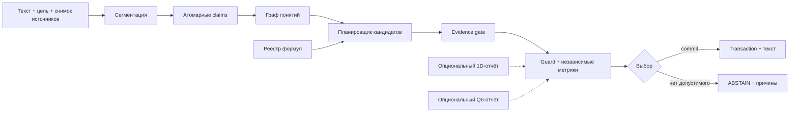

# 31 - Программа развития самостоятельного семантического кольца P78

Статус: интеграционное архитектурное решение и исполнимый план  
Дата: 2026-07-20

Связанные документы:

- [27 - автономное 2D-кольцо](27-p78-autonomous-2d-development.md);
- [28 - матрёшка формул и лингвистическая математика](28-formula-nesting-and-linguistic-mathematics.md);
- [29 - энциклопедическое семантическое кольцо](29-encyclopedic-semantic-ring-spec.md);
- [30 - научное слияние и расщепление текстов](30-scientific-synthesis-fission-fusion-spec.md);
- [26 - протокол трёх соседних миров](26-three-neighbor-worlds-protocol.md);
- [19 - математика разумного круговорота](19-mathematics-of-reasonable-circulation.md).

## 1. Короткое решение

**P78 должен оставаться самостоятельно работающим 2D-инструментом.** P79/1D и P80/Q6 не являются обязательными источниками смысла. Их допустимая роль - внешние проверяющие приборы:

- 1D сообщает о порядке, кодировании, разбиении и обратимости последовательности;
- Q6 сообщает о шести явно определённых булевых условиях, контрфактическом переходе и тупике;
- только P78 строит смысловые кандидаты, выбирает продолжение, создаёт transaction и меняет текст.

Это решение отделяет три разных утверждения:

| Уровень | Состояние сейчас | Что требуется |
|---|---|---|
| техническая автономность | **есть**: P78 открывается и выполняет действия без соседних вкладок | сохранить |
| семантическая автономность | **частичная**: есть guard, rollback, траектория и шаблонное продолжение | добавить типизированные утверждения, кандидатов и проверку смысла |
| исследовательская пригодность | **пока нет**: эвристические оценки не доказывают истинность и качество текста | provenance, корпус, разметка, метрики и воспроизводимые эксперименты |

Q6 не устраняет второй и третий пробелы. Он может проверить уже сформулированные условия, но не знает, что означает предложение. Поэтому подключение центра до усиления собственного семантического ядра P78 только создаст более сложную визуализацию прежней эвристики.

## 2. Что сейчас отсутствует больше всего

Главный дефицит P78 - не новая анимация и не ещё одна общая формула. Нужен **проверяемый промежуточный объект между исходным текстом и новым предложением**:

```text
источник
  -> фрагменты
  -> атомарные утверждения
  -> понятия и отношения
  -> допустимые операции
  -> несколько кандидатов
  -> проверка опоры на источник
  -> выбор / откат / воздержание
  -> текст + объяснимый отчёт
```

Сейчас `composeContinuation()` в основном выбирает слова и готовые конструкции по правилам. Это полезный детерминированный MVP, но сходство слов, регулярное выражение или положение частицы не являются доказательством:

- истинности нового факта;
- логического следования;
- корректности обобщения;
- полноты обзора;
- отсутствия противоречия источникам.

Первый принципиальный этап поэтому должен быть **не генерацией свободного текста, а автономным кольцом типизированных формул и утверждений**. Лингвистическая генерация подключается после того, как переходы можно сохранить, повторить и проверить без красивой фразы.

## 3. Определение самостоятельного 2D-кольца

Минимальное семантическое состояние:

```text
X_t = (sourceRevision, goal, claims, conceptGraph, theta, rho, history)
```

где:

- `rho in [0, 1]` - уровень детализации: `0` означает чрезмерное сжатие, `1` - чрезмерное дробление;
- `theta in [0, 2*pi)` - фаза смысловой операции, а не «качество текста»;
- `claims` - атомарные утверждения с областью действия и статусом опоры;
- `conceptGraph` - понятия и типы отношений;
- `history` - обратимые операции и их доказательства.

Живое 2D-состояние - не одна точка `rho=0.5`, а безопасное кольцо:

```text
R_live = { X : rho_min <= rho(X) <= rho_max
                 and hardInvariants(X) = true }
```

Угол задаёт семейство действия:

```text
theta_0  -> уточнить
theta_1  -> обобщить
theta_2  -> связать причиной
theta_3  -> связать следствием
theta_4  -> сравнить
theta_5  -> противопоставить
theta_6  -> привести пример
theta_7  -> добавить оговорку
theta_8  -> проверить источник
theta_9  -> синтезировать вывод
```

Список расширяем, но каждая операция обязана иметь входные и выходные типы. Само вращение не считается смысловым прогрессом: прогресс существует только при изменении проверяемого состояния.

### 3.1. Критерий семантической автономности

P78 самодостаточен, если при отключённых соседях он умеет:

1. принять текст, цель и фиксированный снимок источников;
2. построить атомарные утверждения и граф понятий;
3. породить не менее двух различимых допустимых переходов либо объяснить, почему это невозможно;
4. проверить типы, область действия, опору на источник и противоречия;
5. выбрать кандидата детерминированным профилем или вернуть `ABSTAIN`;
6. записать точную transaction с `before`, `after`, причиной и provenance;
7. выполнить replay и точный rollback без P79 и P80.

Отсутствие кандидата является нормальным проверяемым результатом. Вымышленное продолжение ради непрерывной анимации нарушает цель проекта сильнее, чем честная остановка конкретного шага.

## 4. Портфель независимых ветвей

| Ветка | Самостоятельный результат | Зависит от | Не зависит от |
|---|---|---|---|
| A. структурное 2D | кольцо типизированных переходов и rollback | текущее ядро P78 | 1D, Q6, LLM, интернет |
| B. матрёшка формул | реестр формул, AST, вывод и объяснимый trace | A | тезаурус, внешний корпус |
| C. лингвистическая математика | SKOS-подобный граф понятий и разрешённые смысловые операции | A, частично B | Q6 |
| D. энциклопедическое кольцо | абзац из проверенных атомарных фактов с локальными ссылками | A, C, evidence layer | 1D, Q6 |
| E. научный синтез | слияние, разделение и сопоставление текстов с типами цитирования | A, evidence layer | P79/P80 |
| F. 1D-аудитор | порядок, сегментация, кодек, ритм, обратимость | exchange contract | право менять текст |
| G. Q6-аудитор | шесть предикатов, контрфактический путь, тупик | измерения P78 | право создавать факт |
| H. федерация | P78 принимает или отклоняет отчёты F/G по политике | A и стабильные контракты | прямой маршрут 1D <-> 3D |

Ветки D и E родственны, но не тождественны. Энциклопедия описывает установленное знание нейтральным обзором. Научная работа различает данные, метод, результат, интерпретацию, возражение и новую гипотезу.

## 5. Четыре конфигурации продукта

### 5.1. Только 2D - рекомендуемый первый продукт

```text
P78 = parser + claim graph + operators + evidence gate + selector + ledger
```

Преимущества:

- минимальная причинная схема;
- каждую ошибку можно отнести к конкретному модулю;
- работает офлайн на фиксированном пакете текстов;
- формирует честную базовую линию для последующего сравнения.

Ограничение: порядок символов и шестимерная диагностика не показаны отдельными интерфейсами, но семантической потери от этого нет.

### 5.2. 2D + 1D

1D подключается, когда важно доказать:

- что сегменты не потеряны и не переставлены;
- что цитата соответствует исходному диапазону;
- что разбиение предложения на утверждения обратимо;
- что ритм или длина частей измерены, а не угаданы.

1D не определяет важность факта и не решает, какие части следует объединить.

### 5.3. 2D + Q6

Q6 подключается после появления измеримых предикатов. Например:

```text
[sourceCovered, goalCovered, relationSupported,
 noveltyPreserved, guardSafe, reversible]
```

Q6 полезен для вопроса «какое одно условие нужно изменить, чтобы кандидат стал допустимым?». Он не отвечает на вопрос «какая следующая фраза истинна?».

### 5.4. 2D + 1D + Q6

Полная конфигурация оправдана только для отладки и исследования. Каждый сосед получает один immutable snapshot, возвращает типизированный отчёт, а P78 применяет версионированную политику решения. Наличие двух отчётов не даёт автоматического commit.

## 6. Целевая модульная архитектура

HTML P78 должен оставаться оболочкой. Новые вычисления следует размещать в небольших чистых модулях:

| Модуль | Ответственность |
|---|---|
| `p78-claim-model.js` | `Claim`, область действия, модальность, время, отрицание |
| `p78-evidence-model.js` | источник, диапазон, идентификатор, версия и отношение к claim |
| `p78-formula-registry.js` | символы, сигнатуры, единицы, предпосылки, ссылки |
| `p78-formula-engine.js` | типизированные подстановки и trace вывода |
| `p78-thesaurus-graph.js` | broader/narrower/related и доменные отношения |
| `p78-candidate-planner.js` | множество допустимых смысловых операций |
| `p78-evidence-gate.js` | `SUPPORTED/REFUTED/NOT_ENOUGH_INFO/CONFLICT` |
| `p78-semantic-evaluator.js` | независимые метрики и калибровка |
| `p78-neighbor-policy.js` | влияние отчётов 1D/Q6 без передачи commit |
| `p78-scientific-synthesis.js` | merge/split/compare с сохранением цитат |

Зависимости направлены к чистым моделям. Ни один из этих модулей не должен читать DOM, рисовать Canvas или самостоятельно обращаться к сети.



## 7. Контракты данных

### 7.1. Атомарное утверждение

```ts
type Claim = {
  id: string;
  subject: ConceptRef;
  predicate: RelationRef;
  object: ConceptRef | ScalarValue;
  qualifiers: {
    time?: Interval;
    place?: ConceptRef;
    population?: ConceptRef;
    method?: MethodRef;
    modality: "asserted" | "reported" | "hypothesis" | "question";
    polarity: "positive" | "negative";
  };
  evidenceIds: string[];
  status: "SUPPORTED" | "REFUTED" | "NOT_ENOUGH_INFO" | "CONFLICT";
};
```

### 7.2. Свидетельство

```ts
type EvidenceSpan = {
  id: string;
  sourceId: string;
  sourceVersion: string;
  locator: { start: number; end: number; page?: number; section?: string };
  quoteHash: string;
  relation: "supports" | "refutes" | "qualifies" | "usesMethod" | "extends";
  retrievedAt: string;
};
```

`quoteHash` проверяет неизменность диапазона, но не доказывает достоверность публикации. Надёжность источника и соответствие утверждению являются отдельными измерениями.

### 7.3. Кандидат перехода

```ts
type Candidate = {
  id: string;
  operator: string;
  inputs: string[];
  outputs: Claim[];
  formulaTrace: TraceStep[];
  evidenceIds: string[];
  predictedState: { theta: number; rho: number };
  hardChecks: Record<string, boolean | "UNKNOWN">;
  metrics: Record<string, number>;
};
```

## 8. Выбор без подмены истины одной цифрой

Нельзя разрешать слабую опору на источник высокой «красивостью» текста. Поэтому сначала выполняются жёсткие условия:

```text
hard(c) = typed(c)
       AND sourceRevisionMatches(c)
       AND evidencePolicyAllows(c)
       AND noUnresolvedContradiction(c)
       AND reversible(c)
       AND rho_min <= rho(c) <= rho_max
```

Только допустимые кандидаты ранжируются. Для мягких метрик можно использовать взвешенное геометрическое среднее:

```text
rank(c) = exp(sum_i w_i * ln(max(epsilon, metric_i(c)))) - penalties(c)
```

Оно чувствительно к провалу одной оси, но всё равно не является доказательством истины. `hard(c)=false` всегда даёт отказ независимо от `rank(c)`.

Разумный набор независимых метрик:

- соответствие цели;
- покрытие исходных утверждений;
- новизна без повторения;
- связность перехода;
- сохранение оговорок и области действия;
- разнообразие источников;
- читаемость;
- величина смыслового изменения.

Профили весов версионируются. Нельзя менять их скрытно между replay одного эксперимента.

## 9. Главный алгоритм

```text
function continue2D(snapshot, goal, profile):
    assert immutable(snapshot)
    claims      = claimParser.parse(snapshot.text)
    concepts    = thesaurus.buildGraph(claims)
    formulaOps  = formulaEngine.applicable(claims, concepts, goal)
    languageOps = planner.applicable(claims, concepts, goal)
    candidates  = deduplicate(formulaOps + languageOps)

    reports = []
    for candidate in candidates:
        typed       = typeChecker.check(candidate)
        evidence    = evidenceGate.verify(candidate, snapshot.sources)
        contradiction = conflictChecker.check(candidate, claims)
        predicted   = ringModel.project(candidate)
        hardChecks  = guard.evaluate(typed, evidence, contradiction, predicted)
        metrics     = evaluator.measure(candidate, goal, claims)
        reports.push(explain(candidate, hardChecks, metrics))

    admissible = filter(reports, report => report.hardChecks.allTrue)
    if admissible is empty:
        return ABSTAIN(reports.failureReasons)

    winner = deterministicArgMax(admissible, profile, stableTieBreak)
    tx = transaction.create(snapshot, winner)
    assert replay(tx).after == tx.after
    assert rollback(tx).state == snapshot
    return READY(tx, winner.explanation)
```

Опциональные отчёты P79/P80 добавляются после локальной проверки кандидата и до окончательного выбора. Тайм-аут или `ABSTAIN` соседа не ломает автономный профиль.

## 10. Порядок реализации

### Этап 0. Зафиксировать границы

Результат:

- документы 27-31;
- словарь терминов `claim/evidence/operator/transaction/abstain`;
- тест документационных инвариантов;
- запрет на использование слов «истина», «доказано» для эвристического score.

Критерий: все ветви используют одинаковые определения и не дают соседям право commit.

### Этап 1. Формульное автономное кольцо

Результат:

- реестр из 10-20 типизированных формул;
- AST вместо строковой подстановки;
- детерминированный поиск применимых формул;
- trace каждого шага;
- визуальная цепочка «формула -> подстановка -> результат -> следующая формула»;
- property-тесты типов, replay и rollback.

Критерий: одна и та же входная структура и версия реестра дают одинаковый trace; неверные единицы или типы дают `ABSTAIN`, а не число.

### Этап 2. Закрытый тезаурус

Результат:

- 100-500 понятий одной предметной области;
- явные `broader`, `narrower`, `related`, причинные и временные связи;
- операции обобщения и детализации с сохранением пути;
- набор размеченных пар «допустимо/недопустимо».

Критерий: ни одна ассоциативная связь `related` не превращается автоматически в иерархию или причинность.

### Этап 3. Энциклопедический режим

Результат:

- атомизация утверждений;
- локальный индекс фиксированного корпуса;
- evidence span для каждого внешнего факта;
- `SUPPORTED/REFUTED/NOT_ENOUGH_INFO/CONFLICT`;
- генерация абзаца только после claim-level проверки;
- режим «показать, откуда взялось каждое утверждение».

Критерий: 100% внешних атомарных фактов имеют проверяемый диапазон источника; отсутствие опоры вызывает `ABSTAIN` или маркированную гипотезу, но не скрытое дополнение.

### Этап 4. Научное слияние и расщепление

Результат:

- отдельный pipeline обзора литературы;
- типы связи цитат `supports/refutes/extends/usesMethod/qualifies`;
- merge только при совместимых областях действия;
- split с наследованием ссылок на точные диапазоны;
- таблица противоречий и исследовательских пробелов;
- экспорт черновика, карты утверждений и списка источников.

Критерий: система не создаёт библиографические записи из памяти; новая комбинация утверждений явно помечена как синтез или гипотеза.

### Этап 5. Измеримое влияние соседей

Результат:

- политика `neighbor-policy/1`;
- эксперимент `2D` против `2D+1D`, `2D+Q6`, `2D+1D+Q6`;
- заранее определённые метрики и одинаковый корпус;
- отчёт о пользе, цене и ошибках каждого соседа.

Критерий: сосед включается в основной профиль только при измеримом улучшении хотя бы одной целевой метрики без ухудшения жёстких инвариантов.

### Этап 6. Внешний retrieval или языковая модель

Подключается последним как заменяемый поставщик кандидатов. Retrieval/LLM не получает прямой доступ к commit. Выход проходит те же Claim, Evidence, Guard и Transaction, что и локальные правила.

## 11. Научная ветка: слияние и расщепление

Эта ветка должна быть независимым инструментом, а не режимом «написать диплом одной кнопкой».

### 11.1. Допустимые операции

```text
SPLIT(statement)       -> atomic claims
MERGE(a, b)            -> one claim only if scope and evidence are compatible
COMPARE(a, b)          -> shared dimensions + differences
CONTRAST(a, b)         -> explicit incompatibility
GENERALIZE(set)        -> bounded statement + listed exceptions
SPECIALIZE(claim, q)   -> claim with added qualifier
TRACE(claim)           -> all source spans and transformations
SYNTHESIZE(set)        -> labeled interpretation, never disguised source fact
```

### 11.2. Условия безопасного merge

Два утверждения нельзя просто соединить из-за похожих слов. Проверяются:

- одинаковый объект или явное отношение объектов;
- совместимые время, место, популяция и метод;
- одинаковая модальность;
- отсутствие отрицания или количественного конфликта;
- сохранение всех существенных оговорок;
- независимая ссылка на каждую часть результата.

Если хотя бы одно условие неизвестно, результатом становится `COMPARE` или пара параллельных ветвей, а не единое утверждение.

### 11.3. Условия безопасного split

После разделения каждый атом должен:

- быть понятен без скрытого местоимения;
- иметь собственную проверяемую форму;
- наследовать только относящиеся к нему evidence spans;
- сохранять отрицание, модальность и ограничения;
- ссылаться на родительское утверждение и операцию разделения.

### 11.4. Новое сочетание

Новая комбинация допустима в трёх разных статусах:

| Статус | Значение | Можно включать как установленный факт |
|---|---|---|
| `DERIVED` | следует по зарегистрированному правилу из поддержанных premises | после проверки правила и области |
| `SYNTHESIS` | авторская интерпретация нескольких источников | только с явной маркировкой |
| `HYPOTHESIS` | проверяемое предположение | нет |

Это разграничение особенно важно для диссертации: новизна работы не должна возникать из незаметной потери цитаты или оговорки.

## 12. Проверенные исторические и современные опоры

Эти источники не «доказывают P78», а дают подходящие инженерные формы:

- **Комбинаторные круги Раймунда Луллия** - исторический образ систематического перебора сочетаний. Для P78 полезен как генератор кандидатов, но современный type checker должен отбрасывать бессмысленные комбинации: [The Art of Reasoning in Medieval Manuscripts](https://art-of-reasoning.huygens.knaw.nl/ramon.html).
- **Средневековая disputed question** - структура «возражения -> позиция -> решение -> ответы» полезна для кольца противоречий и не сводит спор к усреднению: [Stanford Encyclopedia of Philosophy](https://plato.stanford.edu/entries/medieval-literary/).
- **OpenMath Content Dictionaries** - образец явных имён, описаний и формальных свойств математических символов: [OpenMath Standard](https://openmath.org/standard/) и [Content Dictionaries](https://openmath.org/cd/).
- **Rewriting logic / Maude** - основа для переходов над типизированными термами и воспроизводимого trace: [Maude Manual](https://maude.cs.illinois.edu/manual.pdf).
- **SKOS** различает иерархические `broader/narrower` и ассоциативное `related`; это полезная защита от ложного вывода «связано, значит является видом»: [W3C SKOS Reference](https://www.w3.org/TR/skos-reference/).
- **PROV-O** задаёт модель `Entity/Activity/Agent` и отношения происхождения: [W3C PROV-O](https://www.w3.org/TR/prov-o/).
- **SHACL** позволяет проверять ограничения графа и получать validation report: [W3C SHACL](https://www.w3.org/TR/shacl/).
- **RAG** отделяет параметрическую генерацию от извлечённых документов, но retrieval сам по себе не гарантирует, что предложение поддержано источником: [Lewis et al., 2020](https://arxiv.org/abs/2005.11401).
- **FEVER** формализует проверку claim как `SUPPORTED/REFUTED/NOT ENOUGH INFO` и хранит evidence для поддержанных/опровергнутых утверждений: [Thorne et al., 2018](https://aclanthology.org/N18-1074/).
- **FActScore** предлагает разложение длинного текста на атомарные факты и измерение доли фактов, поддержанных надёжным источником: [Min et al., 2023](https://arxiv.org/abs/2305.14251).
- **CiTO** различает намерение цитирования, например `extends`, `usesMethodIn`, `supports`: [Citation Typing Ontology](https://www.sparontologies.net/ontologies/cito).
- **DataCite Metadata Schema** задаёт воспроизводимые идентификаторы и метаданные ресурсов для цитирования и поиска: [DataCite Schema](https://schema.datacite.org/).

## 13. Экспериментальные идеи

Ниже не готовые научные методы, а кандидаты для прототипов. Каждый требует отдельной гипотезы и сравнения с базовой линией.

1. **Текст с доказательством перехода**: каждый абзац экспортируется вместе с компактным graph/trace, который объясняет происхождение утверждений.
2. **Обратимая алгебра абзаца**: `merge` и `split` являются парными операциями там, где не произошло потери оговорок.
3. **Контрфактическое теневое кольцо**: рядом с выбранным кандидатом проходит лучший отклонённый кандидат; различие показывает решающий инвариант.
4. **Два независимых судьи**: структурный проверяет типы и provenance, семантический - отношение к источнику; согласие по одной скалярной оценке не требуется.
5. **Закон сохранения оговорок**: время, популяция, модальность и отрицание нельзя удалить без явной операции и причины.
6. **Карта исследовательских пустот**: кольцо визуализирует не только найденные связи, но и пары понятий, для которых нет достаточного свидетельства.
7. **Адвокат возражения**: для каждого синтеза система обязана построить наиболее сильное поддержанное ограничение или вернуть `NO_COUNTEREVIDENCE_FOUND`, не выдавая это за отсутствие возражений вообще.

## 14. Что нельзя делать

1. Использовать Q6 как оракул истины или генератор следующего предложения.
2. Использовать binary/Morse как меру смысла, важности или научной новизны.
3. Считать близость embeddings доказательством связи, причинности или истинности.
4. Складывать factuality, красоту, новизну и длину в один score до жёсткой проверки источников.
5. Генерировать DOI, автора, название публикации или страницу по памяти.
6. Склеивать конфликтующие результаты в «среднее» утверждение.
7. Терять область действия при обобщении.
8. Называть движением изменение координат частицы без изменения семантического состояния.
9. Подменять `NOT_ENOUGH_INFO` значением `false`.
10. Выпускать научный текст без карты `claim -> evidence span -> source version`.

## 15. Первый исполнимый спринт

Рекомендуемый следующий кодовый этап - **формульное автономное кольцо**, а не одновременная реализация всех ветвей.

Состав спринта:

1. определить JSON-схему `FormulaDef/1` и 10-20 формул одного домена;
2. реализовать AST, type checker и детерминированную подстановку;
3. реализовать `APPLICABLE/TYPE_ERROR/MISSING_PRECONDITION/ABSTAIN`;
4. сохранять полный trace и хеш версии реестра;
5. вывести в P78 формулу, подстановку, результат и следующий допустимый ход;
6. связать ход с существующей transaction, replay и rollback;
7. добавить property-тесты и небольшой золотой корпус;
8. измерить непрерывность не частотой кадров, а числом допустимых неповторяющихся переходов до `ABSTAIN`.

После этого тот же механизм можно использовать для тезауруса: математический символ заменяется понятием, а формальное правило - разрешённой смысловой операцией. Так «лингвистическая математика» вырастает из проверяемого механизма, а не из метафоры.

## 16. Критерий достижения цели P78

Цель достигнута не тогда, когда кольцо вращается бесконечно, а когда на фиксированном корпусе система воспроизводимо показывает три вида результата:

```text
CONTINUE  - существует поддержанный, новый и обратимый смысловой шаг;
REPAIR    - шаг возможен после явно указанного уточнения;
ABSTAIN   - допустимого шага при данных источниках и правилах нет.
```

«Продолжение движения» означает сохранение возможности следующего осмысленного перехода. Полный коллапс и полный распад являются крайностями, но честный локальный `ABSTAIN` является защитой живого кольца, а не его поражением.
