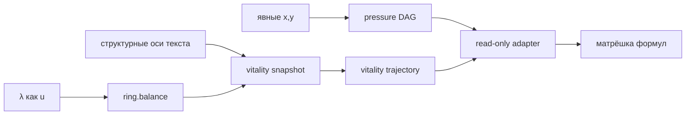

# 32 - Реализация формульного кольца P78

**Статус:** рабочий вертикальный срез F1  
**Дата фиксации:** 2026-07-20  
**Связанные спецификации:** [28](28-formula-nesting-and-linguistic-mathematics.md), [31](31-p78-semantic-program-roadmap.md), [33](33-ast-grep-semantic-ring-adaptation.md)

---

## 1. Что реализовано

P78 получил автономное формульное ядро, которое не зависит от P79/1D или P80/3D и не изменяет пользовательский текст.

| Слой | Файл | Ответственность |
|---|---|---|
| canonical data | `prototype/lib/p78-canonical-json.js` | строгий canonical JSON, UTF-8 SHA-256, отказ от циклов, class instances и нечисловых значений |
| registry | `prototype/lib/p78-formula-registry.js` | immutable `FormulaRecord`, SemVer, pinned dependency hashes, проверка DAG |
| engine | `prototype/lib/p78-formula-engine.js` | закрытый AST без `eval`, типы, размерности, бюджеты, replay, trace, `ABSTAIN` |
| adapter | `prototype/lib/p78-formula-adapter.js` | соединение давления, `M(λ)` и структурных осей текста в один пассивный UI-пакет |
| view | `prototype/lib/p78-formula-view.js` | наблюдаемая трасса без команд изменения текста |
| style | `prototype/p78-formula-view.css` | отдельная адаптивная геометрия панели |

Главный HTML содержит только DOM-слоты и versioned script/style references. Формулы и представление вынесены наружу.

---

## 2. Явные входы

```text
x, y              : UnitInterval / RingCoordinate
u = λ              : RingCoordinate
growth             : Growth
novelty            : Novelty
openness           : Openness
previousVitality   : PolicyScore
```

`x` и `y` вводятся отдельными ползунками. Они не выводятся из расстояния точек, похожести слов или положения Canvas.

`growth`, `novelty`, `openness` и `previousVitality` берутся из текущего `semanticPhi` только как структурные эвристики. Результат поэтому маркируется:

```json
{
  "evidenceLevel": "STRUCTURAL",
  "soundness": "NOT_COMPUTED",
  "semanticTruth": false
}
```

Ни один UI score не объявляется научно доказанной мерой смысла.

---

## 3. Реестр формул

| ID | Выражение | Роль |
|---|---|---|
| `ring.balance` | `M(u)=4u(1-u)` | нули на полюсах, максимум в середине |
| `pressure.closure` | `C=xy` | давление обобщения |
| `pressure.edge` | `E=(1-x)(1-y)` | давление детализации |
| `pressure.orbit-forward` | `O_f=x(1-y)` | прямая 2D-орбита |
| `pressure.orbit-reverse` | `O_r=(1-x)y` | обратная 2D-орбита |
| `pressure.orbit-total` | `O=O_f+O_r` | полное движение в кольце |
| `pressure.partition` | `C+E+O_f+O_r` | инвариант полного разбиения |
| `pressure.direction` | `O_f-O_r=x-y` | знак направления |
| `pressure.margin` | `O-max(C,E)` | запас 2D над сильнейшей крайностью |
| `vitality.snapshot-geomean` | `sqrt(growth*novelty*openness*balance)` | текущая структурная эвристика |
| `vitality.trajectory` | `(snapshot+previousVitality)/2` | детерминированное продолжение снимка |

Каждая запись имеет собственный `contentHash`; registry имеет отдельный SHA-256. Зависимость закрепляет `formulaId`, `version` и `contentHash`.

---

## 4. Исполнение



Порядок pressure trace детерминирован:

```text
closure -> edge -> orbit-forward -> orbit-reverse
        -> partition -> orbit-total -> direction -> margin
        -> ring.balance -> snapshot -> trajectory
```

Контрольный вход:

```text
x=0.85, y=0.20, u=0.50
C=0.17, E=0.12, O_f=0.68, O_r=0.03
partition=1.00, O=0.71, direction=0.65, margin=0.54, M=1.00
```

---

## 5. Статусы отказа

| Статус | Значение |
|---|---|
| `READY` | типы, область, hash, DAG и бюджет прошли проверку |
| `PARTIAL` | обязательный вход отсутствует |
| `ABSTAIN` | значение неизвестно или типизировано несовместимо; число не выдумывается |
| `INVALID` | нарушена схема, область, hash или постусловие |
| `BLOCKED` | превышен operation budget или исполнение запрещено контрактом |

Интервалы не чинятся скрытым `clamp`. Например, `x=1.5` возвращает `DOMAIN_VIOLATION` и не создаёт числовой результат.

---

## 6. Граница действий

Формульная панель относится к `data-surface="analysis"` и не содержит кнопок commit/apply. Она:

1. читает состояние;
2. исполняет чистые формулы;
3. показывает current/next, значения и hash;
4. не вызывает `actionController`;
5. не меняет текст, ledger, transaction или Canvas state.

Это сохраняет единственного владельца мутаций: существующий P78 action controller.

---

## 7. Проверки

```text
semantic-p78-formula-engine-regression.cjs  19/19
semantic-p78-formula-view-regression.cjs     8/8
semantic-p78-shell-regression.cjs           12/12
semantic-p78-primary-flow-regression.cjs    10/10
```

Проверяются независимые SHA-256, повреждение registry, неизвестная AST operation, типы и размерности, cycle rejection, operation budget, replay, углы квадрата `[0,1]^2`, отсутствие `eval`, сети, часов и случайности.

---

## 8. Что ещё не решено

1. Формульная корректность не доказывает лингвистическую истинность.
2. `semanticPhi` остаётся эвристическим структурным измерителем.
3. Нет Claim AST, InterpretationMap и evidence gate для внешних источников.
4. Нет корпусного holdout и калибровки порогов.
5. Planner выбирает следующую формулу, но пока не строит новый проверяемый текст.

Следующая ветвь описана в [33](33-ast-grep-semantic-ring-adaptation.md): широкий lexical/span retrieval должен давать кандидатов, Formula/Claim AST должен проверять структуру, а provenance gate должен отделять найденное от подтверждённого.

---

## 9. Первый исполнимый шаг: формульная часть реализована

Вместо генератора статьи реализован первый двунаправленный индекс:

```text
grep-like candidate retrieval
  -> Formula AST / Claim AST structural match
  -> evidence gate
  -> AST-to-query counter-search
  -> ACCEPT | REPAIR | ABSTAIN
```

Работающие span index, FormulaShape matcher, exact AST-to-query projector, trace и UI зафиксированы в [документе 34](34-p78-bidirectional-index-implementation.md). Evidence gate пока честно возвращает `ABSTAIN`: Claim AST и claim-level alignment ещё отсутствуют.

Следующий шаг: Controlled Russian Claim AST из этапа AG3 документа 33.

Научный `split/merge` и энциклопедический синтез подключаются только после claim links, polarity/modality/qualifier gates и сохранённого provenance.
