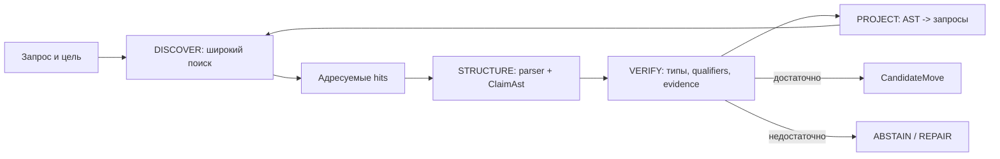
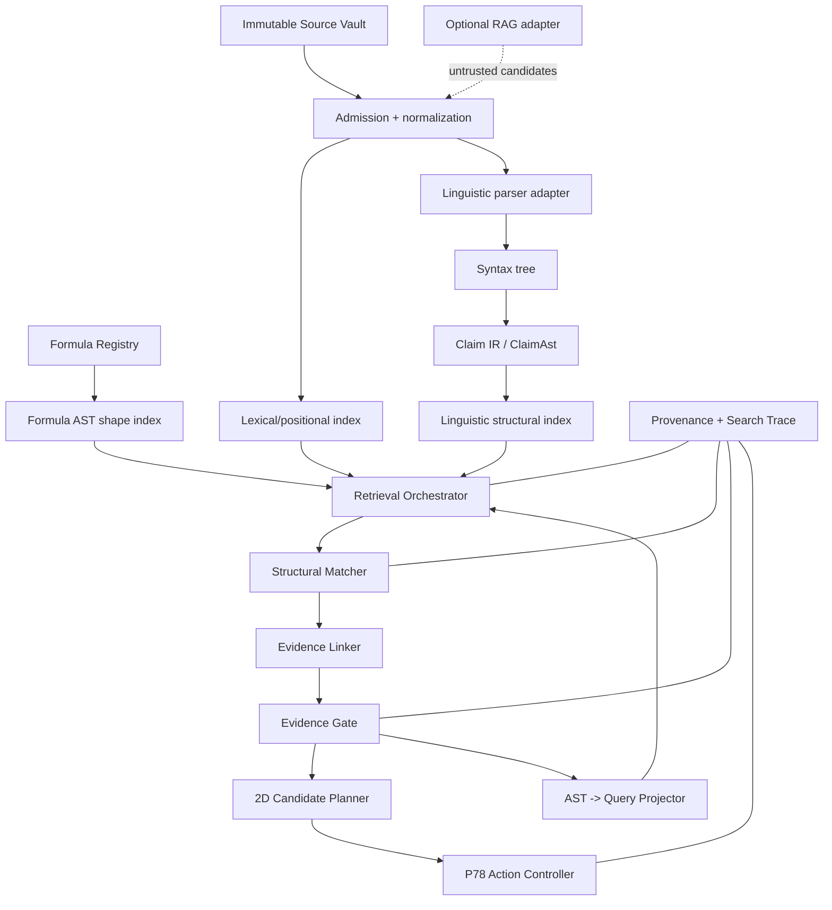

# 33 - Адаптация grep-ast / ast-grep к автономному семантическому кольцу P78

Статус: критический аудит, целевая архитектура и исполнимый план  
Дата: 2026-07-20

Связанные документы:

- [28 - матрёшка формул и лингвистическая математика](28-formula-nesting-and-linguistic-mathematics.md);
- [29 - самостоятельное 2D-кольцо энциклопедической семантики](29-encyclopedic-semantic-ring-spec.md);
- [30 - научное слияние и разделение текстов](30-scientific-synthesis-fission-fusion-spec.md);
- [31 - программа развития самостоятельного семантического кольца](31-p78-semantic-program-roadmap.md).

Исследованные внешние материалы:

- [разбор статьи в `svend4/meta10`](https://github.com/svend4/meta10/blob/claude/review-habr-ecom-article-MjaMf/review-habr-ecom-article.md), проверенная версия blob `9aa3ddab995c30b8bad85283d9745ecb23b0a6b5`;
- [исходный код `grep-ast` / `TreeContext`](https://github.com/Aider-AI/grep-ast/blob/9a2c49b00852d012dc97850a3c0b3248f15bd043/grep_ast/grep_ast.py), проверенный commit `9a2c49b00852d012dc97850a3c0b3248f15bd043`;
- [официальный репозиторий `ast-grep`](https://github.com/ast-grep/ast-grep);
- [официальный справочник правил `ast-grep`](https://ast-grep.github.io/reference/rule.html);
- [официальный контракт JSON-вывода `ast-grep`](https://ast-grep.github.io/guide/tools/json.html).

---

## 0. Решение в одном абзаце

Из пары `grep-ast` / `ast-grep` для P78 следует заимствовать не конкретные библиотеки как готовую семантику русского текста, а **разделение ответственности**. Широкий, дешёвый и объяснимый поиск должен находить кандидатов с высоким recall; структурный слой должен проверять форму кандидата по Formula AST или Linguistic/Claim IR; обратный проектор должен превращать уже построенную структуру в новые точные, расширенные и контрпримерные поисковые запросы; provenance должен связывать каждый переход с неизменяемым диапазоном источника; RAG может поставлять только кандидатов и никогда не получает право объявлять найденную строку доказательством смысла. Это создаёт настоящее двунаправленное 2D-кольцо:

```text
DISCOVER (grep-подобный поиск)
  -> STRUCTURE (Formula AST / Linguistic IR)
  -> VERIFY (claim + evidence gate)
  -> PROJECT (AST -> новые запросы)
  -> DISCOVER ...
```

Кольцо остаётся автономным без 1D, Q6, внешнего RAG и языковой модели. При недостатке опоры оно возвращает `ABSTAIN`, а не продолжает движение вымышленным фактом.

---

## 1. Что именно является источником и что в нём доказано

### 1.1. Связанный файл не является научным первоисточником

Связанный `review-habr-ecom-article.md` является вторичным техническим разбором публикации Habr. Он полезен как аудит инженерной идеи и исходного кода, но сам по себе не является:

- рецензируемой научной статьёй;
- benchmark-отчётом с опубликованным корпусом;
- официальной документацией `grep-ast` или `ast-grep`;
- доказательством превосходства одного retrieval-пайплайна над другим.

Поэтому утверждения обзора разделены ниже на три класса:

| Класс | Что означает |
|---|---|
| `VERIFIED_IMPLEMENTATION` | свойство непосредственно подтверждено исходным кодом или официальным контрактом инструмента |
| `ENGINEERING_INFERENCE` | разумный архитектурный вывод, который ещё надо проверить в P78 |
| `HEURISTIC_OR_UNMEASURED` | правдоподобная гипотеза без достаточного benchmark или формального основания |

### 1.2. Что подтверждено технически

1. В проверенной версии `grep-ast` метод `TreeContext.grep()` выполняет обычный `re.search()` по строкам.
2. AST в `grep-ast` используется для построения областей, заголовков и контекста вокруг найденной строки.
3. Следовательно, `grep-ast` сам по себе не отличает совпадение в исполняемом коде от совпадения в комментарии или строковом литерале.
4. `ast-grep` выполняет поиск по tree-sitter-структуре, поддерживает структурные паттерны, metavariables и relational rules (`inside`, `has`, `precedes`, `follows`).
5. JSON-вывод `ast-grep` содержит файл, диапазон, текст совпадения и захваченные metavariables, поэтому его можно использовать как машинный контракт, а не просить LLM заново извлекать поля из текста.
6. Оба инструмента анализируют синтаксическую структуру программных языков. Ни один из них не является готовым анализатором значения русского предложения.

### 1.3. Что в обзоре сформулировано слишком сильно

| Утверждение | Аудит |
|---|---|
| `grep-ast` устраняет false positives | Неверно как общее утверждение. Он добавляет AST-контекст к текстовому hit, но не фильтрует hit по типу узла |
| широкий regex не теряет false negatives | Не гарантируется. Неизвестный синоним, динамическая конструкция или иной способ выражения могут не попасть в кандидаты |
| `ast-grep` даёт семантическую точность | Слишком сильно. Он даёт структурную точность относительно грамматики и правила, но не понимает доменную истинность |
| двухстадийная схема быстрее | Возможно, но для конкретного корпуса нужен benchmark. Приведённые числа являются иллюстрацией, а не измерением |
| RAG является непрозрачным по определению | Преувеличение. Frozen-модель, версия индекса, top-k и retrieval trace могут быть воспроизводимы; однако причины embedding-близости менее интерпретируемы, чем точный pattern hit |
| уменьшение контекста снижает галлюцинации | Правдоподобная гипотеза, но её нужно проверять ablation-тестом |
| все стадии детерминированы | Верно только для зафиксированных source hash, parser version, pattern version, configuration и numeric policy. Последующая свободная LLM-генерация детерминированной не становится |
| пустой AST-поиск следует компенсировать RAG | Полезная политика-кандидат, но пустой результат может означать ошибочный запрос, отсутствие факта или неподдерживаемый язык; fallback обязан сохранить эти варианты различимыми |

### 1.4. Научно корректная формулировка идеи

Двухстадийный поиск является **каскадом обнаружения и фильтрации**:

```text
CandidateRecallStage -> StructuralPrecisionStage
```

Он может улучшить precision при сохранении recall только при выполнении двух условий:

```math
Recall(Stage_1) \approx 1
```

на целевом корпусе и

```math
FalseRejectRate(Stage_2)
```

остаётся приемлемым. Оба условия являются измеряемыми свойствами корпуса и правил, а не теоремой об инструментах.

---

## 2. Главный перенос в P78

### 2.1. Не переносить библиотеки буквально

`grep-ast` и `ast-grep` полезны непосредственно для исходного кода P78:

- `grep-ast` может помогать агенту читать большой репозиторий с контекстом функций и модулей;
- `ast-grep` может проверять архитектурные запреты, искать обход action controller, запрещённые DOM/network-вызовы в чистом ядре и выполнять контролируемые codemod.

Но включать Python/Rust CLI в браузерный runtime P78 ради семантики русского текста на первом этапе не следует. Это увеличит вес и сложность поставки, не создавая Linguistic AST автоматически.

Для runtime надо перенести **архитектурный паттерн**:

```text
grep-ast role -> широкий локальный поиск + адресуемый контекст
ast-grep role -> структурная проверка типизированного дерева
```

### 2.2. Два дерева, которые нельзя смешивать

P78 нужны два независимых структурных слоя:

1. `FormulaAst` из документа 28: закрытое data-only дерево вычисления.
2. `LinguisticIR/ClaimAst`: типизированное представление языкового утверждения.

Синтаксическое дерево предложения полезно, но недостаточно. Поэтому рекомендуемая цепочка выглядит так:

```text
TextSpan
  -> Tokens/Morphology
  -> DependencySyntax
  -> SenseResolution
  -> ClaimAst
  -> Proposition
```

`DependencySyntax` показывает форму предложения. `ClaimAst` хранит предикат, аргументы, отрицание, модальность, квантор и qualifiers. Только `ClaimAst` подходит для evidence gate.

### 2.3. Формульное дерево не доказывает языковой смысл

Связь между Formula AST и Claim AST разрешена только через versioned `InterpretationMapRecord`, уже заданный документом 28:

```text
FormulaTrace
  -> InterpretationMap
  -> Proposition(mode=DEFINITIONAL|MODEL|ANALOGY|METAPHOR)
```

Запрещён прямой переход:

```text
числовой balance = 0.84
  -/> предложение «текст осмыслен на 84%»
```

Число может участвовать в политике ранжирования, но не создаёт факт о смысле без отдельного определения, валидации и provenance.

---

## 3. Реальная взаимодополняемость двух направлений

В названиях внешних продуктов `grep-ast` и `ast-grep` порядок слов не обозначает направление преобразования. В обзоре предложена последовательность `grep-ast -> ast-grep`. Для P78 полезно сделать следующий шаг и реализовать **настоящие два направления**.

### 3.1. Направление A: grep -> AST

Назначение: от широкого совпадения перейти к проверяемой структуре.

```text
Query
  -> lexical/token/lemma hits
  -> immutable context spans
  -> linguistic parser
  -> ClaimAst candidates
  -> structural constraints
  -> evidence candidates
```

Сильная сторона: высокий recall и обнаружение ранее неизвестных мест источника.

Слабая сторона: строка или лемма может совпасть без совпадения смысла.

### 3.2. Направление B: AST -> grep

Назначение: из уже известной структуры вывести новые поисковые проекции.

```text
FormulaAst / ClaimAst
  -> exact signatures
  -> curated aliases
  -> role-preserving paraphrase patterns
  -> counterevidence patterns
  -> source queries
```

Примеры:

- из `CAUSES(A,B)` получить запросы на `A вызывает B`, `B обусловлено A`, а отдельно контрзапросы `A не вызывает B`, `связь A и B не подтверждена`;
- из формулы с корневым `multiply` и типом `RingBalance` искать формулы с тем же root/type signature, не объявляя их эквивалентными;
- из claim с qualifier `population=дети` искать свидетельства с тем же qualifier и отдельно материалы с несовместимой популяцией;
- из `DERIVED_FROM` построить поиск недостающей premise или активного контрпримера.

Сильная сторона: запросы становятся структурно мотивированными и трассируемыми.

Слабая сторона: синонимы, перефразы и контрзапросы являются неполными; LLM-expansion остаётся эвристикой.

### 3.3. Почему направления образуют кольцо

Первое направление превращает неструктурированное множество совпадений в небольшое множество типизированных объектов. Второе проверяет полноту и устойчивость этих объектов, снова выходя в корпус.



Цикл прекращается при одном из условий:

- достигнут goal-port;
- новые запросы не дают новых content hashes;
- найден поддержанный контрпример;
- исчерпан budget;
- остаётся неразрешимая неоднозначность;
- evidence policy требует человеческого решения.

Бесконечный поиск не является целью. Целью является воспроизводимая возможность следующего допустимого шага.

---

## 4. Связь с геометрией автономного 2D-кольца

### 4.1. Радиус не является истинностью

Сохраняется определение документа 31:

```text
rho -> степень детализации / дробления
theta -> семейство смысловой операции
```

Предлагаемое отображение retrieval-процесса:

| Движение | Семантическая операция |
|---|---|
| наружу | расширить запрос, найти варианты, разделить составной claim, открыть qualifiers |
| внутрь | канонизировать, объединить дубликаты, построить bounded generalization |
| по окружности | сравнить, проверить, найти возражение, сменить роль дискурса |
| опасный центр | все различия исчезли в чрезмерном обобщении |
| опасный край | hits раздроблены до несвязанных токенов и не собираются в claim |

`rho` не должен вычисляться из factuality. Два независимых состояния могут иметь одинаковый `rho` и разный evidence status.

### 4.2. Состояние кольца

```ts
type SemanticSearchRingState = {
  schema: "meridian.semantic-search-state/1";
  revision: string;
  sourceSetHash: string;
  goal: GoalPort;

  theta: SemanticOperation;
  rho: number;

  frontierHitIds: string[];
  structuralMatchIds: string[];
  claimIds: string[];
  evidenceCandidateIds: string[];
  acceptedEvidenceIds: string[];
  openQuestionIds: string[];

  visitedQueryHashes: string[];
  visitedStructureHashes: string[];
  budget: SearchBudget;
  traceId: string;
};
```

`rho` является визуальной проекцией состояния. Полное состояние остаётся многомерным и не сворачивается в одну оценку.

### 4.3. Семейства угловых операций

```ts
type SemanticOperation =
  | "DISCOVER_EXACT"
  | "DISCOVER_LEMMA"
  | "PARSE_STRUCTURE"
  | "RESOLVE_SENSE"
  | "SPLIT_CLAIM"
  | "MERGE_DUPLICATES"
  | "MATCH_PATTERN"
  | "SEARCH_SUPPORT"
  | "SEARCH_COUNTEREVIDENCE"
  | "COMPARE_SCOPE"
  | "PROJECT_QUERY"
  | "VERIFY_PROVENANCE"
  | "REALIZE_TEXT";
```

Переход считается движением только если изменился хотя бы один проверяемый объект:

```text
new query hash
OR new source span hash
OR new ClaimAst hash
OR changed evidence status with rationale
OR discharged proof/evidence obligation
```

Перерисовка частиц движением смысла не считается.

---

## 5. Целевая архитектура



### 5.1. Правила зависимости

1. Formula Registry не зависит от корпуса или DOM.
2. Индексы строятся только из admitted immutable snapshots.
3. Parser создаёт structure candidates, а не supported claims.
4. Structural Matcher не меняет evidence status выше `STRUCTURAL_MATCH`.
5. RAG входит через Admission, а не напрямую в planner.
6. LLM может предложить QueryProjection или ClaimAst, но не может присвоить `SUPPORTED`.
7. Только P78 action controller создаёт preview/transaction/commit/rollback.
8. UI читает отчёты и не является источником семантического решения.

### 5.2. Предлагаемые чистые модули

| Модуль | Ответственность |
|---|---|
| `p78-search-contracts.js` | схемы query, hit, match, projection, trace |
| `p78-search-pattern-registry.js` | versioned exact/lemma/structural patterns |
| `p78-local-text-index.js` | токенный, лемматический и позиционный индекс фиксированного корпуса |
| `p78-formula-shape-index.js` | сигнатуры закрытого Formula AST |
| `p78-linguistic-parser-adapter.js` | изоляция конкретного морфологического/dependency parser |
| `p78-claim-ir.js` | canonical ClaimAst и type validation |
| `p78-linguistic-structure-index.js` | predicate/role/sense/qualifier signatures |
| `p78-structural-matcher.js` | сопоставление Formula AST и ClaimAst по закрытым правилам |
| `p78-query-projector.js` | AST -> exact/curated/heuristic queries |
| `p78-bidirectional-retrieval.js` | budget, frontier, deduplication, stable scheduling |
| `p78-evidence-linker.js` | кандидат связи claim <-> source span |
| `p78-evidence-gate.js` | support/refute/qualify/mention и fail-closed policy |
| `p78-search-trace.js` | canonical trace, hashes, replay |
| `p78-semantic-search-worker.js` | выполнение тяжёлого индекса/парсинга вне animation loop |

Ни один чистый модуль не должен читать DOM, Canvas, сеть, текущее время или случайность. Сеть доступна только provider adapter, время поступает явным параметром snapshot.

---

## 6. Контракты данных

### 6.1. Версионированный запрос

```ts
type SemanticQuery = {
  schema: "meridian.semantic-query/1";
  queryId: string;
  revision: string;
  mode:
    | "EXACT"
    | "TOKEN"
    | "LEMMA"
    | "FORMULA_SHAPE"
    | "LINGUISTIC_STRUCTURE"
    | "CLAIM_PATTERN"
    | "VECTOR_OPTIONAL";
  expression: QueryAst;
  filters: {
    sourceIds?: string[];
    language?: string;
    dateCutoff?: string;
    genre?: string;
    requiredSourceStatus?: "ADMITTED";
  };
  origin:
    | { kind: "USER"; inputHash: string }
    | { kind: "FORMULA_AST"; formulaRef: FormulaRef; astPath: string }
    | { kind: "CLAIM_AST"; claimId: string; astPath: string }
    | { kind: "RULE"; ruleId: string; version: string }
    | { kind: "MODEL_PROPOSAL"; provider: string; providerVersion: string };
  expansionClass: "EXACT" | "CURATED" | "HEURISTIC";
  contentHash: string;
};
```

`HEURISTIC`-запрос не может повышать evidence status без последующей проверки.

### 6.2. Закрытый Query AST

```ts
type QueryAst =
  | { node: "Term"; value: string; normalization: "NONE" | "LOWER" | "LEMMA" }
  | { node: "Phrase"; terms: QueryAst[]; slop: number }
  | { node: "And"; items: QueryAst[] }
  | { node: "Or"; items: QueryAst[] }
  | { node: "Not"; item: QueryAst }
  | { node: "Near"; left: QueryAst; right: QueryAst; maxDistance: number }
  | { node: "Field"; field: string; value: QueryAst }
  | { node: "Structure"; patternRef: PatternRef };
```

Regex допускается только как отдельный ограниченный pattern type с budget и запретом небезопасных конструкций. Исполняемая строка, `eval` и callback в Query AST запрещены.

### 6.3. Поисковое совпадение

```ts
type SearchHit = {
  schema: "meridian.search-hit/1";
  hitId: string;
  queryRef: { queryId: string; revision: string; contentHash: string };
  indexRef: { indexId: string; version: string; contentHash: string };
  sourceId: string;
  sourceRevision: string;
  sourceHash: string;
  locator: {
    start: number;
    end: number;
    sentenceIndex?: number;
    paragraphIndex?: number;
    section?: string;
    page?: number;
  };
  matchedTextHash: string;
  contextSpanHash: string;
  matchClass: "EXACT" | "TOKEN" | "LEMMA" | "SHAPE" | "VECTOR";
  status: "LOCATED";
};
```

`SearchHit.status` намеренно имеет только значение `LOCATED`. Поле `SUPPORTED` здесь запрещено.

### 6.4. Formula AST signature

```ts
type FormulaShapeSignature = {
  schema: "meridian.formula-shape/1";
  formulaRef: FormulaRef;
  rootNode: string;
  operationMultiset: Record<string, number>;
  operationPaths: string[];
  inputTypes: TypeRef[];
  outputType: TypeRef;
  dependencyRefs: FormulaRef[];
  literalKinds: string[];
  assumptions: PredicateRef[];
  shapeHash: string;
};
```

Одинаковый `shapeHash` означает одинаковую каноническую форму выбранной сигнатуры, но не автоматически математическую эквивалентность. Для `EQUIVALENT` нужен proof artifact или зарегистрированное правило переписывания.

### 6.5. Linguistic IR и Claim AST

```ts
type ClaimAst = {
  schema: "meridian.claim-ast/1";
  claimAstId: string;
  sourceSpanIds: string[];
  predicate: {
    lemma: string;
    senseId: string | null;
    relationTypeId: string | null;
  };
  arguments: Array<{
    role: string;
    surfaceSpanId: string;
    entityId: string | null;
    senseId: string | null;
    ontologyTypes: string[];
  }>;
  quantifier: "ONE" | "SOME" | "ALL" | "MOST" | "NONE" | "UNSPECIFIED";
  polarity: "POSITIVE" | "NEGATIVE";
  modality: "FACT" | "REPORTED" | "DERIVED" | "HYPOTHESIS" | "INTERPRETATION";
  qualifiers: {
    time?: string;
    place?: string;
    population?: string;
    method?: string;
    condition?: string;
    measure?: string;
  };
  parserRef: { id: string; version: string };
  resolutionStatus: "RESOLVED" | "AMBIGUOUS" | "OOV";
  contentHash: string;
};
```

Claim AST является проверяемым промежуточным представлением, но не доказательством. Ошибка parser или sense resolution остаётся возможной.

### 6.6. Структурное совпадение

```ts
type StructuralMatch = {
  schema: "meridian.structural-match/1";
  matchId: string;
  patternRef: PatternRef;
  candidateRef: string;
  candidateKind: "FORMULA_AST" | "CLAIM_AST" | "SYNTAX_TREE";
  bindings: Record<string, TypedValue | string>;
  constraints: Array<{
    constraintId: string;
    result: "TRUE" | "FALSE" | "UNKNOWN";
    rationale: string;
  }>;
  status: "STRUCTURAL_MATCH" | "STRUCTURAL_REJECT" | "AMBIGUOUS";
  parserVersion: string;
  matcherVersion: string;
  contentHash: string;
};
```

### 6.7. AST -> query projection

```ts
type QueryProjection = {
  schema: "meridian.query-projection/1";
  projectionId: string;
  sourceStructureRef: string;
  ruleRef: PatternRef;
  queries: SemanticQuery[];
  purpose:
    | "SUPPORT"
    | "COUNTEREVIDENCE"
    | "QUALIFIER_CHECK"
    | "DUPLICATE_CHECK"
    | "GENERALIZATION_CHECK"
    | "SPECIALIZATION_SEARCH";
  completenessClaim: "NONE" | "BOUNDED_VOCABULARY_ONLY";
  omittedKnownVariants: string[];
  contentHash: string;
};
```

По умолчанию `completenessClaim="NONE"`. Нельзя утверждать, что отсутствие hits означает отсутствие свидетельств во всём мире.

### 6.8. Evidence candidate

```ts
type EvidenceCandidate = {
  schema: "meridian.evidence-candidate/1";
  evidenceCandidateId: string;
  claimId: string;
  hitIds: string[];
  sourceSpanIds: string[];
  proposedRelation: "SUPPORTS" | "REFUTES" | "QUALIFIES" | "MENTIONS";
  alignment: {
    predicate: "TRUE" | "FALSE" | "UNKNOWN";
    arguments: "TRUE" | "FALSE" | "UNKNOWN";
    polarity: "TRUE" | "FALSE" | "UNKNOWN";
    modality: "TRUE" | "FALSE" | "UNKNOWN";
    qualifiers: "TRUE" | "FALSE" | "UNKNOWN";
  };
  status:
    | "CANDIDATE"
    | "STRUCTURALLY_ALIGNED"
    | "REQUIRES_REVIEW"
    | "ACCEPTED"
    | "REJECTED";
  rationale: string[];
  provenance: ProvenanceRecord;
};
```

### 6.9. Полный двунаправленный trace

```ts
type BidirectionalSearchTrace = {
  schema: "meridian.bidirectional-search-trace/1";
  traceId: string;
  sourceSetHash: string;
  queryRegistryHash: string;
  formulaRegistryHash: string;
  thesaurusHash: string | null;
  parserVersions: string[];
  indexManifests: IndexManifest[];
  steps: Array<{
    ordinal: number;
    direction: "GREP_TO_AST" | "AST_TO_GREP" | "EVIDENCE_GATE";
    inputHashes: string[];
    outputHashes: string[];
    status: "READY" | "EMPTY" | "AMBIGUOUS" | "ABSTAIN" | "ERROR";
    reasonCodes: string[];
    operationCount: number;
  }>;
  finalStatus: "CONTINUE" | "REPAIR" | "ABSTAIN";
  contentHash: string;
};
```

---

## 7. Индексы автономного 2D-ядра

### 7.1. Обязательные индексы MVP

| Индекс | Ключи | Для чего полезен | Чего не доказывает |
|---|---|---|---|
| source/span | source hash, revision, locator, span hash | точное происхождение и stale detection | поддержку claim |
| token/position | normalized token, source, offsets | exact и phrase search | совпадение значения |
| lemma | lemma, morphology, positions | расширение словоформ | корректный sense |
| Formula AST shape | root, operations, types, units, dependencies | поиск структурно похожих формул | эквивалентность формул |
| linguistic structure | predicate, roles, polarity, modality, qualifiers | поиск claims той же формы | истинность claim |
| claim graph | sense IDs, relation IDs, source/evidence edges | навигация и derivation paths | полноту знания |
| provenance | entity/activity/parent hashes | replay и аудит | качество внешнего источника |

### 7.2. Опциональные индексы

| Индекс | Когда подключать | Ограничение |
|---|---|---|
| BM25 | корпус вырос и token search даёт слишком много hits | relevance score не является evidence |
| character n-gram | OCR, опечатки, варианты написания | повышает false positives |
| vector | семантически размытые запросы после готового admission/evidence слоя | близость не доказывает отношение |
| citation graph | научная ветка | ссылка документа на документ не равна support claim |
| symbolic formula index | после Formula Registry MVP | требует каноникализации и proof-aware equivalence |

### 7.3. Версия индекса

```ts
type IndexManifest = {
  schema: "meridian.index-manifest/1";
  indexId: string;
  indexType: string;
  version: string;
  sourceSetHash: string;
  tokenizerVersion?: string;
  parserVersion?: string;
  normalizationPolicyVersion: string;
  recordCount: number;
  contentHash: string;
};
```

Query replay с другим `sourceSetHash` или manifest hash является новым экспериментом, а не тем же запуском.

### 7.4. Почему одного облака тегов недостаточно

Облако тегов визуализирует частоту или вес строки. Архипелаг тегов может показывать кластеры и мосты. Оба интерфейса полезны для обзора, но не хранят автоматически:

- polarity;
- modality;
- роль аргумента;
- точный источник;
- направление `supports/refutes`;
- область действия;
- derivation trace.

Поэтому облако/архипелаг должно быть projection view над typed indexes, а не семантическим хранилищем.

---

## 8. Status ladder: как не спутать строку и смысл

Обязательная лестница статусов:

```text
LOCATED
  -> PARSED
  -> STRUCTURAL_MATCH
  -> CLAIM_ALIGNED
  -> EVIDENCE_CANDIDATE
  -> ACCEPTED_EVIDENCE
  -> SUPPORTED / REFUTED / QUALIFIED / CONFLICT
```

Запрещённые сокращения:

```text
LOCATED -/> SUPPORTED
STRUCTURAL_MATCH -/> TRUE
VECTOR_NEAR -/> ENTAILS
FORMULA_SHAPE_MATCH -/> EQUIVALENT
CITATION_EXISTS -/> SOURCE_SUPPORTS_CLAIM
```

### 8.1. Жёсткий evidence gate

```text
evidenceAccepted(e, c) =
    sourceAdmitted(e.source)
AND sourceRevisionPinned(e.source)
AND locatorVerified(e.span)
AND predicateAligned(e, c) = TRUE
AND argumentsAligned(e, c) = TRUE
AND polarityAligned(e, c) = TRUE
AND modalityPolicyAllows(e, c)
AND qualifiersCompatible(e, c) = TRUE
AND noUnresolvedExtractionError(e)
```

Любое `UNKNOWN` в обязательном поле приводит к `REQUIRES_REVIEW` или `ABSTAIN`, а не к усреднённому confidence.

### 8.2. Что может делать score

После hard gates score может ранжировать:

- какой accepted span показать первым;
- какой структурный кандидат проверить следующим;
- какой query projection дешевле;
- какой допустимый discourse move меньше повторяется.

Score не может:

- менять `UNKNOWN` на `TRUE`;
- компенсировать несовпадающую polarity высокой lexical similarity;
- скрывать конфликт источников;
- создавать evidence;
- давать право commit.

---

## 9. Formula AST в двунаправленном поиске

### 9.1. grep -> Formula AST

Широкий поиск может находить:

- formula ID;
- название и символы;
- operation names;
- единицы;
- ссылки на зависимости;
- формулы в source passages.

После hit выполняются:

1. parse в закрытый Formula AST;
2. проверка schema;
3. type/dimension/MeasureKind check;
4. dependency pinning;
5. canonical hash;
6. structural pattern match;
7. отдельная проверка claims/evidence.

Найденная строка `M(u)=4u(1-u)` не становится активной формулой до прохождения registry contract.

### 9.2. Formula AST -> grep

Из Formula AST допустимо проецировать:

```text
root operation
operation path n-grams
input/output type signatures
unit signatures
FormulaRef dependencies
literal roles
assumption IDs
claim IDs
```

Проектор создаёт разные запросы для разных целей:

```text
SHAPE_SIMILARITY
DEPENDENCY_LOOKUP
ASSUMPTION_LOOKUP
COUNTEREXAMPLE_LOOKUP
SOURCE_PROVENANCE_LOOKUP
```

### 9.3. Эквивалентность остаётся отдельной задачей

Формулы

```math
4u(1-u)
```

и

```math
1-(2u-1)^2
```

могут иметь разные shape signatures и быть алгебраически эквивалентными. Поэтому structural search только находит кандидата. Статус `EQUIVALENT` требует:

- symbolic normalization;
- проверяемого rewriting trace;
- SMT/CAS/ручного proof artifact;
- явно записанных domain assumptions.

---

## 10. Linguistic AST и поиск по смысловой структуре

### 10.1. Почему синтаксический AST недостаточен

Предложения:

```text
Исследование A подтверждает эффект B.
Эффект B подтверждён исследованием A.
```

имеют разную синтаксическую поверхность, но могут нормализоваться к одному Claim AST. Предложение

```text
Исследование A не подтверждает эффект B.
```

имеет почти те же слова, но противоположную polarity.

Поэтому индекс должен хранить минимум:

```text
predicate sense
semantic roles
entity/sense IDs
polarity
modality
quantifier
time/place/population/method qualifiers
source span
parser and resolver versions
```

### 10.2. grep -> Claim AST

```text
hit
  -> sentence boundary
  -> tokens and morphology
  -> dependency parse
  -> entity/sense candidates
  -> predicate/argument roles
  -> polarity/modality/qualifiers
  -> ClaimAst(RESOLVED|AMBIGUOUS|OOV)
```

При `AMBIGUOUS` нельзя выбирать удобный sense только потому, что он улучшает продолжение. Результат должен дать discriminator или `CLARIFY`.

### 10.3. Claim AST -> grep

Проекция должна иметь три класса:

1. `EXACT`: исходные сущности, числа, даты, цитатные фразы.
2. `CURATED`: морфологические формы, aliases и отношения из versioned thesaurus.
3. `HEURISTIC`: LLM-перефразы, непроверенные синонимы, предполагаемые контрформулировки.

Каждый expansion term хранит путь происхождения. Это позволяет ответить, почему система искала конкретную фразу.

### 10.4. Контрпоиск обязателен для сильных выводов

Для candidate claim с modality `FACT` или `DERIVED` планировщик должен попытаться построить:

- запрос поддержки;
- запрос отрицания;
- запрос ограничения области;
- запрос альтернативного определения;
- запрос на зависимость источников.

Отсутствие контррезультатов отображается как `NO_COUNTEREVIDENCE_FOUND_WITHIN_SCOPE`, а не как `NO_COUNTEREVIDENCE_EXISTS`.

---

## 11. Provenance и RAG

### 11.1. RAG не является evidence gate

Сохраняется контракт документа 29:

```text
retrieved
  -> downloaded
  -> immutable snapshot
  -> normalized
  -> deduplicated
  -> policy/cutoff checked
  -> ADMITTED
  -> parsed claims
  -> evidence candidates
  -> evidence gate
```

Snippet без доступного snapshot используется только как указатель.

### 11.2. Provenance каждого поискового шага

Минимальная цепочка:

```text
output sentence
  -> proposition/claim ID
  -> evidence relation
  -> source span hash
  -> source revision/hash
  -> query ID/revision/hash
  -> projection rule ID/version
  -> parser/matcher/index versions
  -> decision policy version
  -> transaction ID
```

Такой trace доказывает происхождение результата внутри системы, но не доказывает надёжность самого источника.

### 11.3. Retrieval trace не равен chain of thought

P78 должен хранить операционные факты:

- какой versioned запрос был выполнен;
- какие hits получены;
- какие структуры построены;
- какие constraints прошли;
- какие reason codes привели к выбору или отказу.

Скрытые рассуждения модели хранить не требуется. Воспроизводимость обеспечивается контрактами и hashes, а не текстовым дневником размышлений.

### 11.4. Защита от prompt injection

Внешний текст всегда является данными. Строка источника, похожая на команду, может стать SearchHit, но не tool call. RAG adapter не получает:

- доступ к action controller;
- право менять policy;
- право объявлять snapshot admitted;
- право создавать citation без locator;
- право повышать evidence status.

---

## 12. Применение к научному слиянию и разделению текстов

Эта архитектура напрямую усиливает независимую ветку документа 30.

### 12.1. Детализация: split + grep -> AST

Для составного тезиса:

```text
Метод X ускоряет процесс Y и повышает точность Z у группы P.
```

система строит отдельные claims:

```text
C1: X ускоряет Y [population=P]
C2: X повышает Z [population=P]
```

Затем для каждого child claim независимо выполняется поиск поддержки, отрицания и qualifiers. Evidence исходного предложения не наследуется обоим детям автоматически: каждый span должен действительно поддерживать соответствующий child.

### 12.2. Слияние: AST comparison + AST -> grep

Два claims становятся merge-кандидатом только если структурно сопоставимы:

```text
predicate compatible
arguments resolved
polarity equal
modality compatible
quantifier compatible
time/place/population/method compatible
evidence remains separately addressable
```

После структурного допуска AST -> grep выполняет поиск:

- источников, где оба тезиса встречаются совместно;
- контрпримеров;
- более узкого общего определения;
- конфликтующих qualifiers;
- общей provenance family, чтобы не считать пересказы независимыми подтверждениями.

### 12.3. Новая комбинация не становится фактом

Если два поддержанных claims впервые соединены системой, возможны только статусы:

```text
DERIVED    - есть зарегистрированное правило и проверяемый trace
SYNTHESIS  - авторская интерпретация, явно маркированная
HYPOTHESIS - проверяемое предположение
```

Lexical/structural proximity не создаёт `DERIVED`.

### 12.4. Польза для диссертации или диплома

Система может безопасно помогать:

- находить все passages по структурированному исследовательскому вопросу;
- разделять сложные тезисы на проверяемые atoms;
- строить таблицу `claim -> support/refute/qualify`;
- выявлять несовместимые populations, methods и periods;
- искать недостающие основания и контрпозиции;
- предлагать структуру обзора;
- собирать черновой абзац с claim map;
- проверять, что paraphrase не потерял отрицание или qualifier.

Она не должна:

- выдумывать источник;
- объявлять новизну по отсутствию hits;
- скрывать конфликт ради связного текста;
- выдавать найденное упоминание за поддержку;
- автоматически коммитить научный вывод.

---

## 13. Псевдокод

### 13.1. grep -> AST

```text
function discoverToStructure(query, snapshotSet, registries, budget):
    assert immutable(snapshotSet)
    assert query.contentHash == hashCanonical(query without contentHash)

    hits = localIndexes.search(query, budget.maxHits)
    hits = stableSort(deduplicateBySourceSpanHash(hits))

    results = []
    for hit in hits:
        if budget.exhausted():
            return PARTIAL(results, BUDGET_EXCEEDED)

        span = snapshotSet.resolveExact(hit.sourceRevision, hit.locator)
        if hash(span.text) != hit.matchedTextHash for exact match:
            results.push(REJECT(hit, STALE_SOURCE))
            continue

        syntax = linguisticParser.parse(span, pinnedParserVersion)
        claimCandidates = claimBuilder.build(syntax)

        if claimCandidates is empty:
            results.push(REJECT(hit, NO_CLAIM_STRUCTURE))
            continue

        for claimAst in claimCandidates:
            validation = claimTypeChecker.validate(claimAst)
            if validation.status == AMBIGUOUS:
                results.push(AMBIGUOUS(hit, claimAst, validation.discriminator))
                continue
            if validation.status != READY:
                results.push(REJECT(hit, validation.code))
                continue

            matches = structuralMatcher.matchAll(
                claimAst,
                registries.activeClaimPatterns()
            )
            results.push(STRUCTURED(hit, claimAst, matches))

    return READY(results, deterministicTrace())
```

### 13.2. AST -> grep

```text
function structureToQueries(structure, goal, registries, budget):
    assert validated(structure)

    exact = projector.exact(structure, goal)
    curated = projector.curated(
        structure,
        registries.thesaurus,
        registries.projectionRules
    )

    heuristic = []
    if budget.allowHeuristicExpansion:
        heuristic = proposalProvider.propose(structure, goal)
        heuristic = validateAsDataOnlyQueries(heuristic)
        markAll(heuristic, expansionClass=HEURISTIC)

    queries = stableDeduplicate(exact + curated + heuristic)
    queries = rejectPreviouslyVisited(queries, state.visitedQueryHashes)

    return QueryProjection(
        queries=queries,
        completenessClaim=boundedVocabulary(structure)
            ? BOUNDED_VOCABULARY_ONLY
            : NONE
    )
```

### 13.3. Evidence gate

```text
function verifyEvidenceCandidate(claim, candidate, policy):
    source = sourceVault.get(candidate.sourceRevision)
    if source.status != ADMITTED:
        return REJECT(SOURCE_NOT_ADMITTED)

    alignment = {
        predicate: comparePredicate(claim, candidate),
        arguments: compareArguments(claim, candidate),
        polarity: comparePolarity(claim, candidate),
        modality: compareModality(claim, candidate),
        qualifiers: compareQualifiers(claim, candidate)
    }

    if any required alignment is FALSE:
        return REJECT(ALIGNMENT_FALSE, alignment)

    if any required alignment is UNKNOWN:
        return REQUIRES_REVIEW(ALIGNMENT_UNKNOWN, alignment)

    relation = classifyRelation(claim, candidate)
    if relation not in {SUPPORTS, REFUTES, QUALIFIES, MENTIONS}:
        return REQUIRES_REVIEW(RELATION_UNKNOWN)

    return ACCEPT(candidate, relation, exactProvenance())
```

### 13.4. Полный шаг 2D-кольца

```text
function semanticSearchRingStep(state, goal, policy):
    assert immutable(state)

    nextTask = planner.selectLexicographically(
        openGoalCoverage,
        unresolvedHardObligations,
        counterevidenceDuty,
        informationGain,
        operationCost,
        nonRepetition,
        stableId
    )

    if nextTask.kind == DISCOVER:
        discovered = discoverToStructure(nextTask.query, sources, registries, budget)
        nextState = absorbStructuredCandidates(state, discovered)

    else if nextTask.kind == PROJECT:
        projection = structureToQueries(nextTask.structure, goal, registries, budget)
        nextState = enqueueQueries(state, projection)

    else if nextTask.kind == VERIFY:
        report = verifyEvidenceCandidate(nextTask.claim, nextTask.candidate, policy)
        nextState = absorbEvidenceReport(state, report)

    else:
        return ABSTAIN(UNKNOWN_TASK)

    nextState = deduplicateAndHash(nextState)

    if hardGoalSatisfied(nextState):
        candidate = buildCandidateMove(nextState)
        return CONTINUE(previewOnly(candidate), trace(nextState))

    if noNovelAdmissibleTask(nextState):
        return ABSTAIN(minimalMissingEvidence(nextState), trace(nextState))

    if repairable(nextState):
        return REPAIR(minimalDiscriminator(nextState), trace(nextState))

    return READY_FOR_NEXT_STEP(nextState)
```

### 13.5. Научный split

```text
function splitScientificClaim(parentClaim, sourceVault):
    children = controlledClaimSplitter.split(parentClaim.claimAst)
    if children.length < 2:
        return ABSTAIN(NOT_COMPOSITE)

    for child in children:
        assert preservesPolarity(child, parentClaim)
        assert preservesModality(child, parentClaim)
        assert noQualifierSilentlyDropped(child, parentClaim)

        child.evidence = []
        for parentEvidence in parentClaim.evidence:
            relation = recheckEvidence(parentEvidence, child)
            if relation == ACCEPTED:
                child.evidence.push(parentEvidence)

        child.provenance.parentClaimId = parentClaim.id
        child.provenance.operation = SPLIT

    if roundTripMerge(children) changes parent claim set:
        return REQUIRES_REVIEW(ROUNDTRIP_LOSS, children)

    return READY(children)
```

### 13.6. Научный merge

```text
function mergeScientificClaims(a, b, policy):
    structural = compareClaimAst(a, b)
    if structural.polarityConflict:
        return CONTRAST(a, b)
    if structural.qualifierConflict:
        return COMPARE(a, b, structural.conflicts)
    if structural.hasUnknownRequiredField:
        return REQUIRES_REVIEW(structural.unknowns)

    merged = boundedMerge(a, b)
    merged.evidence = preserveSeparateEvidence(a, b)
    merged.status = SYNTHESIS

    if registeredRuleDerives(merged, [a, b]):
        proof = formulaCore.verifyDerivation(merged.derivation)
        if proof.status == READY:
            merged.status = DERIVED

    return PREVIEW(merged, exactInverse())
```

---

## 14. Риски и защиты

| Риск | Как проявляется | Защита |
|---|---|---|
| строка принята за смысл | одинаковые слова, противоположный claim | status ladder и polarity/modality gate |
| синтаксис принят за истину | AST pattern совпал | `STRUCTURAL_MATCH` не повышается до `SUPPORTED` |
| каскадный false negative | первая стадия не нашла passage | несколько query projections, gold recall tests, optional fallback |
| structural false reject | parser или pattern не покрывает конструкцию | `AMBIGUOUS/UNKNOWN`, parser-version matrix, human review |
| неверный sense | омоним соединяет разные понятия | explicit sense IDs, discriminator, запрет silent merge |
| потеря qualifiers | merge расширяет область действия | qualifier conservation property tests |
| отрицание потеряно | близкие токены скрывают `не` | polarity является обязательным полем Claim AST |
| формулы признаны эквивалентными по форме | одинаковые operation signatures | proof-aware equivalence gate |
| RAG snippet стал evidence | нет полного snapshot | admission workflow, snippet only as pointer |
| prompt injection | источник содержит команды | data/control separation |
| двойной счёт источников | пересказы выглядят независимыми | provenance family / independenceGroup |
| query expansion создаёт желаемый ответ | LLM подбирает подтверждающую формулировку | expansion class, обязательный countersearch, trace |
| бесконечное кольцо | AST и search порождают друг друга | visited hashes, depth/hit/operation budgets |
| ранний центр | агрессивная дедупликация стирает различия | sense/scope-aware dedup, conflict preservation |
| крайняя фрагментация | каждый токен становится отдельным claim | minimal proposition contract, discourse/role constraints |
| benchmark leakage | правила написаны под тестовый корпус | train/dev/test split и external blind set |
| метрика выдаётся за доказательство | высокий F1 или score | EvidenceVector и раздельные release gates |
| runtime блокирует анимацию | индекс/parse в main thread | Worker, bounded batches, frame-gap test |
| дрейф индекса | replay использует другой корпус | sourceSetHash + IndexManifest |
| сложность двух реестров | regex и structural rules расходятся | единый PatternRecord с linked discovery/validation rules |

---

## 15. Тестовая стратегия

### 15.1. Unit tests

1. Canonical hash одинаков для одинакового Query AST.
2. Неизвестный Query AST node отклоняется.
3. `SearchHit` без source revision или locator отклоняется.
4. Hit всегда создаётся со status `LOCATED`.
5. Structural Matcher не может вернуть `SUPPORTED`.
6. Formula shape index различает output `MeasureKind`.
7. Formula shape match не создаёт equivalence edge.
8. Claim AST сохраняет polarity.
9. Claim AST сохраняет modality.
10. Claim AST сохраняет time/place/population/method qualifiers.
11. `AMBIGUOUS` sense не выбирается автоматически.
12. Projection rule pinning проверяет version/hash.
13. Heuristic projection маркируется `HEURISTIC`.
14. Evidence candidate без admitted source не принимается.
15. Evidence candidate с несовпадающей polarity отклоняется.
16. `UNKNOWN` qualifier даёт `REQUIRES_REVIEW`.
17. Snippet без snapshot не становится evidence.
18. Duplicate source span не создаёт второй независимый hit.
19. Budget прекращает цикл с `BUDGET_EXCEEDED`.
20. Одинаковые inputs и registry/index hashes дают одинаковый trace.

### 15.2. Контрастные примеры для строкового поиска

Gold corpus должен включать пары:

```text
«A вызывает B»
«A не вызывает B»

«Автор утверждает, что A вызывает B»
«Автор проверяет, вызывает ли A B»

«Метод применён к детям»
«Метод применён ко взрослым»

«Источник цитирует тезис C»
«Источник поддерживает тезис C»

«Формула имеет похожую запись»
«Формула эквивалентна»
```

Token overlap здесь высок, но ожидаемые claim/evidence relations различаются.

### 15.3. Property-based tests

- перестановка записей индекса не меняет stable results;
- добавление нерелевантного документа не меняет accepted evidence;
- повторный импорт того же source hash не меняет число independence groups;
- изменение source content меняет source revision и блокирует stale trace;
- projection -> search -> origin возвращает исходный span для exact projection;
- split не теряет polarity/modality/qualifiers;
- merge не расширяет scope без explicit operation;
- accepted evidence после split является подмножеством перепроверенных parent evidence;
- циклический query projection останавливается по visited hash;
- ошибки parser не превращаются в пустой истинный claim.

### 15.4. Metamorphic tests

| Преобразование | Ожидаемый инвариант |
|---|---|
| active -> passive voice | нормализованный predicate/roles сохраняются |
| изменение порядка придаточных | claim set сохраняется |
| добавление цитатных кавычек | attribution/modality меняются корректно |
| добавление отрицания | polarity меняется |
| замена морфологической формы | sense сохраняется при том же контексте |
| замена омонима в ином контексте | sense меняется или появляется ambiguity |
| добавление population qualifier | scope сужается |
| удаление qualifier | операция блокируется или маркируется loss |
| алгебраическое переписывание формулы | shape может измениться, proof result должен сохранить equivalence |

### 15.5. Adversarial tests

- совпадение только в цитате, примечании или библиографии;
- источник обсуждает ошибочный тезис, но не поддерживает его;
- prompt injection внутри документа;
- одинаковые имена разных сущностей;
- отрицание на расстоянии от predicate;
- двойное отрицание;
- modal verbs и условные конструкции;
- conflicting dates/units/populations;
- OCR-ошибка в числе или знаке минус;
- две версии одного источника;
- обзор и первичная работа с одной provenance family;
- RAG возвращает snippet без полного документа;
- vector hit с высокой близостью и противоположной polarity;
- формула вне допустимого domain;
- structural pattern, который совпадает с parser error node;

### 15.6. E2E tests

#### E2E-A. grep -> Claim AST -> evidence

Вход: фиксированный мини-корпус с тремя passages, один поддерживает claim, один опровергает, один только упоминает.  
Ожидание: три hits, три структурных кандидата, разные evidence relations, итог `CONFLICT` или policy-specific decision без потери источников.

#### E2E-B. Claim AST -> countersearch

Вход: поддержанный candidate claim.  
Ожидание: exact и curated support queries, отдельные negation/qualifier queries, trace происхождения каждого запроса.

#### E2E-C. Formula AST

Вход: две эквивалентные формулы с разной формой и одна структурно похожая неэквивалентная.  
Ожидание: shape search возвращает кандидатов; equivalence status появляется только после proof checker.

#### E2E-D. Научный split

Вход: составной тезис с одним источником, поддерживающим только первую часть.  
Ожидание: два child claims; evidence наследует только первый; второй получает `NOT_ENOUGH_INFO`.

#### E2E-E. Научный merge

Вход: claims с одинаковыми словами и разными populations.  
Ожидание: `COMPARE`, а не merge.

#### E2E-F. Offline autonomy

Вход: отключены RAG, LLM, 1D и Q6.  
Ожидание: exact/lemma/structural loop, trace, `CONTINUE/REPAIR/ABSTAIN`, replay и rollback работают локально.

### 15.7. Browser/runtime tests

- индекс и parser работают в Worker;
- animation frame gaps не превышают установленный budget;
- панель показывает отдельно hits, structural matches и accepted evidence;
- ни один цвет или радиус не обозначает истину без текстового status;
- пользователь может открыть путь `sentence -> claim -> evidence span -> snapshot`;
- `VERIFY` не меняет текст;
- preview не создаёт commit;
- stale source блокирует commit;
- mobile/desktop layout не перекрывает trace.

---

## 16. Метрики и эксперимент

### 16.1. Сравниваемые варианты

```text
B0 exact token search
B1 exact + lemma
B2 broad search -> structural matcher
B3 B2 + AST -> query projection
B4 B3 + optional BM25
B5 B3 + optional vector/RAG
```

Нельзя сравнивать только B0 с B5 и приписывать улучшение одному компоненту.

### 16.2. Retrieval-метрики

- passage recall;
- passage precision;
- claim-bearing passage recall;
- structural false accept rate;
- structural false reject rate;
- counterevidence recall;
- mean queries per accepted evidence;
- p50/p95 latency;
- parsed tokens and operations per task;
- index size and rebuild time.

### 16.3. Семантические и provenance-метрики

- polarity preservation rate;
- qualifier preservation rate;
- entity/sense resolution accuracy;
- citation alignment;
- unsupported accepted claim rate;
- provenance completeness;
- stale detection rate;
- replay exactness;
- split conservation rate;
- merge scope-loss rate;
- abstention precision/recall.

### 16.4. Жёсткие release gates

Независимо от среднего score релиз блокируют:

- accepted factual claim без exact evidence span;
- hit, напрямую повышенный до support;
- потеря polarity/modality/required qualifier;
- silent entity merge;
- formula equivalence без proof artifact;
- stale source, прошедший commit;
- prompt instruction, повлиявшая на control flow;
- невозможность replay по сохранённым hashes;
- RAG как обязательная зависимость автономного режима.

---

## 17. Этапы внедрения

### Этап AG0. Заморозить термины и status ladder

Результат:

- схемы `SemanticQuery`, `SearchHit`, `StructuralMatch`, `QueryProjection`, `BidirectionalSearchTrace`;
- запрет `hit -> support`;
- version/hash policy;
- общий словарь reason codes.

Критерий: документационные regression tests не допускают смешения `LOCATED`, `STRUCTURAL_MATCH` и `SUPPORTED`.

### Этап AG1. Formula AST index

Использовать уже предусмотренные `p78-formula-registry.js` и `p78-formula-engine.js` как первый замкнутый домен.

Результат:

- canonical FormulaShapeSignature;
- поиск по operation/type/unit/dependency;
- structural pattern registry;
- proof-aware запрет equivalence;
- deterministic trace.

Почему первым: Formula AST уже закрыт и типизирован, поэтому здесь можно проверить архитектуру без нерешённой морфологии русского языка.

### Этап AG2. Локальный lexical/span index

Результат:

- immutable source snapshots;
- token/position index;
- exact phrase search;
- source/span hashes;
- bounded context extraction;
- Worker execution.

На этом этапе нет утверждений о смысле. Выход заканчивается на `LOCATED`.

### Этап AG3. Controlled Russian Claim AST

Ограничить домен одним жанром и 100-500 понятиями, как предлагает документ 31.

Результат:

- morphology/dependency parser adapter;
- sense IDs;
- predicate/roles/polarity/modality/qualifiers;
- 20-50 versioned structural patterns;
- `RESOLVED/AMBIGUOUS/OOV`;
- golden corpus.

### Этап AG4. grep -> AST cascade

Результат:

- broad discovery;
- parsing только candidate spans;
- structural validation;
- evidence candidates;
- precision/recall benchmark против lexical baseline.

Критерий: structural stage улучшает precision без заранее недопустимого падения recall на blind set.

### Этап AG5. AST -> grep projector

Результат:

- exact и curated projections;
- support/counterevidence/qualifier queries;
- visited-hash loop guard;
- completeness labels;
- replay trace.

LLM projection остаётся выключенной по умолчанию.

### Этап AG6. Evidence gate и 2D planner

Результат:

- claim-level alignment;
- `SUPPORTS/REFUTES/QUALIFIES/MENTIONS`;
- lexical choice следующего шага по hard obligations;
- `CONTINUE/REPAIR/ABSTAIN`;
- preview через существующий action controller.

### Этап AG7. Научный split/merge vertical slice

Результат:

- split одного составного claim;
- независимый evidence search для children;
- merge только совместимых scopes;
- countersearch;
- claim map и citation trace для одного абзаца.

### Этап AG8. Опциональный RAG

Подключается только после работающих Admission, Source Vault, Evidence Gate и provenance.

Результат:

- заменяемый provider adapter;
- retrieval trace;
- full snapshot admission;
- prompt-injection suite;
- ablation `local only` против `local + RAG`.

### Этап AG9. Инструменты разработки репозитория

Отдельно от runtime можно оценить:

- `ast-grep` rules для архитектурных запретов P78;
- `ast-grep test` для rule fixtures;
- `grep-ast` как агентский navigation tool;
- отсутствие обязательной зависимости этих CLI в пользовательском браузере.

---

## 18. Первый исполнимый спринт

Рекомендуемый первый спринт не должен пытаться сразу понимать произвольную статью.

### Состав

1. Зафиксировать схемы AG0.
2. Построить FormulaShapeSignature для 10 формул Formula Registry.
3. Реализовать закрытый structural pattern matcher для Formula AST.
4. Построить локальный token/span index по небольшому фиксированному корпусу документов P78.
5. Реализовать `SearchHit` только со status `LOCATED`.
6. Реализовать exact AST -> query projection для formula IDs, operations, units и dependencies.
7. Сохранить полный trace и hashes.
8. Добавить cycle/budget/stale tests.
9. Показать в UI три отдельные колонки или слоя: `найдено`, `структурно совпало`, `доказательность не вычислена`.

### Не входит

- свободная русская генерация;
- внешняя сеть;
- embeddings;
- LLM-query expansion;
- автоматический merge научных выводов;
- утверждение semantic truth.

### Критерий готовности

Одинаковые source, registry, pattern и index hashes дают одинаковые:

```text
hits
-> Formula AST matches
-> projected queries
-> trace
```

Неизвестный тип, stale source, цикл или превышение budget дают явный отказ без числового fallback.

---

## 19. Definition of Done двунаправленной ветки

Ветка готова к экспериментальной эксплуатации, когда одновременно выполнено:

1. P78 работает без RAG, LLM, 1D и Q6.
2. Formula AST и Claim AST имеют разные схемы и разные индексы.
3. Formula -> language переход проходит только через InterpretationMap.
4. Каждый SearchHit ведёт к immutable source span.
5. Ни один SearchHit не имеет factual status.
6. Structural Match не выдаётся за entailment или truth.
7. AST -> query projection имеет origin path и expansion class.
8. Support и counterevidence search различимы в trace.
9. `UNKNOWN` не превращается в `FALSE` или нейтральный score.
10. Каждый accepted factual claim имеет evidence span и source revision.
11. Split перепроверяет evidence каждого child claim.
12. Merge сохраняет qualifiers, конфликты и отдельные evidence paths.
13. Formula equivalence требует proof artifact.
14. RAG проходит Admission до участия в решении.
15. Одинаковые hashes дают exact replay.
16. Индекс и parser не блокируют animation loop.
17. Blind corpus измеряет обе стадии отдельно и вместе.
18. Пользователь может открыть полный путь результата.
19. Commit выполняется только action controller.
20. При недостатке основания система возвращает `REPAIR` или `ABSTAIN`.

---

## 20. Итоговая рекомендация

Самая полезная идея разбора состоит не в замене RAG одной библиотекой и не в названии двух CLI. Полезно следующее инженерное разделение:

```text
широко найти
-> строго структурировать
-> отдельно проверить смысловую связь
-> из структуры построить следующий проверяемый поиск
-> сохранить provenance каждого шага
```

Для P78 это даёт самостоятельное движение в 2D без обязательного обращения к центру Q6 или внешнему 1D-коду. Внутреннее и внешнее движение становятся двумя операциями над знанием:

- наружу: обнаружение, split, qualifiers, контрпримеры;
- внутрь: canonical structure, deduplication, bounded merge;
- по окружности: проверка, сравнение, смена поисковой проекции.

Главная защита остаётся прежней: **поиск строки показывает, где смотреть; AST показывает, какая там структура; provenance показывает, откуда это взялось; только claim-level evidence gate решает, поддерживает ли источник утверждение.** Ни один из первых трёх слоёв отдельно не является доказательством смысла.
