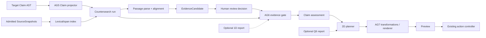
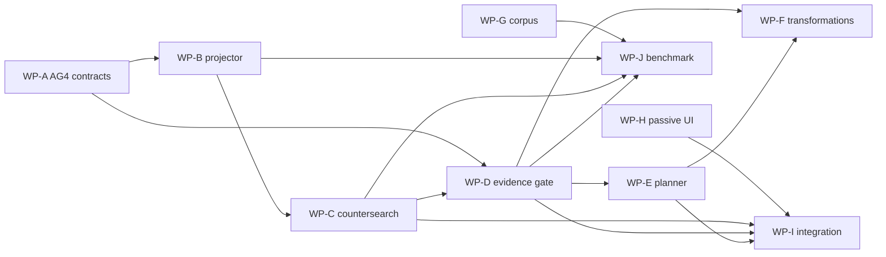

# 37 - P78: аудит AG4 и план параллельной разработки AG5-AG7

Статус: `REVIEWED_ROADMAP`; AG4 hardened, AG5 `DISCONNECTED_DRAFT`, AG6-AG7 не реализованы  
Дата: 2026-07-20  
Область: автономное 2D-кольцо, Claim AST, source-backed retrieval, countersearch, evidence gate, научный split/merge и проверяемая генерация абзаца

Связанные документы:

- [29 - самостоятельное 2D-кольцо энциклопедической семантики](29-encyclopedic-semantic-ring-spec.md);
- [30 - научное слияние и разделение текстов](30-scientific-synthesis-fission-fusion-spec.md);
- [31 - программа развития самостоятельного семантического кольца](31-p78-semantic-program-roadmap.md);
- [32 - реализация формульного кольца](32-p78-formula-ring-implementation.md);
- [33 - адаптация grep/AST к семантическому кольцу](33-ast-grep-semantic-ring-adaptation.md);
- [34 - реализация Formula AST/span index](34-p78-bidirectional-index-implementation.md);
- [35 - реализация Controlled Russian Claim AST](35-p78-controlled-russian-claim-ast-implementation.md).
- [36 - реализация source-backed каскада AG4](36-p78-source-backed-claim-cascade-implementation.md);
- [38 - многоагентный семантический поток](38-p78-multi-agent-semantic-flow-crosswalk.md).

На момент аудита файл `docs/36-*` в рабочем дереве отсутствовал. Поэтому этот документ опирается не на предполагаемый отчёт AG4, а непосредственно на существующие runtime-модули и регрессионные тесты.

---
## Актуализация после hardening

Нормативный текущий статус зафиксирован в документе 36:

- AG4 подключён как optional, lazy, review-only vertical slice;
- exact passage replay связан с полным `SourceSnapshot` и `sentenceIndex`;
- engine изолирует authority escalation и malformed candidates;
- `QUALIFIES` проверен end-to-end, квантор `NONE` покрывает три рода;
- интерфейс показывает actionable relations раньше свёрнутых `MENTIONS`;
- Edge через localhost даёт HTTP 200, изменяющийся canvas и ноль runtime errors;
- финальный checkpoint прошёл `49/49` suites и `579/579` checks;
- AG5 остаётся отключённым черновиком и не загружается HTML.

Числа `47/49`, `566/568`, упоминание отсутствующего `docs/36-*` и browser-smoke-pending ниже относятся к сохранённому pre-hardening снимку аудита, а не к текущему состоянию. При конфликте статусов нормативны этот блок и документ 36. Новая orchestration-ветка описана отдельно в документе 38, чтобы не смешивать AG4 hardening, AG5 и многоагентный UI в один roadmap.


## 1. Решение в одном абзаце

P78 уже имеет работающее автономное основание AG0-AG3 и runtime-connected micro-vertical-slice AG4: точный корпус, passage locators, разбор найденных предложений, структурное выравнивание и review-only `EvidenceCandidate`. HTML загружает cascade/view, runtime создаёт `ControlledClaimEngine.create({evidenceCascade})`, а focused AG4 suites проходят `85/85`. Во время аудита также появился disconnected draft AG5 countersearch с пятью обязательными purposes и результатом `14/14`. Однако систему ещё нельзя считать завершённой: полный прогон даёт `47/49 suites` и `566/568 checks` из-за двух stale runtime-version expectations, строгие схемы `PassageClaimRecord` и `ClaimAlignment` отсутствуют, AG5 не связывает attempts с AG4 passage/evidence objects, а benchmark остаётся малым синтетическим micro-set. Следующий правильный ход - не свободная генерация статьи, а последовательность `AG4 contract hardening and regression stabilization -> AG5 draft hardening and AG4 linkage -> AG6 reviewed evidence gate -> AG7 source-bound transformations and drafting`. Эти части можно разрабатывать несколькими агентами параллельно только через заранее замороженные контракты и отдельные файлы; изменение общего runtime должно оставаться одной контролируемой интеграционной задачей.

---

## 2. Что было проверено

### 2.1. Документация

Проверены документы 29-35. Их общий нормативный инвариант согласован:

```text
найденная строка
  != разобранное утверждение
  != структурно совпавшее утверждение
  != принятое свидетельство
  != итоговый статус claim
  != разрешение изменить текст
```

Документы 29-31 задают самостоятельность 2D, provenance-first работу и optional-only роль P79/P80. Документы 32-35 последовательно фиксируют Formula AST, lexical/span index и Controlled Russian Claim AST. Документ 33 определяет AG4-AG7 и правильную лестницу доказательных статусов.

### 2.2. Runtime-модули AG2-AG4

Проверены как минимум следующие файлы:

| Слой | Файл | Фактическая роль |
|---|---|---|
| contracts | `prototype/lib/p78-search-contracts.js` | SemanticQuery, SourceSnapshot, SearchHit, IndexManifest, trace v1 |
| lexical retrieval | `prototype/lib/p78-local-text-index.js` | exact token/phrase search и UTF-16 locators |
| Formula projection | `prototype/lib/p78-query-projector.js` | только Formula AST exact projection |
| Claim parser | `prototype/lib/p78-linguistic-parser-adapter.js` | Controlled Russian -> Claim AST |
| Claim matcher | `prototype/lib/p78-claim-structural-matcher.js` | закрытые Claim patterns |
| Claim orchestration | `prototype/lib/p78-controlled-claim-engine.js` | AG3 parse/match trace и optional AG4 evidence cascade injection |
| AG4 contracts | `prototype/lib/p78-evidence-contracts.js` | SourcePassage и review-only EvidenceCandidate |
| AG4 corpus | `prototype/lib/p78-claim-evidence-corpus.js` | 10 admitted snapshots, 30 предложений |
| AG4 index | `prototype/lib/p78-linguistic-structure-index.js` | broad discovery, candidate-only parse, alignment |
| AG4 facade | `prototype/lib/p78-claim-evidence-cascade.js` | factory вокруг linguistic index |
| AG4 view | `prototype/lib/p78-evidence-candidate-view.js` | пассивный просмотр кандидатов и exact text resolver |
| AG5 draft | `prototype/lib/p78-claim-countersearch.js` | disconnected Claim projection/countersearch, max status `LOCATED` |
| основной runtime | `prototype/lib/p78-living-ring-runtime.js` | текущая UI orchestration, 1836 строк и 142643 bytes |

Главный HTML остаётся сравнительно малой оболочкой: 323 строки и 17346 bytes. На момент итоговой перепроверки он уже загружает AG4 corpus/contracts/index/cascade/view и содержит отдельный evidence root. Runtime создаёт `ClaimEvidenceCascade`, инъецирует его в `ControlledClaimEngine` и передаёт кандидаты в passive view. Это новое состояние появилось параллельно аудиту и пока не согласовано со всеми regression expectations.

### 2.3. Выполненные проверки

Текущий focused snapshot после завершения AG4 wiring:

```text
semantic-p78-evidence-contracts-regression.cjs             10/10
semantic-p78-linguistic-structure-index-regression.cjs     12/12
semantic-p78-claim-evidence-corpus-regression.cjs          13/13
semantic-p78-claim-cascade-benchmark-regression.cjs         9/9
semantic-p78-claim-evidence-cascade-regression.cjs          9/9
semantic-p78-controlled-claim-engine-regression.cjs        12/12
semantic-p78-evidence-candidate-view-regression.cjs        12/12
semantic-p78-claim-interface-regression.cjs                 8/8
semantic-p78-claim-countersearch-regression.cjs            14/14
Focused AG4 + disconnected AG5 draft                       99/99
```

Полный runner был выполнен с разрешением на дочерние Node-процессы:

```text
ALL FAIL | suites 47/49 | checks 566/568
semantic-p78-primary-flow-regression.cjs      runtime shell version is stale
semantic-p78-search-interface-regression.cjs  runtime version stale
```

Оба сбоя относятся к прежним literal version expectations после изменения HTML/runtime, а не к semantic output. Тем не менее ветвь формально не regression-clean, пока эти tests не синхронизированы и полный runner не повторён.

Micro-benchmark содержит 8 измеряемых target claims и 2 fail-closed guards. На 10 snapshots и 30 passages получены:

```text
lexical:    retrieved=54, TP=12, FP=42, FN=0, precision=0.222222, recall=1.0
structural: retrieved=12, TP=12, FP=0,  FN=0, precision=1.0,      recall=1.0
```

Это корректный регрессионный результат для фиксированного синтетического набора. Он не является доказательством качества на статьях, новостях или научном корпусе: данные сконструированы под закрытую Controlled Russian грамматику, blind source-level test отсутствует, а размер выборки слишком мал для обобщения.

---

## 3. Строгая оценка текущей стадии

### 3.1. Матрица готовности

| Этап | Состояние | Что действительно достигнуто | Что ещё запрещено утверждать |
|---|---|---|---|
| AG0 contracts/status | выполнен для v1 | content hashes, closed objects, `LOCATED` boundary | v1 status ladder не отражает полный review gate |
| AG1 Formula AST | выполнен | типизированный Formula registry/engine/shape search | shape match не доказывает equivalence |
| AG2 lexical/span | выполнен | admitted snapshots, exact Unicode spans, deterministic replay | hit не является semantic support |
| AG3 Claim AST | выполнен в закрытом домене | 144 senses, 24 frames, 30 patterns, 120 fixtures | это не общий русский parser |
| AG4 grep -> Claim AST | runtime-connected, focused tests green | 30 source passages, broad retrieval, selective parsing, alignment, candidates, passive UI | browser smoke pending, accepted evidence отсутствует |
| Formula fragment AG5 | выполнен отдельно | Formula AST exact projector | не является Claim AST countersearch |
| AG5 Claim countersearch | disconnected draft, 14/14 | пять purposes, rules/hashes, budgets, cycles, bounded empty result | attempts не содержат passage/evidence refs, projector ещё поверхностный |
| AG6 evidence gate | не реализован | есть proposed relations и review boundary | нет `ACCEPTED_EVIDENCE`, итогового claim status и planner decision |
| AG7 split/merge/draft | не реализован | есть подробная спецификация | нет transformation contract, claim map или source-bound paragraph |

### 3.2. Что AG4 делает правильно

1. `SourceSnapshot` допускается только со статусом `ADMITTED`.
2. Passage хранит точный диапазон и hash текста.
3. Broad lexical retrieval остаётся на уровне `LOCATED`.
4. Parser вызывается только для найденных passages, а не для всего корпуса.
5. Неоднозначные и OOV passages остаются видимыми, но не становятся EvidenceCandidate.
6. Predicate, arguments, polarity, modality, quantifier и qualifiers сравниваются раздельно.
7. Одинаковая структура с противоположной polarity создаёт только предложение `REFUTES`.
8. `SUPPORTS + REFUTES` не разрешается автоматически.
9. Каждый кандидат остаётся `EVIDENCE_CANDIDATE / REQUIRES_REVIEW / NOT_COMPUTED`.
10. View повторно проверяет exact passage text по hash перед показом.
11. View не имеет command, action controller или commit path.
12. Replay детерминирован и content-addressed.

### 3.3. Почему AG4 пока частичен

AG4 решает задачу поиска и предложения evidence, но не задачу принятия evidence. Его честный максимальный результат:

```text
target Claim AST
  -> candidate passage
  -> passage Claim AST
  -> structural alignment
  -> proposedRelation
  -> EVIDENCE_CANDIDATE
  -> REQUIRES_REVIEW
```

В нём отсутствуют:

- review decision;
- accepted evidence artifact;
- независимая перепроверка exact source slice внутри evidence gate;
- countersearch run;
- агрегация нескольких accepted spans;
- source independence grouping;
- final claim assessment;
- `CONTINUE/REPAIR/ABSTAIN` planner;
- preview через action controller;
- проверяемая генерация нового абзаца.

---

## 4. Критические разрывы перед AG5

### 4.1. Несогласованная лестница статусов v1

`p78-search-contracts.js` содержит:

```text
LOCATED -> PARSED -> STRUCTURAL_MATCH
        -> EVIDENCE_CANDIDATE -> SUPPORTED/REFUTED
```

Документ 33 требует более строгую лестницу:

```text
LOCATED
  -> PARSED
  -> STRUCTURAL_MATCH
  -> CLAIM_ALIGNED
  -> EVIDENCE_CANDIDATE
  -> ACCEPTED_EVIDENCE
  -> SUPPORTED / REFUTED / QUALIFIED / CONFLICT
```

Рекомендация: не ломать `SearchHit v1`. Следует добавить evidence-specific transition contract v1 или новую версию общего status contract. Миграция должна быть явной; простое добавление строк в существующий массив без теста совместимости недостаточно.

### 4.2. Не хватает строгих контрактов промежуточных объектов

`p78-linguistic-structure-index.js` создаёт объекты со схемами:

```text
meridian.passage-claim/1
meridian.claim-alignment/1
```

Но для них нет публичных factory/validator contracts. Это означает, что тесты проверяют поведение конкретной реализации, но другой агент может сформировать похожий объект с иным набором полей, не получив fail-closed отказа.

До AG5 нужны отдельные строгие фабрики:

- `createPassageClaimRecord()`;
- `validatePassageClaimRecord()`;
- `createClaimAlignment()`;
- `validateClaimAlignment()`.

### 4.3. EvidenceCandidate недостаточно закрепляет путь решения

Текущий кандидат содержит passage Claim AST ref, но не содержит обязательных ссылок на:

- `passageClaimId/contentHash`;
- `alignmentId/contentHash`;
- structural match refs;
- pattern set hash как самостоятельный проверяемый этап;
- span-map completeness;
- exact passage resolution result.

Контракт запрещает unresolved Claim AST, но сам по себе не доказывает, что перед созданием кандидата был пройден `STRUCTURAL_MATCH`. Это должно стать конструктивным инвариантом, а не соглашением одного orchestrator.

### 4.4. SourcePassage валидирует себя, но не replay против vault

`validateSourcePassage()` проверяет hash сохранённого `text`, locator shape и собственную identity. Без переданного SourceSnapshot он не может доказать:

```text
snapshot.text.slice(start, end) == passage.text
```

AG6 обязан иметь resolver, который заново получает admitted snapshot, сверяет source hash, revision, locator, offset unit и exact text hash. Самодостаточная проверка passage object не заменяет replay против source vault.

### 4.5. Offset policy задана не в каждом locator

Segmenter публикует `UTF16_CODE_UNIT`, а locator содержит только `start/end/sentenceIndex`. View дописывает название единицы из соглашения. Для переносимости единица смещения должна быть частью passage locator или обязательной versioned locator policy ref.

### 4.6. Риск смещений после `trim()`

Parser нормализует границы входной строки, а AG4 segmenter предварительно удаляет внешние пробелы предложения. Для текущего pipeline offsets совпадают, что подтверждено тестом. Но произвольный caller может передать passage с leading whitespace и затем ошибочно сложить local offset с source offset. Нужен один из вариантов:

1. parser возвращает `normalizationOffsetMap`;
2. passage contract запрещает внешние пробелы;
3. parser получает точный passage и отдельно публикует trimmed range.

Первый вариант наиболее общий.

### 4.7. Query origin не закрепляет Claim content hash

`SemanticQuery.origin.kind="CLAIM_AST"` хранит `claimId`, но не `claim.contentHash`. AG5 может оставить query v1 неизменным, если `CountersearchAttempt` обязательно содержит полный target Claim ref и проверяет, что query входит в content-addressed projection этого claim. Иначе stale Claim может повторно использовать старый query.

### 4.8. Ошибки Controlled Claim engine сворачиваются в OOV

Текущий общий `catch` в `p78-controlled-claim-engine.js` преобразует unknown option, stale config и внутреннюю ошибку в результат с `resolutionStatus="OOV"`. Для AG5/AG6 это слишком грубо. Нужны независимые классы:

```text
INVALID_INPUT
STALE_CONFIGURATION
BUDGET_EXCEEDED
PARSER_OOV
PARSER_AMBIGUOUS
INTERNAL_ERROR
```

OOV должен означать только отсутствие разрешённой лексической/семантической записи.

### 4.9. Budget пока не является общим budget

Lexical index имеет operation budget, но parsing, matching, projection и repeated countersearch должны расходовать общий deterministic budget. Частичный результат обязан содержать выполненные attempts и `COUNTERSEARCH_PARTIAL`, а не выглядеть как полный поиск.

### 4.10. AG4 facade/view подключены, но полный runner не regression-clean

`p78-claim-evidence-cascade.js` теперь имеет отдельную suite `9/9`, создаётся основным runtime и передаётся в Controlled Claim engine. View загружается HTML и проходит `12/12`, Claim interface проходит `8/8`. Остаются browser verification и два stale literal runtime-version tests из соседних interface suites. Поэтому AG4 можно считать подключённым review-only vertical slice, но не завершённой доказательной функцией и не полностью зелёной ветвью.

### 4.11. Micro-benchmark нельзя использовать как release benchmark

Текущий 100% structural precision/recall подтверждает регрессию восьми закрытых случаев. Для release нужны:

- source-level holdout;
- unseen lexical surfaces;
- passive voice;
- qualifiers и quantifiers;
- attribution и reported modality;
- true/false contradiction pairs;
- OOV и ambiguity вне шаблонов разработки;
- real-source formatting noise;
- отдельная человеческая разметка relation.

---

## 5. Научная метафора и вычислимые утверждения

Проекту полезно сохранить образ кольца, но необходимо помечать границу между интерфейсной метафорой и вычислительной моделью.

| Образ | Допустимая вычислимая интерпретация | Что из образа не следует |
|---|---|---|
| 2D-кольцо | цикл операций, `theta=operation family`, `rho=explicit granularity state`, immutable history | истинность, причинность или качество текста |
| движение по кругу | новый content-addressed state и новый неповторяющийся obligation | одна анимация не является смысловым прогрессом |
| центр/3D | риск чрезмерного обобщения или optional Q6 diagnostic vector | центр не доказывает общий закон |
| внешний край/1D | риск дробления, exact order/serialization audit | символы, Morse и binary не измеряют смысл |
| гиперкуб/Q6 | шесть заранее определённых булевых predicates и adjacency counterfactual | размерность не создаёт evidence |
| живость кольца | наличие `CONTINUE`, repairable obligation или честного bounded `ABSTAIN` | бесконечная генерация не является обязательной |
| радиус | измеримый scope/granularity delta по versioned rule | близость к центру не равна уверенности |
| угол | идентификатор семейства операции: split, merge, compare, verify | угол не ранжирует истинность |

Нормативное правило:

> Геометрия может отображать уже вычисленный тип операции и диагностическое состояние. Она не может создавать или повышать epistemic status.

---

## 6. Варианты развития продукта

### 6.1. Ветка A: самостоятельное 2D, рекомендуемый основной путь

```text
P78 2D Core = source vault + lexical index + Claim AST
            + alignment + countersearch + evidence gate
            + planner + preview/ledger
```

Плюсы:

- минимальное число причинных зависимостей;
- офлайн replay на фиксированном source set;
- ошибки локализуются по stage;
- P79/P80 не требуются для смысла;
- это честная baseline для дальнейших сравнений.

Ограничения:

- Controlled Russian покрывает узкий домен;
- без curated thesaurus recall ограничен;
- человеческий review остаётся обязательным;
- без реального корпуса нельзя заявлять пригодность для статей.

### 6.2. Ветка B: самостоятельное 2D с энциклопедическим профилем

Добавляет после AG6:

- goal/section model;
- definition/detail/compare/limitation discourse moves;
- deterministic paragraph renderer;
- sentence-to-claim map;
- citation trace;
- abstention и список отсутствующих facts.

В первом выпуске renderer использует только accepted claims и закрытые шаблоны. Он не ищет знания в параметрах модели.

### 6.3. Ветка C: самостоятельное 2D для научного синтеза

Добавляет:

- compound claim и transformation proposals;
- split с повторной evidence adjudication children;
- compare/contrast;
- merge с scope matrix;
- conflict register;
- DraftFragment и provenance DAG.

Это отдельная продуктовая ветвь поверх того же evidence substrate. Она не должна смешиваться с простой кнопкой «продолжить текст».

### 6.4. Ветка D: 2D + 1D integrity auditor

P79 получает immutable report request и возвращает:

- порядок spans;
- roundtrip serialization;
- quote byte/text hash integrity;
- потерю/перестановку сегментов;
- экспортную обратимость.

P79 не назначает relation и не имеет commit authority. Отказ или timeout P79 не меняет semantic result автономного профиля, но может заблокировать экспорт, если выбран policy, где integrity audit обязателен.

### 6.5. Ветка E: 2D + Q6/3D diagnostics

P80 получает уже вычисленный guard vector, например:

```text
[sourcePinned,
 passageVerified,
 claimResolved,
 countersearchCompleted,
 conflictHandled,
 reversible]
```

Он может показать один ближайший контрфактический переход между шестибитными состояниями. Он не выбирает sense, relation или следующий factual sentence.

### 6.6. Ветка F: полная федерация 2D + 1D + Q6

Полная конфигурация оправдана для исследовательского режима и аудита. P78 остаётся единственным владельцем planner decision и action preview. Отчёты соседей versioned, immutable, optional и policy-scoped.

### 6.7. Сравнительный эксперимент

Следует заранее сравнить четыре профиля на одном source-level holdout:

```text
P0 = 2D only
P1 = 2D + 1D
P2 = 2D + Q6
P3 = 2D + 1D + Q6
```

Метрики:

- semantic result equivalence;
- locator/roundtrip error rate;
- human correction time;
- unsafe accepted claim rate;
- stale detection rate;
- planner latency;
- UI comprehension of blocking reason.

Сосед включается в основной профиль только при измеримом улучшении guardrail или ergonomics без изменения semantic authority.

---

## 7. Целевая архитектура AG5-AG7



Правила зависимости:

1. AG5 зависит от замороженных AG4 refs, но не от DOM.
2. AG6 принимает только content-addressed AG4/AG5 artifacts.
3. AG7 принимает только reviewed claim assessments или явно маркированные hypotheses.
4. Только action controller создаёт preview/commit/rollback.
5. UI не создаёт evidence relation.
6. P79/P80 возвращают отчёты и не вызывают core services.

---

## 8. AG4 hardening: обязательный Gate 0

Перед слиянием работ разных агентов необходимо заморозить следующие схемы.

### 8.1. `PassageClaimRecord`

```ts
type PassageClaimRecord = {
  schema: "meridian.passage-claim/1";
  passageClaimId: string;
  passageRef: {
    passageId: string;
    sourceSpanId: string;
    contentHash: Hash;
  };
  sourceVersionRef: {
    sourceId: string;
    revision: string;
    sourceHash: Hash;
    textHash: Hash;
  };
  discoveryRefs: {
    hitIds: string[];
    queryRefs: QueryRef[];
    indexRefs: IndexRef[];
  };
  claimAstRef: ClaimRef | null;
  parseResultHash: Hash;
  resolutionStatus: "RESOLVED" | "AMBIGUOUS" | "OOV";
  surfaceSpans: SurfaceSpan[];
  spanMapStatus: "COMPLETE" | "PARTIAL" | "INVALID";
  parserIdentity: ParserIdentity;
  structural: {
    status: "STRUCTURAL_MATCH" | "STRUCTURAL_REJECT" | "NOT_COMPUTED";
    matchRefs: ContentRef[];
    matcherRef: VersionedRef;
    patternSetHash: Hash;
  };
  reasonCodes: string[];
  contentHash: Hash;
};
```

### 8.2. `ClaimAlignment`

```ts
type ClaimAlignment = {
  schema: "meridian.claim-alignment/1";
  alignmentId: string;
  targetClaimRef: ClaimRef;
  passageClaimRef: ContentRef;
  predicate: AlignmentDimension;
  arguments: {
    overall: "EXACT" | "MISMATCH" | "UNKNOWN";
    roles: RoleAlignment[];
  };
  polarity: {
    target: string;
    passage: string;
    result: "SAME" | "OPPOSITE" | "UNKNOWN";
  };
  modality: CompatibilityDimension;
  quantifier: {
    result: "EXACT" | "NARROWER" | "BROADER" | "MISMATCH" | "UNKNOWN";
  };
  qualifiers: QualifierAlignment[];
  gateStatus: "CLAIM_ALIGNED" | "REQUIRES_REVIEW" | "REJECTED";
  evaluatorRef: VersionedRef;
  reasonCodes: string[];
  contentHash: Hash;
};
```

### 8.3. Усиленный `EvidenceCandidate`

Кандидат должен ссылаться на `PassageClaimRecord` и `ClaimAlignment`, а не дублировать их без identity refs:

```ts
type EvidenceCandidate = {
  schema: "meridian.evidence-candidate/2";
  evidenceCandidateId: string;
  targetClaimRef: ClaimRef;
  passageClaimRef: ContentRef;
  alignmentRef: ContentRef;
  structuralMatchRefs: ContentRef[];
  sourceSetHash: Hash;
  hitIds: string[];
  proposedRelation:
    | "SUPPORTS" | "REFUTES" | "QUALIFIES" | "MENTIONS" | "UNKNOWN";
  status: "EVIDENCE_CANDIDATE";
  reviewStatus: "REQUIRES_REVIEW";
  finalRelation: "NOT_COMPUTED";
  reasonCodes: string[];
  contentHash: Hash;
};
```

Можно сохранить v1 для уже написанных tests и добавить explicit adapter `v1 -> v2`. Молчаливое изменение v1 contract недопустимо.

### 8.4. Gate 0 acceptance

Gate 0 пройден, если:

- все три объекта имеют exact-key validators;
- IDs воспроизводятся независимо;
- каждый surface span восстанавливается из snapshot;
- stale parser/lexicon/pattern/source pins дают отдельные reason codes;
- EvidenceCandidate невозможно создать без `RESOLVED + STRUCTURAL_MATCH + CLAIM_ALIGNED`;
- opposite polarity допускает proposed `REFUTES`, а не ошибочно блокирует весь alignment;
- ни один объект не содержит `ACCEPTED_EVIDENCE` или final support.

---

## 9. AG5: Claim AST -> grep и контрпоиск

### 9.0. Что уже реализовано как disconnected draft

Во время аудита появился `prototype/lib/p78-claim-countersearch.js` версии `1.0.0`. Модуль сам маркирует себя `integrationStatus="DISCONNECTED_DRAFT"` и не загружается HTML.

Фактическая граница authority:

```text
maxOutputStatus = LOCATED
finalStatus     = ABSTAIN
reviewStatus    = REQUIRES_REVIEW
finalRelation   = NOT_COMPUTED
commitAllowed   = false
```

Suite подтверждает:

```text
semantic-p78-claim-countersearch-regression.cjs  14/14
```

Сильные стороны текущего draft:

- все пять required purposes создаются в stable order;
- target Claim content hash закреплён projection object;
- rule set и curated term set имеют hashes;
- source/index/claim/rules/thesaurus stale pins fail closed;
- visited hashes и query/operation budgets проверяются;
- пустой результат формулируется только как `NO_COUNTEREVIDENCE_FOUND_WITHIN_SCOPE`;
- module не имеет DOM, сети, часов, random или commit path.

Ограничения текущего draft:

- contracts, rule registry, projector и runner находятся в одном файле;
- SUPPORT использует прежде всего predicate lemma, а не полную role signature;
- polarity counter строится ограниченным добавлением/снятием `не` перед predicate expression;
- QUALIFIER_SCOPE объединяет predicate и qualifier tokens через broad `Or`, а не проверяет scope relation;
- SOURCE_DEPENDENCY является source filter, а не моделью provenance family;
- `passageClaimIds` и `evidenceCandidateIds` в attempts всегда пусты;
- AG4 linguistic cascade не вызывается из countersearch attempts;
- partial budget result выражается общим `ABSTAIN`, отдельного `PARTIAL` status нет.

Поэтому разделы 9.1-9.10 ниже являются планом hardening и подключения уже существующего draft, а не разработкой с нуля.

### 9.1. Цель

AG5 должен превращать один validated target Claim AST в воспроизводимый набор запросов разного назначения и исполнять их в фиксированном admitted source set. AG5 ищет потенциальную поддержку, отрицание и ограничения. Он не принимает evidence и не вычисляет final claim status.

### 9.2. Нецели

- не подключать LLM projection по умолчанию;
- не считать пустой результат отсутствием evidence во всём мире;
- не менять Claim AST;
- не создавать source snapshots из snippets;
- не ранжировать truth score;
- не вызывать action controller;
- не выдавать `SUPPORTED` или `REFUTED`.

### 9.3. Рекомендуемая декомпозиция текущего monolithic draft

| Модуль | Ответственность |
|---|---|
| `p78-claim-projection-contracts.js` | QueryProjection, CountersearchAttempt, CountersearchRun |
| `p78-claim-projection-rule-registry.js` | versioned exact/curated rules |
| `p78-claim-query-projector.js` | Claim AST -> purpose-specific SemanticQuery[] |
| `p78-claim-countersearch.js` | budget, visited hashes, scheduling, result aggregation |
| `p78-claim-projection-fixtures.js` | test-only gold projections |

Не следует расширять Formula-only `p78-query-projector.js` условными ветками для Claim AST. Два projector имеют разные структуры, правила и test corpus.

### 9.4. Обязательные purposes

```text
SUPPORT
POLARITY_COUNTER
QUALIFIER_SCOPE
ALTERNATE_DEFINITION
SOURCE_DEPENDENCY
```

Допустимые дополнительные purposes:

```text
DUPLICATE_CHECK
GENERALIZATION_CHECK
SPECIALIZATION_SEARCH
COUNTEREXAMPLE_LOOKUP
```

### 9.5. Классы расширения

| Класс | Источник | Epistemic право |
|---|---|---|
| `EXACT` | surface forms, IDs, числа, даты и literals target claim | только retrieval |
| `CURATED` | closed lexicon/thesaurus alias с version/hash path | только retrieval |
| `HEURISTIC` | model/vector proposal | data-only candidate, выключен по умолчанию |

### 9.6. Контракт projection

```ts
type ClaimQueryProjection = {
  schema: "meridian.claim-query-projection/1";
  projectionId: string;
  targetClaimRef: ClaimRef;
  purpose: ProjectionPurpose;
  expansionClass: "EXACT" | "CURATED" | "HEURISTIC";
  ruleRef: ContentRef;
  lexiconHash: Hash;
  thesaurusHash: Hash | null;
  queries: SemanticQuery[];
  omittedKnownVariants: string[];
  completenessClaim:
    | "NONE"
    | "BOUNDED_VOCABULARY_ONLY"
    | "BOUNDED_SOURCE_SET";
  contentHash: Hash;
};
```

### 9.7. Контракт countersearch

```ts
type CountersearchAttempt = {
  schema: "meridian.countersearch-attempt/1";
  attemptId: string;
  ordinal: number;
  purpose: ProjectionPurpose;
  projectionRef: ContentRef;
  queryRef: QueryRef;
  indexRef: IndexRef;
  resultHash: Hash;
  hitIds: string[];
  passageClaimIds: string[];
  evidenceCandidateIds: string[];
  status: "HITS" | "EMPTY" | "ABSTAIN";
  reasonCodes: string[];
  operationCount: number;
  contentHash: Hash;
};

type CountersearchRun = {
  schema: "meridian.countersearch-run/1";
  runId: string;
  targetClaimRef: ClaimRef;
  sourceSetHash: Hash;
  linguisticIndexHash: Hash;
  projectorRef: VersionedRef;
  projectionRuleSetHash: Hash;
  lexiconHash: Hash;
  thesaurusHash: Hash | null;
  requiredPurposes: ProjectionPurpose[];
  attempts: CountersearchAttempt[];
  visitedQueryHashes: Hash[];
  budget: { maxQueries: number; maxOperations: number; maxPassages: number };
  completenessClaim: "NONE" | "BOUNDED_VOCABULARY_ONLY" | "BOUNDED_SOURCE_SET";
  status: "READY" | "PARTIAL" | "ABSTAIN";
  reasonCodes: string[];
  finalRelation: "NOT_COMPUTED";
  contentHash: Hash;
};
```

### 9.8. Projection rules

#### SUPPORT

Проецировать:

- predicate surface forms;
- resolved role surfaces;
- exact entity/sense aliases;
- explicit quantifier;
- explicit modality markers;
- explicit qualifiers;
- exact numbers, units, dates.

#### POLARITY_COUNTER

Проецировать контролируемое отрицание или снятие отрицания по predicate frame. Простое добавление слова `не` в произвольное место запрещено. Rule должен знать позицию отрицания в Closed Russian pattern.

#### QUALIFIER_SCOPE

Строить запросы для:

- другой population;
- другого времени/места;
- отсутствующего или альтернативного method;
- `ALL/SOME/NONE`;
- `FACT/HYPOTHESIS/REPORTED`;
- condition present/absent.

#### ALTERNATE_DEFINITION

Использовать только versioned sense records и curated definition aliases. OOV alias остаётся omitted variant или отдельным heuristic proposal.

#### SOURCE_DEPENDENCY

Искать не текстовую поддержку, а признаки одной provenance family, версии, обзора и первичного источника. Текущий synthetic corpus не содержит достаточной модели зависимости, поэтому первый implementation может честно возвращать `ABSTAIN / SOURCE_DEPENDENCY_DATA_UNAVAILABLE`.

### 9.9. Нормативный pseudocode AG5

```text
function runCountersearch(targetClaim, sourceIndex, rules, budget):
    require validAndResolved(targetClaim)
    require fresh(sourceIndex, rules)

    purposes = [
        SUPPORT,
        POLARITY_COUNTER,
        QUALIFIER_SCOPE,
        ALTERNATE_DEFINITION,
        SOURCE_DEPENDENCY
    ]

    attempts = []
    visited = set()

    for purpose in purposes:
        projections = projector.project(targetClaim, purpose, rules)

        for projection in stableSort(projections):
            for query in stableSort(projection.queries):
                if query.contentHash in visited:
                    record ABSTAIN(COUNTERSEARCH_CYCLE_DETECTED)
                    continue

                if budget.exhausted():
                    return PARTIAL(
                        attempts,
                        COUNTERSEARCH_BUDGET_EXCEEDED,
                        completeness=NONE
                    )

                visited.add(query.contentHash)
                lexical = localIndex.search(query)
                passages = resolveAndDeduplicate(lexical.hits)
                structures = parseOnlyLocated(passages)
                candidates = alignAsEvidenceCandidates(targetClaim, structures)
                attempts.push(pinAll(query, lexical, structures, candidates))

    return READY(
        attempts,
        NO_COUNTEREVIDENCE_FOUND_WITHIN_SCOPE only when applicable,
        finalRelation=NOT_COMPUTED
    )
```

### 9.10. AG5 tests

Обязательные проверки:

1. Projection ID меняется при изменении target Claim hash.
2. Exact projection не использует неприкреплённый synonym.
3. Curated term имеет rule/thesaurus provenance.
4. Positive claim создаёт отдельный negative query.
5. Negative claim создаёт отдельный positive query.
6. `FACT` создаёт modality/limitation queries.
7. Population qualifier не теряется.
8. `ALL` и `SOME` создают разные projections.
9. Повторный query hash останавливает цикл.
10. Budget даёт `PARTIAL`, а не fake complete result.
11. Один passage, найденный разными queries, дедуплицируется без потери attempts.
12. Stale source/index/rules fail closed.
13. Empty scoped search не создаёт `NO_COUNTEREVIDENCE_EXISTS`.
14. Source dependency without metadata даёт explicit abstention.
15. Replay создаёт одинаковые attempt IDs и run hash.
16. AG5 output не содержит accepted/final relation.

AG5 готов, когда E2E fixture стабильно возвращает support, polarity counter, qualifier limitation и bounded empty attempt с полным trace.

---

## 10. AG6: reviewed evidence gate и 2D planner

### 10.1. Цель

AG6 должен отделить machine proposal от принятого человеческого решения, агрегировать принятые отношения относительно фиксированного source set и выбрать следующий безопасный semantic obligation.

AG6 не доказывает абсолютную истину. Его сильная формулировка:

> В версии source set `S`, при policy `P` и review decisions `R`, claim имеет статус `SUPPORTED/REFUTED/QUALIFIED/CONFLICT/NOT_ENOUGH_INFO`.

### 10.2. Новые объекты

#### `EvidenceReviewDecision`

```ts
type EvidenceReviewDecision = {
  schema: "meridian.evidence-review-decision/1";
  decisionId: string;
  candidateRef: ContentRef;
  reviewerRef: ActorRef;
  decision: "ACCEPT" | "REJECT" | "DEFER";
  adjudicatedRelation:
    | "SUPPORTS" | "REFUTES" | "QUALIFIES" | "MENTIONS" | null;
  reasonCodes: string[];
  policyRef: ContentRef;
  sequence: number;
  baseProjectRevision: string;
  contentHash: Hash;
};
```

`sequence` и revision передаются явно. Чистый core не читает часы.

#### `AcceptedEvidence`

```ts
type AcceptedEvidence = {
  schema: "meridian.accepted-evidence/1";
  acceptedEvidenceId: string;
  targetClaimRef: ClaimRef;
  candidateRef: ContentRef;
  passageClaimRef: ContentRef;
  alignmentRef: ContentRef;
  reviewDecisionRef: ContentRef;
  adjudicatedRelation: "SUPPORTS" | "REFUTES" | "QUALIFIES" | "MENTIONS";
  sourceResolution: {
    sourceRef: SourceVersionRef;
    locator: Locator;
    exactTextHash: Hash;
    status: "VERIFIED";
  };
  policyRef: ContentRef;
  contentHash: Hash;
};
```

#### `ClaimEvidenceAssessment`

```ts
type ClaimEvidenceAssessment = {
  schema: "meridian.claim-evidence-assessment/1";
  assessmentId: string;
  targetClaimRef: ClaimRef;
  sourceSetHash: Hash;
  countersearchRunRef: ContentRef;
  acceptedEvidenceRefs: ContentRef[];
  rejectedCandidateRefs: ContentRef[];
  independenceGroups: IndependenceGroup[];
  status:
    | "SUPPORTED"
    | "REFUTED"
    | "QUALIFIED"
    | "CONFLICT"
    | "NOT_ENOUGH_INFO";
  scope: "WITHIN_SOURCE_SET";
  reasonCodes: string[];
  policyRef: ContentRef;
  contentHash: Hash;
};
```

#### `PlannerDecision`

```ts
type PlannerDecision = {
  schema: "meridian.2d-planner-decision/1";
  decisionId: string;
  stateRef: ContentRef;
  openObligations: Obligation[];
  selectedObligation: Obligation | null;
  candidateMoveRefs: ContentRef[];
  status: "CONTINUE" | "REPAIR" | "ABSTAIN";
  previewOnly: true;
  reasonCodes: string[];
  policyRef: ContentRef;
  contentHash: Hash;
};
```

### 10.3. Evidence gate algorithm

```text
function acceptReviewedEvidence(candidate, decision, vault, policy):
    validate(candidate)
    validate(decision)
    require decision.candidateRef == ref(candidate)
    require decision.decision == ACCEPT

    passage = vault.resolve(
        candidate.sourceRef,
        candidate.locator,
        offsetUnit=UTF16_CODE_UNIT
    )

    require hash(passage.text) == candidate.passageTextHash
    require candidate has valid passageClaimRef
    require candidate has valid alignmentRef
    require candidate has STRUCTURAL_MATCH refs
    require policy allows adjudicatedRelation

    if any pin is stale:
        return ABSTAIN(STALE_EVIDENCE_ARTIFACT)

    return ACCEPTED_EVIDENCE(
        exact source resolution,
        explicit reviewed relation
    )
```

### 10.4. Claim-level aggregation

```text
function assessClaim(target, acceptedEvidence, countersearch, policy):
    require countersearch belongs to target and source set

    grouped = groupByIndependentProvenance(acceptedEvidence)
    support = groupsWith(SUPPORTS)
    refute = groupsWith(REFUTES)
    qualify = groupsWith(QUALIFIES)

    if support.nonEmpty and refute.nonEmpty:
        return CONFLICT

    if countersearch.status == PARTIAL:
        return NOT_ENOUGH_INFO(COUNTERSEARCH_PARTIAL)

    if support.nonEmpty and requiredScopeCovered(target, support):
        return qualify.nonEmpty ? QUALIFIED : SUPPORTED

    if refute.nonEmpty and requiredScopeCovered(target, refute):
        return REFUTED

    return NOT_ENOUGH_INFO
```

Количество URL не является голосованием. Несколько passages одной provenance family считаются одной зависимой группой.

### 10.5. Planner obligations

Планировщик выбирает не «самую красивую фразу», а следующую жёсткую обязанность в stable order:

```text
1. STALE_ARTIFACT
2. UNRESOLVED_TARGET
3. MISSING_SOURCE_PASSAGE
4. UNREVIEWED_CANDIDATE
5. COUNTERSEARCH_INCOMPLETE
6. CONFLICT_UNHANDLED
7. QUALIFIER_SCOPE_MISSING
8. GOAL_COVERAGE_GAP
9. SAFE_DISCOURSE_MOVE
10. COMPLETE
```

Результаты:

- `CONTINUE`: существует reviewed, reversible preview move;
- `REPAIR`: известен минимальный discriminator или недостающий review/source;
- `ABSTAIN`: при текущих данных безопасного хода нет.

### 10.6. Связь с action controller

AG6 не вызывает commit. Он формирует только typed preview request. Existing action controller обязан повторно проверить:

- base text revision;
- source set hash;
- target Claim hash;
- assessment hash;
- policy hash;
- exact inverse;
- absence of unresolved hard obligations.

### 10.7. AG6 tests

1. Candidate без review не становится accepted evidence.
2. Reviewer `DEFER` сохраняет `REQUIRES_REVIEW`.
3. Review relation не может ссылаться на другой candidate.
4. Exact text mismatch блокирует acceptance.
5. Stale parser/alignment/source/policy блокирует acceptance.
6. `MENTIONS` не увеличивает support.
7. Support и refute вместе дают `CONFLICT`.
8. Duplicate passages одной provenance family не увеличивают независимую поддержку.
9. Partial countersearch не даёт final support при strict policy.
10. Empty bounded countersearch не означает global absence.
11. Qualifier mismatch даёт `QUALIFIED` или repair, не full support.
12. `FACT` и `HYPOTHESIS` не принимаются как одинаковая modality.
13. `ALL` и `SOME` не агрегируются как exact scope.
14. Planner deterministic при перестановке inputs.
15. Preview не меняет text/ledger.
16. Stale preview не коммитится.
17. Replay и rollback exact.
18. UI никогда не показывает proposed relation как final relation.

AG6 готов, когда support/refute/qualify/conflict/not-enough-info проходят отдельные E2E cases и ни один path не обходит review.

---

## 11. AG7: научный split/merge и source-backed генерация

AG7 следует разделить на два связанных вертикальных среза. Это уменьшает риск смешать преобразование claims и языковую реализацию текста.

### 11.1. AG7A: Claim transformations

Операции первого выпуска:

```text
SPLIT
MERGE
COMPARE
CONTRAST
SPECIALIZE
GENERALIZE_AS_HYPOTHESIS
```

`GENERALIZE_AS_SUPPORTED` откладывается до формального rule/evidence protocol.

### 11.2. Ограничение AG3

AG3 принимает одну фразу с одним predicate. Он не может сам разобрать произвольный compound scientific claim. Поэтому AG7A не должен скрытно расширять AG3 parser.

Первый допустимый вариант:

1. parent claim создаётся как reviewed `CompoundClaim` с явными clauses;
2. каждый clause отдельно проходит AG3/AG4/AG5/AG6;
3. split proposal связывает children с parent;
4. свободный compound parser разрабатывается отдельной будущей веткой.

### 11.3. Контракты transformation

```ts
type ScopeProfile = {
  population: string | null;
  time: string | null;
  place: string | null;
  method: string | null;
  condition: string | null;
  modality: string;
  quantifier: string;
  polarity: string;
};

type ClaimTransformationProposal = {
  schema: "meridian.claim-transformation-proposal/1";
  proposalId: string;
  operator: "SPLIT" | "MERGE" | "COMPARE" | "CONTRAST" | "SPECIALIZE" | "GENERALIZE";
  inputClaimRefs: ClaimRef[];
  proposedOutputClaims: ClaimAst[];
  scopeDiffs: ScopeDiff[];
  evidenceRecheckPlans: EvidenceRecheckPlan[];
  provenanceClosure: ContentRef[];
  inversePlan: InversePlan;
  checks: CheckResult[];
  status: "PREPARED" | "BLOCKED" | "REQUIRES_REVIEW";
  contentHash: Hash;
};
```

### 11.4. Split invariants

Каждый child обязан:

- иметь одну главную предикацию;
- сохранить polarity;
- сохранить modality;
- сохранить все относящиеся qualifiers;
- не получить parent evidence как accepted автоматически;
- получить отдельный AG5 countersearch;
- получить отдельный AG6 assessment;
- хранить `DERIVED_FROM(parent)`;
- пройти roundtrip coverage check.

Pseudocode:

```text
function prepareSplit(parent, clauses):
    require reviewedCompoundClaim(parent)
    children = parseEachClause(clauses)

    checks = [
        atomic(children),
        polarityPreserved(parent, children),
        modalityPreserved(parent, children),
        qualifierCoverage(parent, children),
        semanticCoverage(parent, children)
    ]

    for child in children:
        child.acceptedEvidence = []
        child.evidencePlan = buildIndependentCountersearch(child)

    if required check fails:
        return BLOCKED(checks)

    return REQUIRES_REVIEW(children, exactInversePlan)
```

### 11.5. Merge invariants

Merge разрешается только после scope matrix:

| Dimension | Допустимо для merge | Иначе |
|---|---|---|
| predicate | same/registered compatible | COMPARE |
| roles/entities | exact or reviewed same-as | COMPARE |
| polarity | same | CONTRAST |
| modality | same or explicit conservative weakening | COMPARE/REPAIR |
| quantifier | no silent broadening | BLOCKED_SCOPE_EXPANSION |
| population | exact or explicit intersection | COMPARE |
| time/place | compatible intersection | COMPARE |
| method | compatible or preserved separately | COMPARE |
| conflicts | none hidden | CONTROVERSY structure |

Evidence двух inputs сохраняется раздельно. Merge не создаёт новое evidence.

```text
function prepareMerge(left, right, mode):
    alignment = compareScopes(left, right)

    if alignment.polarity == OPPOSITE:
        return CONTRAST(left, right)

    if alignment.hasUnknown or alignment.hasScopeConflict:
        return COMPARE(left, right, alignment)

    output = boundedCompose(left, right, mode)
    output.evidence = preserveSeparateEvidence(left, right)
    output.status = SYNTHESIS

    return REQUIRES_REVIEW(
        output,
        noProvenanceLoss,
        noQualifierLoss,
        exactInversePlan
    )
```

### 11.6. AG7B: source-backed paragraph renderer

Первый renderer не должен «писать статью из темы». Он получает только:

- article goal;
- profile;
- ordered accepted Claim assessments;
- allowed discourse relations;
- exact citation refs;
- word/sentence budget.

Выход:

```ts
type DraftFragment = {
  schema: "meridian.draft-fragment/1";
  draftFragmentId: string;
  text: string;
  profile: "ENCYCLOPEDIA" | "WIKI_LIKE" | "NEWS" | "SCHOLARLY_SYNTHESIS";
  sentenceMap: Array<{
    sentenceId: string;
    textRange: [number, number];
    claimRefs: ClaimRef[];
    acceptedEvidenceRefs: ContentRef[];
    citationRefs: ContentRef[];
    kind: "FACTUAL" | "ATTRIBUTED" | "DISCOURSE" | "HYPOTHESIS";
    status: "SOURCE_BOUND" | "AUTHORIAL" | "REQUIRES_REVIEW";
  }>;
  rendererRef: VersionedRef;
  sourceSetHash: Hash;
  auditStatus: "REQUIRES_REVIEW";
  contentHash: Hash;
};
```

### 11.7. Renderer pipeline

```text
function renderSourceBoundParagraph(goal, profile, assessments):
    claims = requireAllowedAssessments(assessments)
    plan = deterministicRhetoricalPlan(goal, profile, claims)
    sentences = closedTemplates.realize(plan)

    for sentence in sentences:
        reparsed = claimParser.parse(sentence.text)
        mapping = mapOutputClaims(reparsed, claims)

        if sentence is factual and mapping is not exact:
            return REPAIR(OUTPUT_CLAIM_DRIFT)

        sentence.citations = exactCitations(mapping.claims)
        if sentence is factual and citations empty:
            return ABSTAIN(MISSING_CITATION)

    draft = createDraftFragment(sentences, plan, sourceSetHash)
    return PREVIEW_ONLY(draft)
```

### 11.8. Разрешённые шаблоны первого выпуска

```text
DEFINITION -> DETAIL
CLAIM -> QUALIFICATION
CLAIM_A -> COMPARE -> CLAIM_B
SUPPORT -> LIMITATION
SOURCE_A_REPORTS -> SOURCE_B_REFUTES
METHOD -> RESULT, only when relation itself is accepted
```

Template не имеет права вставить entity, number, date, cause или method, которого нет в mapped claims.

### 11.9. AG7 tests

1. Split не теряет qualifiers.
2. Child evidence начинается как empty/recheck, а не accepted inheritance.
3. Parent support только первой clause не поддерживает вторую.
4. Split roundtrip выявляет потерю отрицания.
5. Merge разных populations превращается в compare.
6. Merge opposite polarity превращается в contrast.
7. Merge не скрывает conflict.
8. Merge не удваивает dependent evidence.
9. `some -> all` блокируется.
10. Specialize с новым fact требует нового evidence.
11. Renderer не создаёт factual sentence без accepted claim.
12. Output reparse совпадает с input claim set.
13. Citation locator разрешается до exact passage.
14. Discourse sentence явно помечена `AUTHORIAL`.
15. Hypothesis не отображается как source fact.
16. NEWS сохраняет attribution и time qualifiers.
17. Draft preview не меняет основной текст.
18. Stale source set блокирует preview/commit.
19. Rollback exact.
20. Экспорт содержит sentence -> claim -> evidence -> passage -> snapshot path.

---

## 12. Корпусная программа

### 12.1. Текущий уровень C0

Текущий AG4 corpus:

```text
10 synthetic admitted SourceSnapshots
30 коротких предложений
8 measured retrieval targets
2 unresolved target guards
```

Он пригоден для unit/integration regression и не должен удаляться.

### 12.2. C1: расширенный Controlled Russian contrast set

Цель:

```text
200-500 target/passages
все 24 predicate frames
positive/negative pairs
FACT/REPORTED/HYPOTHESIS
ALL/SOME/NONE
time/place/population/method qualifiers
active/passive controlled variants
ambiguity/OOV/adversarial surfaces
```

Gold хранится только в test fixtures, отдельно от production corpus.

### 12.3. C2: небольшой реальный source corpus

Первый честный vertical slice:

```text
20-40 открытых источников
100-300 passages
50-150 human-reviewed claims
source-level train/dev/test split
точные licenses/metadata/locators
support/refute/qualify/mention adjudication
```

Нужно выбрать один узкий домен. Смешивание новостей, энциклопедии и научных статей на первом holdout ухудшит диагностическую ценность.

### 12.4. Слои gold annotation

```text
L0 sentence/passage boundary
L1 predicate and semantic roles
L2 sense/entity resolution
L3 polarity/modality/quantifier/qualifiers
L4 target-passage alignment
L5 proposed relation
L6 human evidence decision
L7 source independence group
L8 split/merge admissibility
L9 sentence-to-claim/citation map
```

### 12.5. Метрики

Retrieval:

- passage precision/recall;
- claim-bearing passage recall;
- counterevidence recall;
- mean queries per candidate;
- p50/p95 operations and latency.

Semantics:

- predicate/role accuracy;
- polarity preservation;
- modality preservation;
- quantifier/qualifier preservation;
- relation macro-F1;
- conflict recall at fixed precision.

Integrity:

- provenance completeness;
- exact locator resolution;
- stale detection;
- replay exactness;
- split conservation;
- merge scope-loss rate;
- unsupported accepted claim rate.

Guardrails:

```text
fabricated reference rate                  = 0
lost provenance rate                       = 0
silent unsupported factual export rate     = 0
hidden known conflict rate                 = 0
stale artifact accepted rate               = 0
```

---

## 13. Параллельная работа нескольких агентов

### 13.1. Что можно делать параллельно сейчас

После согласования этого документа можно запустить отдельные work packages с непересекающимися write scopes.

| Package | Агент | Результат | Можно начать сейчас | Зависимость |
|---|---|---|---:|---|
| WP-A | contract agent | validators v2 для PassageClaim/Alignment/Candidate | да | текущий AG4 |
| WP-B | projection agent | hardening contracts/rules/projector текущего AG5 draft | да | Claim AST + WP-A refs draft |
| WP-C | countersearch agent | связать attempts с AG4 passage claims/evidence candidates | частично | стабильный API WP-A/WP-B |
| WP-D | evidence agent | AG6 review/accepted/assessment contracts | да как isolated module | финальные WP-A refs |
| WP-E | planner agent | obligation model и deterministic selector | да с fixtures | assessment contract WP-D |
| WP-F | transformation agent | AG7 split/merge pure proposals | да с hand-built reviewed fixtures | Claim/Scope contracts |
| WP-G | corpus agent | C1/C2 protocol, fixtures, annotation guide | да | schemas должны pin version |
| WP-H | UI agent | passive AG4/AG5/AG6 views | да как disconnected prototype | payload examples |
| WP-I | integration agent | стабилизация текущего AG4 wiring и будущая AG5/AG6 integration | AG4 stabilization да, расширение нет | текущий wiring; для расширения WP-A-C |
| WP-J | benchmark agent | independent source-level evaluation | C1 да, C2 после corpus | implementation frozen |

### 13.2. Что нельзя параллельно менять без владельца

Один интеграционный владелец должен контролировать:

- `p78-search-contracts.js` versioning;
- `p78-evidence-contracts.js` migration;
- script order в `p78-living-ring-interface.html`;
- создание engine/cascade в runtime;
- action controller boundary;
- общий result payload;
- общий reason-code registry.

Два агента не должны одновременно редактировать один contract file. Черновой новый контракт создаётся в отдельном файле и принимается после review.

### 13.3. Формат handoff каждого агента

Каждый work package должен вернуть:

1. список созданных файлов;
2. public API;
3. schema/version;
4. dependency list;
5. максимальный разрешённый status;
6. reason codes;
7. determinism statement;
8. security/authority boundary;
9. tests и фактический результат;
10. известные ограничения;
11. integration example без правки main runtime;
12. migration notes.

### 13.4. Рекомендуемые write scopes

```text
WP-A:
  prototype/lib/p78-passage-claim-contracts.js
  prototype/lib/p78-claim-alignment-contracts.js
  prototype/tests/semantic-p78-*-contracts-regression.cjs

WP-B:
  prototype/lib/p78-claim-projection-contracts.js
  prototype/lib/p78-claim-projection-rule-registry.js
  prototype/lib/p78-claim-query-projector.js
  prototype/tests/semantic-p78-claim-query-projector-regression.cjs

WP-C:
  prototype/lib/p78-claim-countersearch.js
  prototype/tests/semantic-p78-claim-countersearch-regression.cjs

WP-D:
  prototype/lib/p78-evidence-review-contracts.js
  prototype/lib/p78-evidence-gate.js
  prototype/tests/semantic-p78-evidence-gate-regression.cjs

WP-E:
  prototype/lib/p78-semantic-obligations.js
  prototype/lib/p78-2d-claim-planner.js
  prototype/tests/semantic-p78-2d-claim-planner-regression.cjs

WP-F:
  prototype/lib/p78-claim-transformation-contracts.js
  prototype/lib/p78-scientific-claim-transformer.js
  prototype/tests/semantic-p78-scientific-transformer-regression.cjs

WP-H:
  prototype/lib/p78-countersearch-view.js
  prototype/lib/p78-claim-assessment-view.js
  prototype/*.css
  isolated view tests
```

### 13.5. Dependency graph



### 13.6. Merge order

```text
M0 document 37 accepted
M1 WP-A contracts merged
M2 existing AG4 adapted and all old/new tests green
M3 WP-B disconnected projector draft hardened
M4 WP-C countersearch connected to AG4 cascade
M5 WP-D evidence gate merged
M6 WP-E planner merged
M7 WP-H passive UI reviewed
M8 one integration patch connects AG4-AG6
M9 WP-F AG7A transformations
M10 AG7B renderer
M11 C2 blind benchmark before stronger product claims
```

---

## 14. План интеграции с текущим интерфейсом

### 14.1. Сохранить уже введённую optional dependency injection

Текущая интеграция уже использует правильную базовую форму:

```text
ControlledClaimEngine.create({
  candidateCascade,
  countersearch,
  evidenceGate,
  planner
})
```

`evidenceCascade` уже optional на уровне engine factory. Такой принцип следует сохранить для AG5/AG6. Без внешних зависимостей AG3 должен сохранять прежний deterministic behavior и `NOT_COMPUTED` boundary. До дальнейшего расширения нужно синхронизировать два stale runtime-version tests и проверить браузерный resolver exact passage text.

### 14.2. Новый orchestration layer

Лучше добавить отдельный `p78-source-backed-claim-engine.js`, чем расширять один `run()` до всех стадий. Он может вызывать AG3 parser engine как dependency и публиковать полный trace:

```text
PARSE_STRUCTURE
MATCH_PATTERN
DISCOVER_PASSAGES
ALIGN_CLAIMS
PROJECT_COUNTERSEARCH
RUN_COUNTERSEARCH
COLLECT_REVIEW
EVIDENCE_GATE
PLAN_NEXT_MOVE
```

### 14.3. UI surfaces

Панель должна показывать раздельно:

1. target Claim AST;
2. located passages;
3. parsed passage claims;
4. proposed evidence relations;
5. countersearch attempts;
6. human review decisions;
7. final scoped assessment;
8. planner result;
9. preview transaction.

Нельзя визуально объединять proposed `SUPPORTS` и final `SUPPORTED` одним цветом или заголовком.

### 14.4. Облегчение runtime

Основной HTML уже лёгкий. Главный оставшийся монолит - `p78-living-ring-runtime.js` с 1836 строками. Семантическое развитие не должно увеличивать его. Следует вынести:

- source-backed claim orchestration;
- evidence candidate resolver;
- countersearch controller;
- review state adapter;
- planner adapter;
- passive view composition.

Runtime должен только создать зависимости, подписать UI events и передать immutable payload views.

### 14.5. Worker boundary

После стабилизации sync implementation lexical search, parsing и countersearch можно перенести в Worker. Message contract должен содержать только canonical JSON и hashes. Worker не получает DOM, action controller или commit capability.

---

## 15. Основные риски и меры

| Риск | Последствие | Обязательная мера |
|---|---|---|
| proposed relation выглядит как факт | пользователь принимает candidate за evidence | раздельные поля, labels и цвета |
| status ladder остаётся сокращённой | обход review | evidence-specific transition validator |
| контракты пишутся параллельно в одном файле | несовместимые schemas | single contract owner, separate drafts |
| benchmark переобучен на fixtures | ложная оценка 100% | source-level blind C2 |
| parser trim ломает offsets | неверная цитата | normalization offset map |
| stale query используется с новым claim | ошибочный replay | target Claim content hash в projection/run |
| countersearch бесконечно расширяется | зависание UI | visited hashes и общий operation budget |
| пустой поиск трактуется глобально | ложная уверенность | bounded completeness language |
| support/refute усредняются | скрытый конфликт | `CONFLICT` как отдельный status |
| количество ссылок заменяет независимость | фиктивный консенсус | independence groups |
| split наследует support | неподдержанный child | evidence recheck per child |
| merge теряет qualifier | ложное обобщение | scope matrix и no-loss gate |
| renderer добавляет связующий факт | citation drift | output reparse + exact claim map |
| LLM подключается раньше gate | неподконтрольные facts | provider output only as candidate |
| AG4 добавляется в animation loop | frame stalls | worker/idle scheduling after profiling |
| P79/P80 получают authority | смешение измерений | immutable reports, no commit capability |
| source content содержит инструкции | control-flow injection | source text всегда data-only |

---

## 16. Критерии приёмки по этапам

### 16.1. AG4 считается готовым к интеграции, когда

- PassageClaim и ClaimAlignment имеют validators;
- Candidate пинит structural/alignment records;
- source replay проверяет exact snapshot slice;
- offset policy формализована;
- AG4 facade имеет прямые tests;
- claim interface и evidence view tests согласованы с подключённым состоянием;
- browser smoke test подтверждает загрузку scripts, exact resolver и отсутствие console errors;
- error classes не сворачиваются в OOV;
- C1 содержит qualifiers/modality/quantifier cases;
- integration adapter остаётся read-only.

### 16.2. AG5 считается готовым, когда

- все пять required purposes исполняются или явно abstain;
- exact/curated provenance воспроизводим;
- loop и budgets fail closed;
- empty result имеет bounded wording;
- target Claim hash pin обязателен;
- replay trace byte-stable;
- countersearch не выдаёт final relation.

### 16.3. AG6 считается готовым, когда

- review decision отделён от machine proposal;
- accepted evidence повторно разрешает exact passage;
- support/refute/qualify/mention агрегируются по правилам;
- conflict не разрешается количеством sources;
- partial countersearch виден;
- planner выдаёт только `CONTINUE/REPAIR/ABSTAIN`;
- preview не меняет текст;
- stale commit блокируется;
- все scoped statuses явно привязаны к source set/policy.

### 16.4. AG7 считается готовым, когда

- split/merge сохраняют provenance и qualifiers;
- child evidence перепроверяется;
- scope conflicts дают compare/contrast;
- renderer работает только с accepted claims;
- sentence-to-claim/citation map полон;
- output reparse не обнаруживает новых facts;
- draft остаётся review-only;
- C2 E2E создаёт хотя бы один проверенный абзац с полным trace.

---

## 17. Что не следует делать следующим шагом

1. Не подключать свободную LLM-генерацию статьи до AG6.
2. Не менять текст автоматически при наличии proposed `SUPPORTS`.
3. Не объявлять текущие 1.0/1.0 benchmark metrics качеством на реальном корпусе.
4. Не использовать Q6, радиус, цвет или particle position как evidence score.
5. Не добавлять Claim logic в Formula projector.
6. Не расширять основной runtime ещё на несколько сотен строк.
7. Не создавать один универсальный scalar score вместо hard gates.
8. Не наследовать parent evidence children после split.
9. Не объединять конфликтующие claims в среднее утверждение.
10. Не считать отсутствие counter-hit отсутствием контрдоказательств вне фиксированного scope.

---

## 18. Итоговые рекомендации

1. **Считать AG4 runtime-connected review-only micro-vertical-slice, а не завершённой доказательной функцией.** Focused AG4 suites проходят `85/85`; вместе с disconnected AG5 draft получено `99/99`, но полный runner пока даёт `47/49 suites` и `566/568 checks`; scope остаётся синтетическим.
2. **Первым merge сделать AG4 contract hardening.** Без строгих PassageClaim/ClaimAlignment refs параллельная работа AG5/AG6 быстро создаст несовместимые объекты.
3. **Разрабатывать Claim projector отдельно от Formula projector.** Формульная точная часть AG5 уже полезна, но не покрывает polarity, modality, qualifiers и countersearch duties.
4. **Сделать CountersearchRun самостоятельным content-addressed artifact.** Он должен хранить required purposes, attempts, budgets, visited hashes и ограниченную completeness claim.
5. **В AG6 ввести явный human review object.** Machine proposed relation не должен превращаться в accepted evidence без проверяемого решения и повторного source replay.
6. **Агрегировать статус только относительно source set и policy.** Даже `SUPPORTED` не следует описывать как абсолютную истину.
7. **Разделить AG7 на transformations и renderer.** Сначала split/merge invariants, затем один source-bound paragraph с sentence-to-claim map.
8. **Сохранить P78 самостоятельным 2D-ядром.** P79 полезен для порядка и roundtrip, P80 для шести диагностик; оба остаются optional report providers.
9. **Разрешить нескольким агентам писать независимые sidecar modules.** Контракты и интеграционный runtime должны иметь одного владельца и последовательный merge order.
10. **До сильных заявлений создать C2 blind corpus.** Нужны реальные открытые sources, source-level split и human adjudication.
11. **Не увеличивать `p78-living-ring-runtime.js`.** Новые вычисления и views должны оставаться внешними модулями с dependency injection.
12. **Следующий принципиальный milestone:**

```text
reviewed target Claim
  -> complete bounded countersearch
  -> accepted exact passages
  -> scoped ClaimEvidenceAssessment
  -> CONTINUE / REPAIR / ABSTAIN
  -> preview-only source-bound sentence
```

Этот milestone впервые соединит математически воспроизводимое 2D-движение и гуманитарный смысл без подмены метафоры доказательством.
